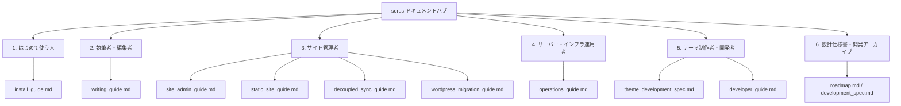

# sorus ドキュメントハブ

sorus の導入ガイド、運用マニュアル、開発者向けリファレンス、設計仕様書を立場別にまとめた目次です。

---

## 1. はじめて使う人

PC に sorus を導入し、初期セットアップを完了するまでの手順です。

* [インストールガイド (install_guide.md)](install_guide.md): Windows / macOS / Linux への 1 行インストール、OS 警告への対処、アップデート・アンインストール、データの保存場所

## 2. 執筆者・編集者

日々の記事執筆、メディア管理、校閲・公開ワークフローを扱う方向けのガイドです。

* [執筆・編集ガイド (writing_guide.md)](writing_guide.md): Markdown 執筆、画像アップロード・フォトギャラリー、AI 執筆支援、下書き・校閲申請・公開承認の手順

## 3. サイト管理者

サイト全体の設定、テーマ・メニュー構成、公開先の管理、チーム運用や移行を担当する方向けのガイドです。

* [サイト管理ガイド (site_admin_guide.md)](site_admin_guide.md): サイト基本設定、外観・サイト構成、ユーザーと権限（RBAC）、招待コード、AI 接続設定、バックアップと復元
* [静的サイト公開ガイド (static_site_guide.md)](static_site_guide.md): レンタルサーバー（FTP/SFTP）、Cloudflare Pages、ローカルフォルダへの静的サイト書き出しと公開手順
* [公開サーバー連携ガイド (decoupled_sync_guide.md)](decoupled_sync_guide.md): 管理画面を遮断した公開専用サーバー（`--public-only`）との同期、招待コードによるチーム執筆、リモート MCP 連携
* [WordPress 移行ガイド (wordpress_migration_guide.md)](wordpress_migration_guide.md): WordPress エクスポート（WXR XML）からの記事・メディア・パーマリンク移行手順

## 4. サーバー・インフラ運用者

VPS やクラウド環境でのサーバー構築、常駐化、バックアップ自動化、セキュリティ設定を担当する方向けのガイドです。

* [運用保守ガイド (operations_guide.md)](operations_guide.md): 運用構成の比較、Docker Compose・systemd・WSL 環境での構築手順、Let's Encrypt 自動 HTTPS、公開専用モードの運用、無停止バックアップと復元、環境変数リファレンス、リバースプロキシ設定、セキュリティの既定動作

## 5. テーマ制作者・開発者

独自テーマの作成・配布や、sorus 本体のビルド・拡張・コントリビューションを行う方向けの資料です。

* [テーマ開発仕様書 (theme_development_spec.md)](theme_development_spec.md): 独自テーマのファイル構成、テンプレート変数・ブロック仕様、Git/Zip 配布ルール（AI エージェント向けプロンプト仕様を含む）
* [開発者ガイド (developer_guide.md)](developer_guide.md): 全体アーキテクチャ、パッケージ構成、ビルド・単体テスト手順、SSG 内部実装、セキュリティ機構の詳細

## 6. 設計仕様書・開発アーカイブ

プロジェクトの開発経緯とロードマップです。現在の操作手順は上記の各ガイドを参照してください。

* [開発ロードマップ (roadmap.md)](roadmap.md): 全体構想・設計原則および各フェーズの実績記録
* [初期要件定義書 (development_spec.md)](development_spec.md): プロジェクト立ち上げ時の要件定義
