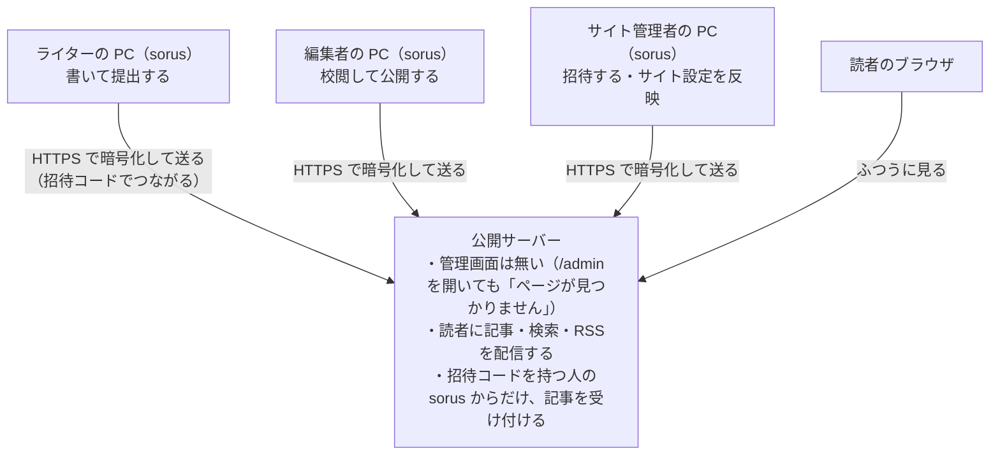
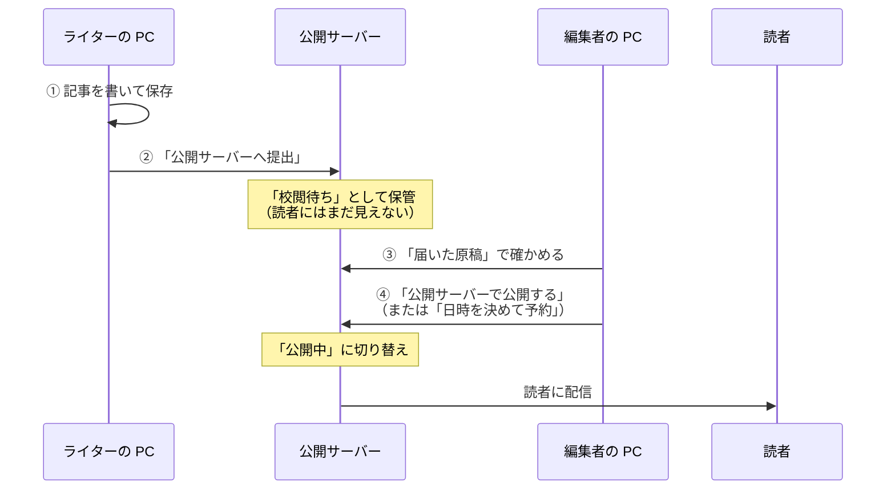

# 公開サーバーを使うガイド（公開サーバー連携）

このガイドは、sorus を **「インターネット上に自分たちの公開サーバーを置き、各自の PC の sorus から記事を提出して公開する」** 形で使うための手順書です。書く・校閲する・公開する操作は、すべて sorus の画面で行います。

* まずは [サーバーを持たずに公開するガイド（静的サイト公開）](static_site_guide.md) を読んでください。ほとんどのチームは静的サイト公開で足ります。公開サーバー連携は、公開サーバーを持ちたいはっきりした理由がある場合の発展形です。
* sorus の入れ方は [インストールガイド](install_guide.md)、記事の書き方は [執筆・編集・AI連携ガイド](writing_guide.md)、サイトの設定・管理は [サイト管理者ガイド](site_admin_guide.md) にあります。
* 公開サーバーの準備だけは、借りたサーバー（VPS）に1行を貼る作業があります。難しいときは、技術者の協力者に頼んでください。ほかの手作業の手順は、最後の [技術者向け付録](#14-技術者向け付録) にまとめています。

---

## 目次

1. [しくみ](#1-しくみ)
2. [公開サーバー連携が向いている場合](#2-公開サーバー連携が向いている場合)
3. [登場人物と立場](#3-登場人物と立場)
4. [用意するもの](#4-用意するもの)
5. [ステップ1: 公開サーバーを用意する](#5-ステップ1-公開サーバーを用意する)
6. [ステップ2: サイト管理者が参加する](#6-ステップ2-サイト管理者が参加する)
7. [ステップ3: 書く人・校閲する人を招待する](#7-ステップ3-書く人校閲する人を招待する)
8. [ステップ4: 招待された人が参加する](#8-ステップ4-招待された人が参加する)
9. [ステップ5: 提出 → 校閲 → 公開](#9-ステップ5-提出--校閲--公開)
10. [サイト名・テーマ・メニューを公開サーバーへ反映する](#10-サイト名テーマメニューを公開サーバーへ反映する)
11. [招待の期限と取り消し](#11-招待の期限と取り消し)
12. [バックアップ](#12-バックアップ)
13. [よくある質問・困ったとき](#13-よくある質問困ったとき)
14. [技術者向け付録](#14-技術者向け付録)

---

## 1. しくみ

sorus は、全員が自分の PC で使うアプリです。静的サイト公開との違いは、複数人で書くときの原稿の「届け方」と、サイトの「公開先」です。

| | 静的サイト公開 | 公開サーバー連携（このガイド） |
| :--- | :--- | :--- |
| 複数人で書くとき | 同じネットワーク（LAN・VPN）のサーバー版に、ブラウザでログインして書く | 各自の PC の sorus の画面の「公開サーバーへ提出」 |
| 公開先 | レンタルサーバー、Cloudflare Pages など | 自分たちの公開サーバー |
| 公開する人 | 正本を持つ1人 | 招待された編集者・サイト管理者（何人でも） |

公開サーバー連携の公開サーバーには、**管理画面がありません。** 書く・直す・確かめるといった作業は各自の PC の sorus で行い、できた記事だけを「招待コード」でつながった専用の窓口から公開サーバーへ送ります。



### なぜ安全なのか

1. **玄関がない**: 公開サーバーには管理画面もログインの機能もありません。公開サイトを閲覧制限で守ることはできますが（[10章](#10-サイト名テーマメニューを公開サーバーへ反映する)の「公開サイトをパスワードで保護する」）、その閲覧用パスワードは見てもらう人全員で共有するもので、CDN のキャッシュなどは別に扱う必要があります。
2. **窓口が見つからない**: 記事を受け付ける窓口と、AI アプリがつなぐ窓口（MCP）は、どちらも推測できないアドレスにあります。
3. **招待がないと入れない**: 窓口を見つけても、公開サーバーが発行した招待コードがなければ何もできません。招待には立場（書く・公開する・設定する）と有効期限があり、画面からいつでも取り消せます。

---

## 2. 公開サーバー連携が向いている場合

| 公開サーバー連携が向いている | 静的サイト公開で足りる |
| :--- | :--- |
| 何人もの編集者が、それぞれの PC から校閲・公開したい | 公開する人は1人でよい |
| 書いた人が、自分の PC の sorus からボタン1つで提出したい | 同じネットワークのサーバー版を一緒に使えば足りる |
| VPS とドメインを用意できる、または技術者の協力者がいる | サーバーを用意したくない |

サイト内検索、記事一覧の2ページ目以降、予約投稿は、静的サイト公開でも使えます。ただし静的サイト公開の予約投稿は、予約の時刻に PC の sorus が動いている必要があります。公開サーバー連携では公開サーバーが予約の時刻を守るので、PC の sorus を閉じていてもかまいません（[公開サーバーで予約して公開する](#公開サーバーで予約して公開する)）。

---

## 3. 登場人物と立場

招待コードには「立場」があります。立場によって、公開サーバーに対してできることが決まります。

| 立場 | 誰か | 公開サーバーに対してできること |
| :--- | :--- | :--- |
| **サイト管理者** | 公開サーバーを用意し、人を招待する人 | 記事の校閲と公開、サイト設定の反映、招待の発行と取り消し |
| **編集者** | 届いた記事を確かめて公開する人 | 記事の提出、届いた記事の校閲と公開 |
| **ライター** | 記事を書いて提出する人 | 記事を書いて公開サーバーへ提出 |

* 1人で全部を兼ねてもかまいません。サイト管理者の招待で、提出・校閲・公開のすべてができます。
* 自分の PC の sorus の中では、「はじめに」で作った自分のアカウント（管理者）で書く・設定する・公開するのすべてができます。招待コードの立場が効くのは、公開サーバーに対してだけです。

---

## 4. 用意するもの

| 立場 | 用意するもの |
| :--- | :--- |
| ライター・編集者 | PC（Windows または Mac）だけ |
| サイト管理者 | PC ＋ VPS ＋ ドメイン |

**VPS とドメイン（サイト管理者だけ）**

| もの | 説明 |
| :--- | :--- |
| VPS 1台 | インターネット上に借りる自分専用のサーバー（月数百円から）。OS は Ubuntu または Debian を選びます。メモリ 1GB 程度で動きます。 |
| ドメイン | 例: `media.example.jp`。ドメインを買った会社の管理画面で、種類「A」の設定（DNS）を作り、値に VPS の IP アドレスを入れておきます。 |

* VPS を借りたサーバー会社（クラウド事業者）の管理画面にファイアウォールの設定がある場合は、22（SSH）・80（HTTP）・443（HTTPS）を開けておきます。
* HTTPS の証明書（Let's Encrypt）は、sorus が自動で取ります。

---

## 5. ステップ1: 公開サーバーを用意する

> この章はサイト管理者の作業です。1回だけ行います。

### 1行で導入する

1. サーバー会社から届いた情報（IP アドレスと root のパスワードなど）で、VPS に SSH でログインします。
2. 次の1行の `media.example.jp` を自分のドメインに、`you@example.jp` を自分のメールアドレスに書き換えてから貼り付け、Enter を押します。

   ```bash
   curl -fsSL https://github.com/ryuzi/sorus/releases/latest/download/install-server.sh | sudo bash -s -- --domain media.example.jp --email you@example.jp
   ```

3. 次の作業が自動で進みます。
   * ドメインがこの VPS を向いているかを確かめる
   * sorus のサーバー版をダウンロードし、壊れていないか確かめて置く
   * 公開サーバーとして動かす設定を書き、常に動き続けるようにする
   * ファイアウォール（ufw）があれば、SSH を先に許可してから 80・443 を開ける
   * 毎日 03:00（日本時間）の自動バックアップを設定する
   * sorus を起動して、動いていることを確かめる
4. 最後に「sorus の公開サーバーの準備ができました」と、**管理者用の招待コード**（`sorus-invite:` で始まる長い1行）が出ます。この1行を全部コピーして控えます。
5. 手元の PC のブラウザで `https://media.example.jp/` を開き、サイトが見えることを確かめます。証明書を取るまで、数分かかることがあります。

* 管理者用の招待コードは、公開サーバーの管理者になれる大切な鍵です。他の人に見せないでください。
* 同じ招待コードは、VPS の `/root/sorus-admin-invite.txt` にも保存されます。
* 「ドメイン … の向き先（DNS）がまだ設定されていません」や「ドメイン … は別のサーバー（…）を向いています」と出たときは、表示された「直し方」に沿って DNS を直し、反映されてから同じ1行をもう一度実行します。

### SSH を使わずに導入する

サーバー会社の申し込み画面に「スタートアップスクリプト」の欄がある場合は、次の2行を貼って VPS を作ることもできます（ドメインとメールアドレスは書き換えます）。

```bash
#!/bin/bash
curl -fsSL https://github.com/ryuzi/sorus/releases/latest/download/install-server.sh | bash -s -- --domain media.example.jp --email you@example.jp
```

この場合、管理者用の招待コードは VPS の `/root/sorus-admin-invite.txt` に保存されます。サーバー会社の管理画面の「コンソール」などから、このファイルの中身を確かめます。

### 公開サーバーを更新する

同じ1行をもう一度実行すると、sorus を新しい版にして起動し直します。招待コードは作り直しません。

---

## 6. ステップ2: サイト管理者が参加する

1. 自分の PC に sorus を入れ、「はじめに」を済ませます（[インストールガイド](install_guide.md)）。
2. 「設定」→「公開先」を開きます。
3. 「招待コード」の欄に、ステップ1で控えた管理者用の招待コードを全部そのまま貼り付けます。
4. 「接続を確かめて参加する」を押します。
5. 「いまの接続」に、接続先・名前・立場（サイト管理者）・有効期限が出れば参加できています。

---

## 7. ステップ3: 書く人・校閲する人を招待する

> この章はサイト管理者の作業です。

1. 「設定」→「公開先」の「招待する」で、次を入力します。

   | 欄 | 入れるもの |
   | :--- | :--- |
   | 名前 | 招待する人の名前（例: 山田 花子）。公開サーバーでの書き手の名前になります |
   | 立場 | 「ライター（記事を提出）」「編集者（校閲して公開）」「サイト管理者（すべて）」のどれか |
   | 使える期間 | 1週間・1か月・3か月・1年・3年のどれか |

2. 「招待コードを作る」を押します。
3. 表示された招待コードを「コピー」で写し、招待する人にメールやチャットで送ります。招待コードはそのときだけ表示されます。

* 1人に1つずつ作ります。
* 「発行した招待」の一覧に、名前・立場・発行日・有効期限・状態が出ます。

---

## 8. ステップ4: 招待された人が参加する

> この章はライター・編集者の作業です。

1. 自分の PC に sorus を入れ、「はじめに」を済ませます（[インストールガイド](install_guide.md)）。
2. 「設定」→「公開先」を開きます。
3. 「招待コード」の欄に、受け取った招待コードを全部そのまま貼り付けます。
4. 「接続を確かめて参加する」を押します。
5. 「いまの接続」に、接続先・名前・立場・有効期限が出れば参加できています。

公開サーバーにつながらないときは、何も変わりません。招待コードが途中で切れていないか確かめて、もう一度貼り付けてください。

---

## 9. ステップ5: 提出 → 校閲 → 公開



### ライター: 記事を提出する

1. 記事を書いて、**保存**します。
2. 執筆画面の **「公開サーバーへ提出」** を押し、確認で提出します。
   * 提出するのは保存済みの内容です。直したら、先に保存してください。
   * 本文と、記事で使っている画像がまとめて送られます。
3. 公開サーバーでは「校閲待ち」になります。この時点では、読者には見えません。

### 編集者・サイト管理者: 確かめて公開する

1. 上部のメニューの **「届いた原稿」** を開きます。公開サーバーに届いた原稿が並びます。
2. 次のどちらかを選びます。
   * **「公開サーバーで公開する」**: そのまま公開サーバーで公開し、読者に配信します。
   * **「この PC に受け取る」**: 中身を確かめてから、自分の PC に取り込みます。この PC に同じ記事があれば、違うところを並べて見せるので、確かめてから「この内容で上書きする」を押します。「開いて校閲する」で直してから「公開サーバーへ提出」し直し、公開します。

ホームや「設定」→「公開先」の画面にある「公開サーバーの校閲待ち記事」からも、プレビューを見て「承認して本番公開」または「ローカルに取り込む」を選べます。この PC に同じ記事があるときは、「届いた原稿」の画面で違うところを確かめてから受け取ります。

* 公開サーバー連携では、ボタンごとに届く先が違います。
  * 執筆画面の **「公開する」**: この PC の sorus の中だけで「公開中」にします（PC 内での確認用）。読者には届きません。
  * **「公開サーバーへ提出」**: 原稿を公開サーバーの「校閲待ち」に届けます。
  * **「公開サーバーで公開する」**（または「日時を決めて予約」）: 公開サーバーで公開し、読者に配信します。読者に記事が届くのは、この操作をしたときだけです。
* サイト管理者が自分で書いた記事も、同じように「公開サーバーへ提出」してから公開します。
* 公開サーバーの前に Cloudflare などの配信サービスを置いている場合は、公開サイトに出るまで最大1時間かかることがあります。

### 公開サーバーで予約して公開する

公開サーバーの記事を、決めた日時に公開できます。公開サーバーはいつも動いているので、予約の時刻になると公開サーバーが読者に記事を見せ始めます。**予約したあとは、この PC の sorus を閉じても、PC の電源を切ってもかまいません。**

1. 「届いた原稿」で、公開サーバーに届いた原稿の **「日時を決めて予約」** を押します。ホームや「設定」→「公開先」の「公開サーバーの校閲待ち記事」でも、各記事やプレビューの画面から「日時を決めて予約」を押せます。
2. **「公開する日時（日本時間）」** を選びます。はじめは、次のちょうどの時刻（5分以上先）が入っています。今から1分以上先の日時を選べます。
3. **「この日時に予約する」** を押し、確認で予約します。
4. 「公開サーバーで公開するよう予約しました」と出ます。予約した記事は「公開サーバーで予約中の記事」に、**「予約: 11月3日 9:00」** のように日時つきで並びます。

* 予約の時刻になるまで、記事は読者に見えません。記事のページ、記事の一覧、RSS、サイト内検索のどれにも出ません。時刻を過ぎると、すべてに出ます。
* 予約をやめるときは、「公開サーバーで予約中の記事」の **「予約を取り消す」** を押します。記事は「校閲待ち」に戻ります。
* 予約の日時を変えるときは、「予約を取り消す」で校閲待ちに戻してから、予約し直します。
* 予約できるのは、編集者かサイト管理者の招待で参加している人です（「公開サーバーで公開する」と同じです）。
* 一度公開した記事を直して提出し直したときは、予約にできません。読者に一度見えた記事が、見えなくなってしまうのを防ぐためです。「公開サーバーで公開する」で公開します（最初の公開日時のままです）。
* 公開サーバーの前に Cloudflare などの配信サービスを置いている場合は、予約の時刻を過ぎてから公開サイトに出るまで、最大1時間ほど遅れることがあります。
* この PC の sorus の中だけで予約した記事（[執筆・編集・AI連携ガイドの「予約投稿」](writing_guide.md#予約投稿)）は、PC 内の公開状態が予約になるだけで、公開サーバーには届きません。公開サーバーで予約するときは、ここでの手順を使います。

### 記事を直したいとき

公開済みの記事を直すときも、PC の sorus で直して「公開サーバーへ提出」し、編集者が公開します。

---

## 10. サイト名・テーマ・メニューを公開サーバーへ反映する

> この章はサイト管理者の作業です。

公開サーバーには管理画面がないため、サイトの見た目に関わる設定は、自分の PC の sorus で作ってから反映します。

1. 自分の PC の sorus で、「設定」→「サイト設定」（サイト名・説明文・公開サイトURL など）と、「設定」→「外観」（テーマ・サイト構成）を設定します。
2. 「設定」→「公開先」の「サイト基本設定の反映」にある **「公開サーバーへ反映する」** を押し、確認で反映します。

* 反映すると、公開サーバーのサイト基本設定・テーマ・サイト構成（メニュー・トップページ）が、この PC の設定で上書きされます。
* 「公開サイトURL」が未設定、または `http://127.0.0.1` などこの PC の中のアドレスのときは、公開サーバーの URL は変えません。
* 「サイト設定」の **多言語対応** の ON/OFF も送ります。OFF にして反映すると、公開サーバーの英語のページ（`/en` 以下）・言語の切り替え・hreflang も出なくなります。ON/OFF を変えて保存したときも、ほかのサイト基本設定と同じく「公開サーバーへ未反映」として案内します。
* 「外観」のテーマ・サイト構成の画面からも「公開サーバーへ反映する」を押せます。どの画面から押しても同じ反映です。
* PC で独自テーマ（URL・Zip から取り込んだテーマ）を適用しているときは、テーマのファイルもいっしょに送り、公開サーバーは再起動せずにそのテーマを使います。公開サーバーにテーマのフォルダを置く作業は要りません。同じテーマを PC で取り込み直したときも、もう一度反映すれば公開サーバーのテーマが新しくなります。独自テーマを適用しているときの確認には、公開サーバーにある同じテーマのファイルもこの PC の内容で上書きすることが出ます。反映に失敗したときや反映の途中で公開サーバーが止まったときは、公開サイトのテーマの見た目が崩れることがあります。テーマの元のデータは PC にあるので、もう一度「公開サーバーへ反映する」を押せば PC の設定とテーマで揃います。表示の意味と対処は [サイト管理者ガイドの「公開サーバーで独自テーマを使う」](site_admin_guide.md#公開サーバーで独自テーマを使う) にあります。

### 公開サイトをパスワードで保護する

公開サーバーの公開サイトを、閲覧用のユーザー名とパスワードを知っている人だけに見せられます。この設定は公開サーバーに保存され、「公開サーバーへ反映する」では変わりません。PC に入れたアプリ（デスクトップ版）の「サイト設定」には閲覧制限はありません（以前の版で有効にしていても働かず、公開サーバーには影響しません）。公開サーバーで設定済みの閲覧制限は、更新後もそのまま働きます。手順と、状態の見方・失敗時の案内の一覧は [サイト管理者ガイドの「公開サーバーの閲覧制限」](site_admin_guide.md#公開サーバーの閲覧制限パスワードで保護する) にあります。

1. 「設定」→「サイト運用」の「公開サーバーの閲覧制限（Basic認証）」を開きます。この欄はサイト管理者だけに出ます。
2. 「公開サーバーの設定」と、画面の上の案内で、いまの状態を確かめます。
3. 有効にするときは、「公開サーバーの公開サイトをパスワードで保護する」にチェックを付け、閲覧用のユーザー名とパスワードを入れて「公開サーバーに保存する」を押します。パスワードを変えないときは、パスワードの欄を空欄のままにします。
4. 解除するときは、チェックを外して「公開サーバーに保存する」を押し、確認の画面で了承します。

* 公開サーバーに問い合わせられないときは「公開サーバーの閲覧制限の状態が分かりません」と出ます。保護されているとは表示されません。
* 保存すると、この PC から公開サイトのトップページ・フィード・最新の記事・画像1枚をパスワードなしで開いて、パスワードを求められるかを確かめます。すべて求められても「確かめたのは一覧の URL だけです」と出ます。CDN を使っている場合は、CDN のキャッシュを削除してから、ブラウザのプライベートウィンドウでいくつかの記事と画像を開いて確かめてください。
* 公開サーバーの「公開サイトURL」が、この PC の中や社内のアドレス（`http://localhost` など）を指しているときは、その URL は開かずに「確かめていません」と出ます。
* 閲覧用のパスワードを受け取るのは、公開サーバーの sorus が https を直接受けているとき（`AUTOCERT_DOMAIN` の自動 HTTPS）だけです。前段のプロキシや CDN（同じサーバーの nginx なども含む）で https を終え、sorus までを http でつなぐ構成では、閲覧制限を変更できません。画面に「公開サーバーの sorus が、この接続を https で直接受けていないため、閲覧制限を変更できません」と出て、保存の欄は使えなくなります（状態の確認はできます）。このとき PC は閲覧用のパスワードを送りません。
* 公開サーバーの URL が `https://` で始まらないとき（練習用の `http://localhost` を含む）も、閲覧用のパスワードは送らず、保存の欄は使えません。
* 記事の提出・公開などの同期は、閲覧用のパスワードが無くても今までどおり行えます。
* CDN（Cloudflare など）を使っている場合、有効にする前に保存されたページや画像が、パスワードなしで配られることがあります。有効にしたあと、CDN のキャッシュを削除（パージ）してください。sorus は CDN の設定を変えません。
* 「サイトに反映」で書き出した静的サイト（Cloudflare Pages など）には、この閲覧制限はかかりません。

### 公開サイトを一時的にメンテナンス表示にする

テーマの入れ替えなどのあいだ、公開サーバーの公開サイトを一時的に止め、訪問者にはテーマに関係のないメンテナンス画面（HTTP 503。標準の案内、またはエンジニアが用意した 1 つの HTML）を見せられます。手順と、状態の見方・失敗時の案内の一覧は [サイト管理者ガイドの「公開サーバーのメンテナンス表示」](site_admin_guide.md#公開サーバーのメンテナンス表示) にあります。

1. 「設定」→「サイト運用」の「公開サーバーのメンテナンス表示」を開きます。この欄はサイト管理者だけに出ます。
2. 独自の画面を使うときは、HTML ファイルを選んで「この PC に保存」します（保存しただけでは公開サーバーは変わりません）。
3. 「メンテナンス表示を始める」を押し、確認の画面で了承します。いま選んでいる画面が公開サーバーの ON といっしょに反映されます。
4. 表示中に画面を変えるときは、新しい HTML をこの PC に保存してから「画面を反映」を押します（ON/OFF は変わりません）。
5. 作業が終わったら「メンテナンス表示を終える」を押します。

* 始めるのも終えるのも手動です。自動では終わらず、「公開サーバーへ反映する」（テーマを含む）や閲覧制限の保存でも切り替わりません。
* ON/OFF は公開サーバーに保存され、公開サーバーを再起動しても続きます。独自 HTML の選択はこの PC のこのサイトに保存します。
* メンテナンス表示中も、記事の提出・公開・予約・取り込みなどの同期は今までどおり行えます。
* 公開サーバーに問い合わせられない・切り替えの結果が分からないときは「状態が分かりません」「反映されたかどうか分かりません」と出ます。成功とは表示されません。「状態を確かめる」を押して、公開サーバーのいまの状態を確かめてください。PC は自動ではやり直しません。
* CDN（Cloudflare など）を使っている場合、始める前に CDN に保存されたページや画像は、CDN のキャッシュが切れるか削除（パージ）するまで表示され続けることがあります。sorus は CDN の設定を変えません。メンテナンス画面自体は `Cache-Control: no-store` で返し、CDN に保存させません。
* 公開サーバーが停止している・接続できないときは、メンテナンス画面も表示されません。「サイトに反映」で書き出した静的サイトにもかかりません。
* 閲覧制限を有効にしているときは、公開サイトのページや画像を開いた、パスワードを知らない人には今までどおりパスワードの入力画面が出ます。パスワードを入れた人にメンテナンス画面が表示されます。
* PC が使えずに終えられないときは、公開サーバーで [sorus token create](#sorus-token-create) を実行してサイト管理者の招待を発行し、別の PC から参加して終えてください。

---

## 11. 招待の期限と取り消し

### 期限が切れたとき

「公開サーバー」の画面に「招待の有効期限が切れています」と出ます。

1. サイト管理者に、新しい招待コードを作ってもらいます（[ステップ3](#7-ステップ3-書く人校閲する人を招待する)）。
2. 「設定」→「公開先」の「別の招待コードで参加し直す」に貼り付けて、「接続を確かめて参加する」を押します。

### 招待を取り消す

PC をなくした人や、チームを抜けた人の招待は、すぐに取り消せます。

1. サイト管理者が「設定」→「公開先」の「発行した招待」を開きます。
2. その人の行の「取り消す」を押します。

* 取り消した招待コードは、すぐに使えなくなります。
* 最後のサイト管理者の招待は取り消せません。先に別のサイト管理者の招待を作り、その招待で参加し直してから取り消します。

---

## 12. バックアップ

### 各自の PC

PC の sorus の下書きは、その PC にしかありません。各自が「設定」→「バックアップ」で自動バックアップを設定してください（[サイト管理者ガイドの「自動バックアップ」](site_admin_guide.md#自動バックアップ)）。

### 公開サーバー

導入スクリプトが、毎日 03:00（日本時間）に公開サーバーの中へバックアップを作るよう設定します。VPS が壊れたときに備えて、ときどき VPS の外へコピーしてください。コピーのしかたは [技術者向け付録](#公開サーバーのバックアップと鍵) にあります。技術者の協力者に頼んでもかまいません。

---

## 13. よくある質問・困ったとき

**Q. 「接続を確かめて参加する」を押しても参加できません。**
A. 招待コードを全部（`sorus-invite:` から最後まで）貼り付けたか確かめてください。期限切れや取り消し済みの招待コードでは参加できません。サイト管理者に新しい招待コードを作ってもらってください。

**Q. 公開サイトをパスワードで保護しましたが、パスワードなしで見られます。**
A. 「設定」→「サイト運用」の「公開サーバーの閲覧制限（Basic認証）」の案内を確かめてください。「パスワードなしで表示される URL があります」と出るときは、CDN（Cloudflare など）のキャッシュが残っている可能性があります。CDN のキャッシュを削除してから「状態を確かめる」を押してください。「確かめた URL は、すべてパスワードを求めました」と出ていても、画面が確かめるのはトップページ・フィード・最新の記事・画像1枚だけです。見えてしまう記事や画像があれば、CDN のキャッシュを削除してください。それでも見えるときは、ブラウザの表示が古い可能性があるので、プライベートウィンドウで開いて確かめてください。

**Q. 閲覧制限を保存したら、記事の提出や公開ができなくなりました。**
A. 閲覧制限は公開サイトを見る人のためのもので、記事の提出・公開には使いません。提出や公開が失敗したときは、表示された案内を確かめてください。

**Q. 「公開サーバーへ提出」のボタンがありません。**
A. 「設定」→「公開先」で参加しているか確かめてください。記事を一度保存すると、ボタンが出ます。

**Q. 「届いた原稿」に、公開サーバーに届いた原稿が出ません。**
A. 編集者かサイト管理者の招待で参加しているか確かめてください。ライターの招待では、届いた原稿を見られません。「公開サーバーに届いた原稿を読み込めませんでした」と出たときは、時間をおいて開き直してください。

**Q. 「日時を決めて予約」がありません。**
A. 編集者かサイト管理者の招待で参加しているか確かめてください。ライターの招待では、予約できません。

**Q. 予約した記事が、時刻を過ぎても公開サイトに出ません。**
A. 「公開サーバーで予約中の記事」の日時（日本時間）を確かめてください。公開サーバーの前に Cloudflare などの配信サービスを置いている場合は、出るまで最大1時間ほどかかることがあります。

**Q. 予約したあと、PC の sorus を閉じてもいいですか？**
A. はい。公開サーバーで予約した記事は、公開サーバーが予約の時刻に公開します。PC の sorus を閉じても、PC の電源を切ってもかまいません。

**Q. 招待の画面（「招待する」）がありません。**
A. 招待を作れるのは、サイト管理者の招待で参加している人だけです。

**Q. 公開サーバーのアドレスに /admin を付けて開くと「ページが見つかりません」になります。壊れていますか？**
A. 正常です。公開サーバーには管理画面がありません。記事の管理は、各自の PC の sorus で行います。

**Q. サイトが開けません（HTTPS の証明書が取れません）。**
A. ドメインの DNS が VPS の IP アドレスを向いているか、VPS で 80 と 443 が開いているかを確かめてください。DNS の変更が反映されるまで、数時間かかることもあります。

**Q. 管理者用の招待コードをなくしました。**
A. VPS の `/root/sorus-admin-invite.txt` を確かめてください。作り直すときは、ステップ1の1行の最後に ` --new-admin-invite` を付けて実行します。

**Q. ChatGPT や Claude などの AI アプリから、公開サーバーの記事を検索したり下書きを保存したりできますか？**
A. できます。公開サーバーに参加している自分の PC の sorus で「設定」→「MCP連携」を開くと、「どこからでも使える接続URL（公開サーバー）」が出ます。その URL を AI アプリのコネクタ（カスタムコネクタ）に貼り、AI アプリが開く画面で、同じ画面の「公開サーバーの MCP 連携」の「確認コードを表示」で出た8文字の確認コード（10分間・1回だけ使える）を入れ、次の画面で「許可する」を押します。AI アプリにできることは、参加している招待の立場（書く・公開する・設定する）までです。招待を取り消すと、その招待でつないだ AI アプリも使えなくなります。

**Q. もっと簡単な方法はありますか？**
A. 公開する人が1人でよければ、サーバーを持たない [静的サイト公開](static_site_guide.md) のほうが手軽です。同じネットワーク（LAN・VPN）にいるメンバーで書くなら、サーバー版を一緒に使う方法もあります（[サイト管理者ガイドの「複数人で書く」](site_admin_guide.md#複数人で書く)）。

---

## 14. 技術者向け付録

ここから先は、ターミナル・Docker・systemd を使う技術者向けの補足です。

### 導入スクリプトのオプション

`deploy/install-server.sh` は Ubuntu / Debian 用です。行うことは [ステップ1](#5-ステップ1-公開サーバーを用意する) のとおりです。

| オプション | 意味 |
| :--- | :--- |
| `--domain D` | 公開サーバーのドメイン（必須） |
| `--email E` | Let's Encrypt の連絡先メールアドレス（必須） |
| `--archive FILE` | ダウンロードせず、サーバーに置いた `sorus-server-<版>-linux-<arch>.tar.gz` を使う（[運用保守ガイド](operations_guide.md#github-に接続できないときファイルを持ち込んで入れる)） |
| `--sha256sums FILE` | `--archive` と一緒に使い、`SHA256SUMS` の場所を指定する |
| `--skip-dns-check` | ドメインがこのサーバーを向いているかの確認を飛ばす |
| `--new-admin-invite` | 2回目以降の実行でも、管理者用の招待コードを新しく作る |
| `--admin-name NAME` | 管理者用の招待の名前（既定: サイト管理者） |

設定は `/etc/sorus/sorus.env`（`PUBLIC_ONLY=true`、`AUTOCERT_DOMAIN`、`AUTOCERT_EMAIL`、`BASE_URL`、`SECURE_COOKIE=true`）に書きます。スクリプトの区切り行より下に手で足した設定は、もう一度実行しても残ります。データは `/var/lib/sorus`、実行ファイルは `/usr/local/bin/sorus`、ユニットは `sorus.service` と `sorus-backup.timer` です。

### 1台の PC で練習する

本番の前に、手元の PC で「公開サーバー役」と「PC の sorus 役」を同時に動かして流れを確かめられます（Go 1.25 以降、make、Git が必要です）。ソースコードは公開リポジトリ `ryuzi/sorus` から取得します。

```bash
git clone https://github.com/ryuzi/sorus.git ~/sorus
cd ~/sorus
go mod download
make build

# 公開サーバー役（別のフォルダ・別のターミナルで）
mkdir -p ~/sorus-public-test && cd ~/sorus-public-test
PORT=8081 ~/sorus/bin/sorus --public-only

# 練習用の招待（さらに別のターミナルで）
cd ~/sorus-public-test
~/sorus/bin/sorus token create --role admin --sub practice --ttl 1d --base-url http://localhost:8081
```

* `token create` は、同期 API の URL（`Sync URL:`）とトークンを表示します。`--base-url` が `https://` でないと招待コードは表示されません。練習では、PC の sorus 役の「設定」→「公開先」の「詳細設定（公開サーバーの URL とトークンを直接入力する）」に、URL とトークンを別々に入れます。
* PC の sorus 役は、ふだんのデータと混ざらないよう `SORUS_DATA_DIR=~/sorus-practice-local go run . --desktop` のように別のデータの場所で起動します。暗号化されない `http://` の URL は、`localhost` のサーバーにだけ使えます。この練習の構成では、公開サーバーの閲覧制限は状態の確認だけができ、変更はできません（閲覧用のパスワードは暗号化されない接続には送りません）。変更は `AUTOCERT_DOMAIN` を設定した本番の公開サーバーで行ってください。
* 公開サーバー役のデータ（`database.db`、`capability.key`、`sync_path.txt` など）は `~/sorus-public-test` にできます。終わったら `Ctrl + C` で止めて、フォルダを消してかまいません。

### Docker Compose で動かす

ソースコードは公開リポジトリ `ryuzi/sorus` から取得します。ふつうは [ステップ1](#5-ステップ1-公開サーバーを用意する) の1行か、[リリースのページ](https://github.com/ryuzi/sorus/releases/latest) のサーバー版を使ってください。

```bash
git clone https://github.com/ryuzi/sorus.git sorus
cd sorus
cp deploy/environments/production.env.example deploy/environments/production.env
chmod 600 deploy/environments/production.env
# production.env の AUTOCERT_DOMAIN・AUTOCERT_EMAIL・SITE_NAME・BASE_URL を書き換え、最後に PUBLIC_ONLY=true を足す
make prod-up
docker compose -f deploy/docker-compose.yml logs sorus | grep -E "Public-only|Sync API"
```

* ログに `Public-only mode: ... MCP API at /api/mcp-...` と `Sync API: enabled at POST /api/sync-...` が出れば成功です。
* データは Docker のボリューム `sorus-prod-data`（コンテナ内の `/data`）です。`docker compose down -v` はデータごと消すので使わないでください。
* 更新は `git pull` してから `make prod-up` です。止めるときは `make prod-down` です。
* 管理者用の招待コードは、次で作ります。

  ```bash
  docker compose -f deploy/docker-compose.yml exec sorus /sorus token create --role admin --sub admin --ttl 365d --base-url https://media.example.jp
  ```

### systemd で手作業で動かす

導入スクリプトを使わない場合の手順です。

```bash
# Go の入った PC で（VPS が ARM なら GOARCH=arm64）
CGO_ENABLED=0 GOOS=linux GOARCH=amd64 go build -tags nodynamic -trimpath -ldflags="-s -w" -o bin/sorus .
scp bin/sorus deploy/systemd/sorus.service deploy/systemd/sorus-backup.service deploy/systemd/sorus-backup.timer user@media.example.jp:~/

# VPS で
sudo useradd --system --home-dir /var/lib/sorus --shell /usr/sbin/nologin sorus
sudo install -m 0755 sorus /usr/local/bin/sorus
sudo install -m 0644 sorus.service sorus-backup.service sorus-backup.timer /etc/systemd/system/
sudo install -d -m 0750 /etc/sorus
sudo nano /etc/sorus/sorus.env   # PUBLIC_ONLY=true と AUTOCERT_DOMAIN などを書く。DB_PATH などの場所は書かない
sudo chmod 0600 /etc/sorus/sorus.env
sudo chown -R root:sorus /etc/sorus
sudo systemctl daemon-reload
sudo systemctl enable --now sorus sorus-backup.timer
```

* ufw を使う場合は、**有効にする前に必ず SSH（22）を許可**します（`sudo ufw allow 22/tcp`、`80/tcp`、`443/tcp`、`sudo ufw enable`）。
* `/etc/sorus/sorus.env` に `DB_PATH` などの場所を書くと、`sorus.service` の `/var/lib/sorus/...` を上書きして起動できなくなります。
* 管理者用の招待コードは、次で作ります。

  ```bash
  sudo -u sorus /usr/local/bin/sorus token create --key-file /var/lib/sorus/capability.key --role admin --sub admin --ttl 365d --base-url https://media.example.jp
  ```

### sorus token create

`sorus token create --role writer|editor|admin --sub <名前> [--ttl 90d] [--key-file path] [--sync-path path] [--base-url url]` は、公開サーバーの署名鍵でトークンを作ります。`--base-url` に `https://` の URL を渡すと、`Invite code:` の行に招待コードも表示します。ふだんの招待は、画面の「招待する」で作れます。コマンドが要るのは、最初のサイト管理者の招待だけです。

### 詳細設定（URL とトークンを別々に入れる）

「設定」→「公開先」の「詳細設定（公開サーバーの URL とトークンを直接入力する）」では、同期 API の URL とトークンを別々に入れられます。URL は `/api/sync-...` のパスまで含めて入れます（例: `https://media.example.jp/api/sync-0123456789abcdef0123456789abcdef`）。「接続テスト」で確かめてから「設定を保存する」を押します。

### 公開サーバーのバックアップと鍵

| ファイル（`/var/lib/sorus/`） | 役割 | 失うとどうなるか |
| :--- | :--- | :--- |
| `database.db` | 公開中の記事、発行した招待の記録など | 公開サイトの記事が消える |
| `themes/` | PC から反映した独自テーマのファイル（完全バックアップには入らない） | 公開サイトが標準テーマ（`modern`）の見た目になる。PC から「公開サーバーへ反映する」を押して送り直す |
| `capability.key` | 招待（トークン）に署名する鍵 | 発行済みの招待がすべて使えなくなる |
| `sync_path.txt` | 同期の窓口のパス | 全員の接続が使えなくなる |
| `mcp_path.txt` | AI アプリの窓口（MCP）の秘匿パス | 新しいパスが作られ、AI アプリの接続をやり直すことになる |

* `sorus-backup.timer` が毎日 03:00（日本時間）に `/var/lib/sorus/backups/` へ Zip を作ります。今すぐ作るときは `sudo systemctl start sorus-backup.service` です。
* **`capability.key`・`sync_path.txt`・`mcp_path.txt` は Zip に入りません。** 別に保管してください（`sudo install -m 0600 -o "$USER" /var/lib/sorus/capability.key /var/lib/sorus/sync_path.txt /var/lib/sorus/mcp_path.txt ~/`）。
* これらのファイルは所有者だけが読める権限（`0600`）で作られます。権限が緩いと、sorus は起動しません。
* Docker Compose では `/data/` の下にあります。`docker compose -f deploy/docker-compose.yml exec sorus /sorus backup /data/backups/manual.zip` で作り、`docker cp` で取り出します。
* 復元は [運用保守ガイド](operations_guide.md#4-技術者向け付録-バックアップとリストア) を見てください。

### 署名鍵を作り直す

署名鍵が漏れたかもしれないときは、署名鍵を作り直します。**発行済みの招待はすべて使えなくなります。**

```bash
sudo rm /var/lib/sorus/capability.key
sudo systemctl restart sorus
```

起動し直すと新しい鍵ができます。そのあと、管理者用の招待を作り直し（導入スクリプトを `--new-admin-invite` 付きで実行するか、`sorus token create`）、全員を招待し直します。同期の窓口のアドレスも変えるときは、`sync_path.txt` も消します（AI アプリの窓口のアドレスを変えるときは `mcp_path.txt`）。

### 同期の窓口のパスを決める

公開サーバーの設定に `SYNC_API_PATH=/api/sync-好きな文字列` を書くと、そのパスを使います（英数字と `.` `_` `~` `-` だけ）。トークンを作るときも、同じ値を `--sync-path` で指定します。詳しくは [運用保守ガイド](operations_guide.md#秘匿同期エンドポイント) を見てください。

### AI アプリの窓口（MCP）と OAuth 2.1

公開専用モードの公開サーバーは、MCP サーバーを推測できない秘匿パス `/api/mcp-<32桁の16進数>` に置きます（固定の `/api/mcp` は 404）。パスは初回起動時に署名鍵と同じディレクトリの `mcp_path.txt`（`0600`）に保存し、`MCP_API_PATH=/api/...` を書けばそのパスを使います（公開専用モードでは `/api/mcp` を指定できません）。

* **接続の流れ**: AI アプリ（ChatGPT・Claude など）は MCP の URL から、パスを含む `/.well-known/oauth-protected-resource/api/mcp-<hex>`（RFC 9728）と `/.well-known/oauth-authorization-server`（RFC 8414）を読み、`POST /oauth/register` で自分を登録し（Dynamic Client Registration、RFC 7591）、PKCE（`code_challenge_method=S256` 必須）で `/oauth/authorize` → `/oauth/token` と進みます。秘匿パスは未認証の MCP 要求への 401 の `WWW-Authenticate` からだけ案内し、共通の `/.well-known/oauth-protected-resource` は 404 にします。
* **確認コード**: 公開サーバーにはログイン画面が無いため、同意画面では、接続した PC の「設定」→「MCP連携」（同期 API の `mcp_issue_login_code`）で発行した確認コード（`XXXX-XXXX`、10分・1回限り。再発行で前のコードは無効）で本人を確かめ、招待のユーザー名と立場を出して「許可する」を求めます。入力の誤りは送り元ごと 10 回・全体 100 回（10分あたり）で、超えると正しいコードでも受け付けません。
* **PC からの管理**: PC の「MCP連携」画面は、同期 API（`mcp_info`・`mcp_issue_token`・`mcp_revoke_token`・`mcp_revoke_oauth_app`・`mcp_issue_login_code`）で公開サーバーの接続URL・API トークン・連携アプリ・確認コードを扱います。招待の取り消し・期限切れで、その招待で作った API トークン・OAuth のトークン・確認コードはすべて使えなくなります。
* **閲覧制限との関係**: 閲覧制限（Basic 認証）やメンテナンス表示が有効でも、MCP の秘匿パスと OAuth のエンドポイントはパスワードなしで通します。
* リバースプロキシ配下では `TRUSTED_PROXIES`・`ALLOWED_HOSTS`・`LISTEN_ADDR`・`BASE_URL` を必ず設定してください（[運用保守ガイド](operations_guide.md#f-リバースプロキシの後ろに置く)、[環境変数一覧](operations_guide.md#リバースプロキシインターネット公開時の設定)）。公開サーバーのログの場所は [運用保守ガイドの G](operations_guide.md#g-公開サーバーのログの場所) にあります。`ALLOWED_HOSTS` を設定すると、一覧に無い `Host` を OAuth のメタデータ・招待コード・MCP の案内に載せません。

