# Project Blueprint: Full-Stack Go Sandbox CMS

このドキュメントは、sorus の**仕様決定書および要件定義書（設計の基準）**である。AI開発エージェントは本書に記載されたアーキテクチャ、セキュリティ、および機能要件をすべて満たすようにコードを保守・拡張すること。本書は現在のコードに合わせて記述しており、コードと食い違う記述を見つけたら、どちらが正しいかを確かめてから合わせること。各機能の詳細は [開発者ガイド (docs/developer_guide.md)](developer_guide.md)、[運用保守ガイド (docs/operations_guide.md)](operations_guide.md)、[サイト管理ガイド (docs/site_admin_guide.md)](site_admin_guide.md) などの各ガイドを参照すること。

---

## 1. 開発環境・前提技術スタック (Tech Stack)

AIエージェントは以下の技術スタックのみを使用し、外部の重厚なミドルウェア（Node.js, Redis, PostgreSQL等）への依存を一切排除した**「シングルバイナリ」**で動作するシステムを構築せよ。`CGO_ENABLED=0` でビルドできること。

*   **Language**: Go 1.25以上（`go.mod` の `go 1.25.0`。標準ライブラリ `net/http`, `embed`, `crypto` を最大限活用）
*   **Web Framework**: `labstack/echo/v4`（ルーティングおよびミドルウェア用）
*   **Database / ORM**: SQLite 3（純Go製の `modernc.org/sqlite`。CGO が要る `mattn/go-sqlite3` は使わない）＋ `jmoiron/sqlx`
*   **SSR Rendering**: Go標準の `html/template`（テンプレートと静的アセットは `go:embed` でバイナリに埋め込む）
*   **Frontend (no Node.js)**: ビルド不要の Vanilla JS（`static/js/`）。管理画面は `Tailwind CSS`（Play CDN）、数式は `KaTeX`（`static/vendor/` 同梱または CDN）。公開サイトの見た目はテーマの CSS（ビルトインは `static/themes/<id>/`、独自テーマはデータディレクトリの `custom-themes/<id>/`、外部 CDN を使わない）。HTMX ライブラリは使わず、部分更新は `fetch` に `HX-Request: true` ヘッダーを付けて、サーバーが返す HTML の断片（パーシャル）を差し替える。執筆エディタは Markdown を直接書くテキストエリアとリアルタイムプレビュー（`static/js/editor.js`）で、Editor.js・Milkdown は使わない
*   **Markdown Engine**: `yuin/goldmark` (デファクトスタンダード)
*   **HTML Sanitizer**: `microcosm-cc/bluemonday`
*   **Search Engine**: `blevesearch/bleve/v2` (ローカルファイルの検索インデックス、CJK バイグラム)
*   **Image Processing**: `gen2brain/webp`（WebP エンコード）、`golang.org/x/image`
*   **AI**: 専用の SDK は使わず、各社の REST API を `net/http` で呼ぶ（`internal/ai`）。既定は Google Gemini（Google AI Studio の `generateContent`、既定モデル `gemini-3.8-flash`）。OpenAI・Anthropic Claude・OpenAI 互換の API（Ollama など）・DeepL（翻訳専用）にも切り替えられる

---

## 2. ディレクトリ構造 (Project Structure)

プロジェクトは以下のクリーンなGoの標準構成に従って配置すること。設定は環境変数（サーバーモードでは `.env` または `ENV_FILE` のファイルも読む）で与え、設定用のパッケージやディレクトリは持たない。

```mermaid
flowchart LR
  r0["（リポジトリ直下）"]
  r0 --> n0["README.md<br/>概要・クイックスタート・CLI コマンド一覧"]
  r0 --> n1["AGENTS.md<br/>開発エージェント向けの規約"]
  r0 --> n1l["LICENSE / Makefile<br/>MIT ライセンスと開発・ビルド用タスク"]
  r0 --> n2["main.go<br/>エントリーポイント・動作モード選択・CLI サブコマンド（import, export, backup, restore, sites, token create, help, --version）"]
  r0 --> n2w["main_desktop_window.go<br/>デスクトップモードのウィンドウ監視と終了確認（windowWatcher）"]
  r0 --> n2m["main_mcp_path.go<br/>公開専用モードの MCP 秘匿パス管理（mcp_path.txt / MCP_API_PATH）"]
  r0 --> n3["go.mod / go.sum"]
  r0 --> n5["database.db<br/>自動生成されるSQLiteファイル（DB_PATH。デスクトップモードでは OS 標準のデータの場所）"]
  r0 --> n6["uploads/<br/>アップロード・取り込みした画像の WebP（UPLOAD_DIR）"]
  r0 --> n7["attachments/<br/>記事の添付資料（ATTACHMENT_DIR）"]
  r0 --> n8["search_index/<br/>Bleve 検索インデックス（SEARCH_INDEX_DIR）"]
  r0 --> n9["internal/"]
  n9 --> n10["ai/<br/>LLM・翻訳連携（Gemini・OpenAI・Claude・互換 API・DeepL）、推敲・タイトル提案・要約・下書き・ファクトチェック・学術推敲・画像解析"]
  n9 --> n11["analytics/<br/>プライバシー保護型のアクセス集計"]
  n9 --> n12["article/<br/>記事・固定ページのエンティティとリポジトリ、スラッグの予約語"]
  n9 --> n13["auth/<br/>クッキーベース認証・権限(Role)管理、Ed25519 ケーパビリティトークン"]
  n9 --> n14["backup/<br/>Zip 完全バックアップ・リストア、自動バックアップ"]
  n9 --> n15["database/<br/>SQLite初期化、SQLx接続、マイグレーション（v1〜v14）、オンラインバックアップ"]
  n9 --> n16["desktop/<br/>デスクトップモードの実行環境（データの場所、ポート、アプリウィンドウ起動、二重起動検出、更新確認）"]
  n9 --> n17["i18n/<br/>管理画面の多言語カタログ（日本語・英語）"]
  n9 --> n18["image/<br/>WebP変換、EXIF削除、リサイズロジック"]
  n9 --> n19["importer/<br/>WordPress (WXR XML) インポーター"]
  n9 --> n20["lock/<br/>記事の編集ロック（ハートビート）"]
  n9 --> n21["markdown/<br/>Goldmarkパース、フロントマター処理、サニタイズ、ギャラリー記法"]
  n9 --> n22["mcp/<br/>内蔵 MCP サーバー（API トークン、OAuth 2.1 PKCE + DCR、公開専用モードの秘匿パス保護）"]
  n9 --> n23["publish/<br/>公開先（FTP/FTPS・SFTP・Cloudflare Pages・GitHub Pages・Netlify・S3 互換ストレージ・フォルダ）への差分反映"]
  n9 --> n24["rag/<br/>純Go のベクトル検索（RAG）"]
  n9 --> n25["revision/<br/>記事のリビジョン履歴と差分"]
  n9 --> n26["scheduler/<br/>予約投稿ワーカー"]
  n9 --> n27["search/<br/>Bleve検索インデックス管理"]
  n9 --> n28["server/<br/>ルーティング、ハンドラー、OAuth 2.1、同期 API・招待、閲覧制限・メンテナンス表示、静的エクスポート、llms.txt"]
  n9 --> n29["social/<br/>OGP 画像の生成"]
  n9 --> n30["theme/<br/>公開テーマのカタログ（ビルトイン 5 テーマ＋独自テーマの Zip / URL 取り込み・検証・メンテナンス画面）"]
  n9 --> n31["version/<br/>版（リリース時に埋め込む）"]
  r0 --> n32["templates/<br/>html/template ファイル群 (go:embedで埋め込み)"]
  n32 --> n33["admin/<br/>管理画面用テンプレート群（layout.html、ダッシュボード、記事一覧・執筆エディタ、設定、OAuth 同意画面など。partials/ に部品）"]
  n32 --> n34["public/<br/>公開サイト用テンプレート群（layout.html、トップ、記事詳細、ページ、カテゴリ、検索など。partials/ に部品）"]
  r0 --> n35["static/<br/>静的ファイル群（css/, js/, vendor/, themes/#lt;id#gt;/, icon.svg, manifest.json, sw.js / go:embedで埋め込み）"]
  r0 --> n35b["build/<br/>icons/（アプリアイコン資材・.ico・.icns・Windows 用 .syso と生成ツール）"]
  r0 --> n36["deploy/<br/>Dockerfile, Docker Compose, systemd ユニット, 公開サーバーの導入スクリプト"]
  r0 --> n37["install/<br/>1行インストール用スクリプト"]
  r0 --> n38["scripts/<br/>開発サーバー・リリース・スタイル検証・E2E テストのスクリプト"]
  r0 --> n39["docs/<br/>設計仕様書・運用・開発・利用ガイド"]
```



---

## 3. データベーススキーマ (SQLite DDL)

アプリケーション起動時にマイグレーションを自動適用するコードを記述せよ。マイグレーションは `internal/database` の `migrations`（`schema.go`・`migration.go`）に順に並べ（現在スキーマバージョン 14）、適用済みのバージョンを `PRAGMA user_version` に記録する。既存のマイグレーションは書き換えず、変更は末尾に追加する。以下は全マイグレーション適用後の主要テーブルである。

```sql
-- ユーザーテーブル
CREATE TABLE IF NOT EXISTS users (
    id            TEXT PRIMARY KEY,
    username      TEXT NOT NULL UNIQUE,
    display_name  TEXT NOT NULL DEFAULT '',   -- 画面に出す名前（空なら username）
    password_hash TEXT NOT NULL,
    role          TEXT NOT NULL CHECK(role IN ('admin', 'editor', 'writer')), -- 権限管理
    created_at    DATETIME NOT NULL DEFAULT CURRENT_TIMESTAMP
);

-- カテゴリテーブル
CREATE TABLE IF NOT EXISTS categories (
    id          INTEGER PRIMARY KEY AUTOINCREMENT,
    name        TEXT NOT NULL UNIQUE,
    slug        TEXT NOT NULL UNIQUE,
    description TEXT NOT NULL DEFAULT ''
);

-- 記事テーブル（本文・翻訳メタデータ・同期状態も DB に保存する）
CREATE TABLE articles (
    id                   TEXT PRIMARY KEY,   -- crypto/rand の16バイトを16進にした一意のID（URL不変対策）
    title                TEXT NOT NULL,
    slug                 TEXT NOT NULL UNIQUE, -- URL（WordPress移行用のスラッグ）
    content_markdown     TEXT NOT NULL DEFAULT '', -- 本文の正本（Markdown）
    content_html         TEXT NOT NULL DEFAULT '', -- 保存時に変換・サニタイズした HTML
    excerpt              TEXT NOT NULL DEFAULT '',
    featured_image_url   TEXT NOT NULL DEFAULT '',
    author_id            TEXT NOT NULL,
    category_id          INTEGER NOT NULL,
    status               TEXT NOT NULL DEFAULT 'draft'
                         CHECK(status IN ('draft', 'review', 'scheduled', 'published', 'deleted')), -- 校閲中・論理削除対応（'scheduled' は互換のため残すだけで使わない）
    locked_by            TEXT,                -- 同時編集ロック中のユーザーID
    locked_at            DATETIME,            -- ロックの最終ハートビート時刻
    published_at         DATETIME,            -- 公開日時（この日時以降にSSR表示。未来の日時の 'published' が予約投稿）
    created_at           DATETIME NOT NULL DEFAULT CURRENT_TIMESTAMP,
    updated_at           DATETIME NOT NULL DEFAULT CURRENT_TIMESTAMP,
    scheduled_at         DATETIME,            -- 使わない（移行 schemaV10 で値を消した。予約は published_at で表す）
    doi                  TEXT NOT NULL DEFAULT '', -- 学術メタデータ
    journal_name         TEXT NOT NULL DEFAULT '',
    conference_name      TEXT NOT NULL DEFAULT '',
    co_authors           TEXT NOT NULL DEFAULT '',
    kind                 TEXT NOT NULL DEFAULT 'post' CHECK(kind IN ('post','page')), -- 記事 / 固定ページ
    lang                 TEXT NOT NULL DEFAULT 'ja', -- 言語コード（例: 'ja', 'en'）
    translation_group_id TEXT NOT NULL DEFAULT '',   -- 翻訳クラスタのグループID（既定は自身の id）
    source_article_id    TEXT,                       -- 翻訳元記事ID
    is_outdated          INTEGER NOT NULL DEFAULT 0, -- 原文更新フラグ（1 なら要更新）
    remote_updated_at    DATETIME,                   -- 公開サーバー側で最後に更新された日時（同期取り込み時点）
    checked_out_by       TEXT NOT NULL DEFAULT '',   -- PC の sorus でチェックアウト中の人
    checked_out_at       DATETIME,                   -- チェックアウト開始日時
    checked_out_client   TEXT NOT NULL DEFAULT '',   -- チェックアウトした PC の sorus 識別子
    FOREIGN KEY(author_id) REFERENCES users(id),
    FOREIGN KEY(category_id) REFERENCES categories(id),
    FOREIGN KEY(locked_by) REFERENCES users(id) ON DELETE SET NULL
);
```

このほかに次のテーブルがある（定義は `internal/database` を正本とする。なお多言語記事は専用テーブルではなく上記の `articles.lang`・`translation_group_id` 等で管理する）。

*   `sessions`: ログインセッション（Cookie のトークンに対応）
*   `media`: アップロード画像（各サイズの WebP のパス、幅・高さ、代替テキスト `alt`・キャプション `caption`・AI タグ `ai_tags`・撮影日時 `taken_at`）
*   `redirects`: 旧 URL からの転送（WordPress 移行の 301 など）
*   `article_revisions`・`article_comments`・`attachments`: リビジョン履歴、校閲・申し送りメモ、添付資料
*   `article_embeddings`: RAG 用の本文チャンクと埋め込みベクトル
*   `mcp_tokens`: MCP サーバーの API トークン
*   `oauth_clients`・`oauth_codes`・`oauth_tokens`: MCP の OAuth 2.1（PKCE S256 + Dynamic Client Registration）用の公開クライアント・認可コード（SHA-256 ハッシュのみ保存）・アクセストークン/リフレッシュトークン（SHA-256 ハッシュのみ保存、ローテーション・取り消し対応）
*   `article_views_daily`・`site_views_daily`: 日次の閲覧数
*   `settings`: サイト全体の設定（テーマ、サイト基本設定、サイト構成、閲覧制限 `basic_auth_*`、メンテナンス表示 `maintenance_*`、AI 設定など）
*   `sync_tokens`: 公開サーバーが発行した招待（ケーパビリティトークン）の記録と取り消し

---

## 4. 記事データの保存形式とフロントマター

記事の実体（本文）は `.md` ファイルではなく、DB の `articles.content_markdown` に Markdown として保存する。DB をメタデータと本文の唯一の正本とし、ディスク上のファイルとの二重管理をしない（バックアップも DB と画像・添付資料だけで完結する）。バックアップにはパスワードや API キーなどの秘密情報が含まれるため、人に渡さない。保存時に Goldmark で HTML に変換し、Bluemonday でサニタイズした結果を `content_html` に保存して公開時に使う。メタデータ（タイトル・スラッグ・著者・カテゴリ・状態・公開日時・種類・言語・学術メタデータなど）は `articles` の列に持つ。

YAML フロントマターは保存には使わない。外部とやり取りするときに、記事を1つの Markdown として表すために使う（`internal/markdown` の `ParseFrontmatter`・`SerializeFrontmatter`）。たとえば MCP サーバーのリソース `cms://articles/<id>` は、次の形で記事を返す。

```markdown
---
id: "9b1deb4d3b7d4bad9bdd2b0d7b3dcb6d"
title: "はじめて書いた記事のタイトル"
slug: "my-first-post"
author: "田中"
category: "イベントレポート"
status: "published"
published_at: "2026-10-19T22:00:00Z"
updated_at: "2026-10-19T22:00:00Z"
---

# ここから本文
エディタで書いた Markdown が、ここに本文として入ります。
```

---

## 5. 実装すべき絶対要件・機能ロジック (AI Agent Core Tasks)

以下の各モジュールを**完全に実装**すること。プレースホルダーや「// TODO」での省略は許されない。

### Task 1: セキュリティ・認証・公開保護ミドルウェア
*   **HttpOnlyセッション**: ログイン成功時、セッショントークン（`sessions` テーブルに記録）を `HttpOnly`, `SameSite=Strict` のクッキーにセットせよ。`Secure` 属性は設定で決める。サーバーモードでは `AUTOCERT_DOMAIN`（autocert による HTTPS 配信）を設定すると付け、`SECURE_COOKIE`（`true`/`1` または `false`/`0`）があればそちらを優先する。デスクトップモードは `http://127.0.0.1` で配信するため付けない。
*   **CSRF防御**: 管理画面（`/admin` 以下）および OAuth 認可同意画面（`/oauth/authorize`）のすべての状態変更ルーティングに CSRF トークン検証を挟むこと（Echo の CSRF ミドルウェア。トークンは `X-CSRF-Token` ヘッダーまたはフォームの `_csrf`。Cookie は `HttpOnly`, `SameSite=Strict`）。トークンが無い・不正な要求は 403 にする。Cookie を使わない API（MCP サーバーの Bearer トークン、同期 API のケーパビリティトークン、OAuth の DCR/Token エンドポイント）はこの外に置く。
*   **MCP OAuth 2.1 と秘匿パス**: 外部 AI アプリ連携向けに OAuth 2.1（PKCE S256 + RFC 7591 Dynamic Client Registration）を提供する（`/.well-known/oauth-protected-resource`, `/.well-known/oauth-authorization-server`, `/oauth/register`, `/oauth/token`, `/oauth/authorize`）。公開専用モード（`--public-only`）では `MCP_API_PATH` 未指定時に `mcp_path.txt` へ推測困難なパス（`/api/mcp-<32桁の16進数>`）を生成・保存し、そのパス以外での MCP アクセスを拒否する。
*   **編集ロック（排他制御）**: `articles` テーブルの `locked_by`, `locked_at` を使い（`internal/lock`）、編集画面は30秒ごとにハートビート（`POST /admin/articles/:id/lock`）を送ってロックを延長し、画面を離れると解放する。最後のハートビートから2分（`lock.DefaultTTL`）でロックは自動失効する。ユーザーAが記事を編集中の場合、ユーザーBがその記事を開くと、編集画面に「%sさんが編集中です（閲覧専用モード）」（例: 「山田さんが編集中です（閲覧専用モード）」）を表示し、保存ボタンを無効化した状態でサーバー側で描画せよ。管理者・編集者はロックを強制解除できる。
*   **公開サイトの閲覧制限とメンテナンス表示**: サーバーモード・公開専用モードでは、公開サイトに Basic 認証による閲覧制限（`basic_auth_*`）および手動切り替えのメンテナンス表示（HTTP 503・`Cache-Control: no-store`、独自 HTML / テーマ同梱 `maintenance.html` / 標準画面の優先順で配信）を適用できる。閲覧制限はメンテナンス表示より先に判定し、管理画面・同期 API・MCP・共通静的アセット・`/healthz` は対象外とする（デスクトップモードでは無効）。

### Task 2: メディア（画像）の自動防弾処理
*   **EXIF削除＆WebP変換**: ユーザーが画像をアップロードした際、バイナリの先頭（マジックナンバー）で `image/jpeg` などの本物チェックを行い（拡張子と中身が食い違えば拒否）、位置情報（GPS等）のEXIFデータを完全に破棄した上で、すべて `WebP` 形式に変換せよ。EXIF の向き（Orientation）だけは破棄の前に読み、画像を正立させる。アップロードされた原本は保存しない。
*   **マルチ解像度（Responsive）生成**: アップロードされた1つの画像から、元の解像度の WebP に加えて「大（横1200px）」「中（800px）」「小（400px）」の3サイズを自動生成して `UPLOAD_DIR`（既定 `uploads/`）に保存し、`/uploads/` で配信する。HTML出力時は自動的に `` をレンダリングせよ。メディア一覧では撮影日時（`taken_at`）を保持・参照する。

### Task 3: 最新SEO・多言語・独自テーマ対応のSSRテンプレート
*   **JSON-LD自動埋め込み**: 公開記事のレンダリング時、記事のメタデータ（`articles` の列）を元に `<script type="application/ld+json">` の `Article` 系のスキーマ（通常は `NewsArticle`、DOI などの学術メタデータがあれば `ScholarlyArticle`）を動的に生成し、`templates/public/layout.html` の `<head>` に埋め込め。
*   **Bleve全文検索**: 記事が公開・更新されるたびに `bleve` インデックスにタイトルと本文を登録し（失敗したときはバックグラウンドの Goroutine で再試行する）、サイト内検索（`/search`）のリクエストに対してミリ秒単位で結果を返せ。検索窓は Vanilla JS（`static/js/public.js`）で入力が止まったら `HX-Request: true` ヘッダー付きで `/search` を問い合わせ、サーバーが返す結果のパーシャルだけを差し替える。JavaScript が無効でも、フォーム送信で同じ結果ページを表示する。静的エクスポートでは、書き出した `search-index.json` をブラウザで絞り込む（`static/js/static-search.js`）。
*   **RSS・sitemap.xml・llms.txt**: `/feed.xml` と `/sitemap.xml` のエンドポイントを用意し、SQLiteから最新の公開記事（`status = 'published'` かつ `published_at <= NOW()`）を引いてXMLを動的出力せよ。RSS には固定ページ（`kind = 'page'`）を出さず、サイトマップには出す。また、AI エージェント・クローラー向けに `/llms.txt` と `/llms-full.txt` を配信する。
*   **多言語と独自テーマ**: 多言語設定が有効な場合は `/en` プレフィックスでの英語公開ルートを提供し、`articles.translation_group_id` で翻訳ペアを紐付ける。テーマはビルトイン 5 テーマ（`modern`, `news`, `portal`, `portfolio`, `tech`）に加え、Zip または Git URL から検証済み（Zip Slip / Zip ボム / SSRF 防御）の独自テーマを取り込み、`/custom-themes/<id>/` で配信できる（詳細は `docs/theme_development_spec.md`）。

### Task 4: AI執筆アシスタント（Gemini 等マルチプロバイダ連携）
*   環境変数 `GEMINI_API_KEY` を読み込み、Google AI Studio の API（`generateContent`、既定モデル `gemini-3.8-flash`。404 のときだけ `gemini-3.5-flash-lite` で再試行する）へ `net/http` でアクセスするクライアントを実装せよ。`AI_PROVIDER`・`OPENAI_API_KEY`・`ANTHROPIC_API_KEY`・`DEEPL_API_KEY`・`AI_BASE_URL` などで OpenAI（既定 `gpt-4o-mini`）・Claude（既定 `claude-3-5-haiku-20241022`）・OpenAI 互換 API（Ollama 等）・DeepL（翻訳専用）にも切り替えられる。どれも設定されていなければ AI 機能は使えず、設定の方法を案内する。
*   推敲・タイトル提案・要約・下書き生成・ファクトチェック（Gemini は Google 検索によるグラウンディング対応）・学術推敲・翻訳・SNS 投稿案生成を備える。管理画面のエディタから「校正・推敲リクエスト」が飛んできた際、以下のシステムプロンプト（`internal/ai/provider.go` の `proofreadPrompt`。Markdown を壊さないための指示を続けて付ける）を用いてリクエストを処理し、推敲結果と元の文との差分をフロントへ返せ。
    > 「あなたはWebサイトを支える優秀な編集者です。書き手が書いた文章を尊重しつつ、誤字脱字の修正、より自然で伝わりやすい語彙・文脈の推敲を行ってください。出力は推敲後のテキストのみを返してください。」

### Task 5: WordPressインポーター（CLIツール）
*   `sorus import [flags] <wordpress.xml>`（`go run . import wordpress.xml`。`--import=wordpress.xml` の形でもよい）コマンドで動作するCLIモジュールを実装せよ。DB と検索インデックスに書き込むため、sorus を止めてから実行する。
*   WordPressのXML（WXR形式）をパースし、以下の処理を行え。
    1.  `<content:encoded>` 内のHTMLをMarkdownに変換。
    2.  本文・アイキャッチの外部画像URLを検知し、Goの HTTP クライアント（プライベート IP への接続を拒む SSRF 対策付き）で自動ダウンロード、Task 2 と同じ処理で WebP 変換して `UPLOAD_DIR`（既定 `uploads/`）へ配置。
    3.  Markdown内の古い画像パスを新しい内部パス（`/uploads/...`）に一括置換。
    4.  記事メタデータと本文を1つのトランザクションで SQLite に流し込み、ファイル名不変IDを生成。古いURL（パーマリンク、`/?p=<ID>`、固定ページの `/?page_id=<ID>`）からのアクセスに対応する `301リダイレクトマッピング` を自動生成。固定ページは `kind = 'page'` として取り込む。
*   著者の扱いは、アプリ版・サーバー版ともに選べる。既定の `current` は、アプリ版ではログイン中の人、CLI では管理者の記事として取り込む。`--account-mode=authors`（アプリ版では著者ごとのユーザーを作る選択）を指定すると、WordPress の著者ごとにユーザーを作り、その人の記事として取り込む。CLI の `--default-author` は `authors` モードで著者が空の記事に使う。

---

## 6. 開発AIエージェントへの指令 (Execution Prompt)

> **AIエージェントへの指示:**
> 1. 上記の要件定義とディレクトリ構造、`AGENTS.md`、関連するガイド（`docs/developer_guide.md`, `docs/operations_guide.md`, `docs/site_admin_guide.md`, `docs/theme_development_spec.md` 等）を完全に理解し、ここに書いた設計を保ったまま変更せよ。
> 2. スキーマを変えるときは `internal/database` のマイグレーションの末尾に追加し、既存のマイグレーションは書き換えないこと。
> 3. 変更に対応する単体テスト・結合テスト（テスト用の WordPress XML などのデータはテストの中で作る）を書き、`.navigator/verify.sh` が exit 0 になるまで、完全にスタンドアロンでビルドおよび実行ができる状態を保て。

---

## 7. 動作モードと役割

*   **権限ロール（`auth.Role`）**: `admin`（管理者）・`editor`（編集者）・`writer`（ライター）・`reader`（読者）の 4 段階を定義する（DB の `users.role` 制約は `admin`, `editor`, `writer`）。`admin` はすべての権限を持ち、サイト設定・テーマ・ユーザー管理・バックアップに加え、`editor`・`writer` のすべての操作ができる。`editor` は執筆・校閲・公開、`writer` は執筆と提出を行う。
*   **サーバーモード**: チームでの共同執筆や静的サイト公開（`internal/publish`）、または管理画面付きの公開サーバーとして動作する。閲覧制限・メンテナンス表示に対応。
*   **公開専用モード（`--public-only` / `PUBLIC_ONLY=true`）**: 管理画面は完全に無効で、`/admin` の下はすべて 404 を返す（`PublicGuardMiddleware`）。公開サイトの配信と、推測できないパスの同期 API（`sync_path.txt` / `SYNC_API_PATH`）・MCP（`mcp_path.txt` / `MCP_API_PATH`）だけを受け付ける。記事は各自の PC の sorus から同期 API で届ける（詳細は [公開サーバー連携ガイド (docs/decoupled_sync_guide.md)](decoupled_sync_guide.md)）。リバースプロキシの後ろに置くときは `TRUSTED_PROXIES`・`ALLOWED_HOSTS`・`LISTEN_ADDR`・`BASE_URL` を必ず設定する（[運用保守ガイド (docs/operations_guide.md)](operations_guide.md)）。
*   **デスクトップモード**: 権限はサーバーモードと同じく、保存されている役割で判定する。`windowWatcher`（`main_desktop_window.go`）が開いている画面数を監視し、すべて閉じられた場合は未反映の予約記事があれば確認ダイアログを出してから終了する。公開サーバーに対して何ができるかは、ケーパビリティトークン（招待）の役割だけで決まる。詳細は [サイト管理ガイド (docs/site_admin_guide.md)](site_admin_guide.md) を参照。

### デスクトップモードの複数サイト

サーバーモードは1つのサーバー＝1つのサイトのままとし、複数サイトの画面・メニューは出さない。

*   **決定事項（D1〜D3）**:
    *   **D1**: すべてのサイトを同時に動かす。sorus が起動している間は、どのサイトの予約投稿・自動反映・自動バックアップも動く。
    *   **D2**: アカウントはサイトごと。サイトごとに「はじめに」で名前とパスワードを決め、ログインとパスワード再設定もサイトごとに行う。
    *   **D3**: サイトはアプリの中から削除できる。そのサイトにログインした管理者が「設定」→「サイト」から削除し、直前に完全バックアップを必ず作る（「はじめに」が未完了の別サイトも一覧から削除できる）。
*   **設計原則（M1〜M4）**:
    *   **M1**: 1サイト = 1フォルダ = 1つの独立した sorus。DB・画像・添付・検索索引・設定・公開先・バックアップをサイト間で共有しない。
    *   **M2**: アプリが持つのは「サイトの一覧」と「入口」だけ。データフォルダのロック・`instance.json`・`sorus.log`・終了・更新確認はアプリ全体で1つ。
    *   **M3**: 1サイトの人には何も変わらない。既存の1つ目のサイトはデータフォルダ直下に置いたまま移行せず、2つ目を作ったときに初めて `sites.json` と左上のサイト切り替えメニュー（▼）を作る。
    *   **M4**: サイトの区別はブラウザが見て分かる単位で行う。サイトごとに `127.0.0.1` の別のアドレス（ポート）で待ち受ける。
*   **データの置き場所と CLI**: 1つ目のサイトは `<データフォルダ>/` 直下（`dir: "."`）、2つ目以降は `<データフォルダ>/sites/<id>/` に置き、一覧と最後に使ったサイトを `<データフォルダ>/sites.json` に記録する（サイト名は各サイトの DB から読む）。CLI（`sorus backup`・`restore`・`export`・`import`）はデスクトップモードで `--site <id>` を受け付け、サイトが2つ以上あるときは指定を必須とする（一覧は `sorus sites`）。
*   **アドレス・Cookie・自動バックアップ**: サイトごとに別のポートで待ち受け、`HostGuard` もポートごとに掛ける。ブラウザがポートで分けない Cookie（`cms_session`・`cms_csrf`・`sorus_lang`）は、2つ目以降のサイトで末尾に `_<id>` を付けて分離する（1つ目のサイトとサーバーモードは従来の名前のまま）。自動バックアップも2つ目以降は `sorus_backup_<id>_YYYYMMDD_HHMMSS.zip` とし、自分のサイトのファイルだけを世代整理する。
*   **サイトの削除**: 開いているサイトが1つしか残っていないときは削除できない。削除時は予約投稿・自動反映・自動バックアップを止め、自動バックアップ先（未設定なら `<データフォルダ>/削除したサイトのバックアップ/`）に `sorus_deleted_site_<id>_YYYYMMDD_HHMMSS.zip` を作ってから（失敗時は何も消さず再開）、自己完結 HTML の完了画面を返し、待ち受け停止・サイトデータの削除・`sites.json` の更新を行う（1つ目のサイトはサイトのファイルだけを消し、データフォルダとアプリ全体のファイルは残す）。
