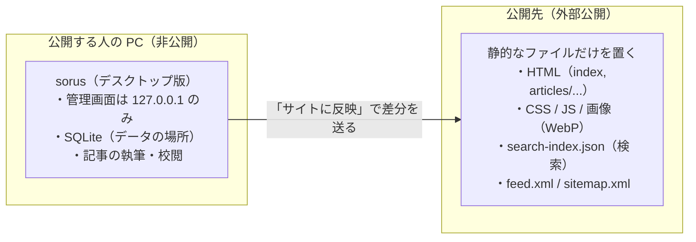
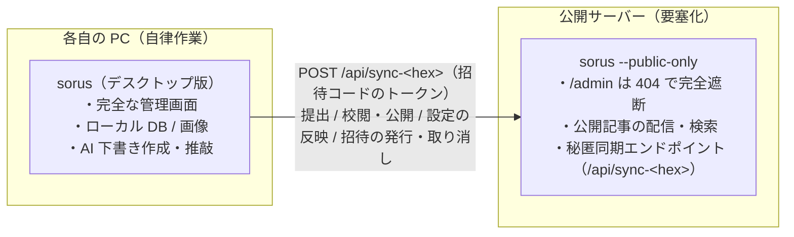

# 運用保守ガイド (Operations Guide)

本ドキュメントは、sorus の構成の選び方と、サーバー・コマンドでの運用（デプロイ、バックアップ、環境変数、移行）をまとめた運用者向けのリファレンスです。

* sorus のアプリ（デスクトップ版）を画面で使うだけなら、このガイドは要りません。[インストールガイド](install_guide.md)、[執筆ガイド](writing_guide.md)、[サイト管理ガイド](site_admin_guide.md) を読んでください。
* 1章と2章は、技術者でない人にも読める内容です。3章から先は、ターミナル・Docker・systemd を使う技術者向けの付録です。

### ドキュメントの使い分け

| ドキュメント | 役割 | こんなときに読む |
| :--- | :--- | :--- |
| [インストールガイド（install_guide.md）](install_guide.md) | アプリの入れ方 | PC に sorus を入れる・更新する・削除する |
| [執筆ガイド（writing_guide.md）](writing_guide.md) | 記事を書く・編集する操作 | ログイン、記事・ページの執筆、画像・ギャラリー、AI 執筆支援、公開・予約 |
| [サイト管理ガイド（site_admin_guide.md）](site_admin_guide.md) | サイト設定・運用の操作 | 役割、公開先とサイトに反映、複数人・公開サーバー連携、外観・サイト設定、バックアップ、複数サイト、ユーザー管理 |
| [サーバーを持たずに公開するガイド（static_site_guide.md）](static_site_guide.md) | 静的サイト公開の通しの手順 | 自分の PC で書き、レンタルサーバーや Cloudflare Pages に公開したい |
| [公開サーバーを使うガイド（decoupled_sync_guide.md）](decoupled_sync_guide.md) | 公開サーバー連携の通しの手順 | 管理画面のない公開サーバーを立て、各自の PC から提出・公開したい |
| 本ガイド（operations_guide.md） | 運用・デプロイリファレンス | 構成の比較、デプロイ方式（ローカル開発・ステージング・本番）、秘匿同期/MCPエンドポイントと鍵の扱い、バックアップ/リストア、環境変数、移行手順 |

---

## 1. 構成の選び方（届け方と公開先の違い）

sorus では、**サイトの「正本」を持つ sorus から公開します。** 静的サイト公開と公開サーバー連携の違いは、複数人で書くときの原稿の「届け方」と、サイトの「公開先」の違いです。どちらも、インターネット上に管理画面を置きません。

| | 静的サイト公開（サーバーを持たない） | 公開サーバー連携（公開サーバーを使う） |
| :--- | :--- | :--- |
| 複数人で書くとき | 同じ LAN・VPN のサーバー版（`sorus --server`）に、ブラウザでログインして書く | 各自のアプリの「公開サーバーへ提出」 |
| 公開先 | レンタルサーバー（SFTP/FTP）、Cloudflare Pages、GitHub Pages、Netlify、S3 互換ストレージ、フォルダへの書き出し | 公開専用モード（`--public-only`）の sorus を動かす VPS |
| 公開の操作 | 管理者が「サイトに反映」 | アプリ側で編集者の役割があり、公開サーバーの招待にも公開権限がある人が「公開サーバーで公開する」 |
| 用意するもの | ライター: PC（サーバー版を一緒に使うならブラウザ）だけ。公開する人: PC ＋ 公開先1つ | 上に加えて VPS とドメイン（`deploy/install-server.sh`） |
| 手順書 | [サーバーを持たずに公開するガイド](static_site_guide.md) | [公開サーバーを使うガイド](decoupled_sync_guide.md) |

迷ったら静的サイト公開から始めます。公開サーバー連携は、複数の編集者がそれぞれの PC から公開したい場合や、原稿をボタン1つで提出したい場合の発展形です。

アプリ版でもサーバー版でも、ライター・編集者・管理者でできる操作が異なります。管理者は編集者・ライターのすべての操作ができます。カテゴリ管理と記事の公開承認は編集者と管理者、公開先の設定とサイトへの反映は管理者が行います。アプリ版で「はじめに」を済ませた人は管理者になります。役割ごとの操作は[サイト管理ガイド](site_admin_guide.md)を見てください。

標準テーマは、モダン・テック・ニュース・ポータル・ポートフォリオの5種類です。公開先の選び方は[サイト管理ガイド](site_admin_guide.md)を見てください。

### 静的サイト公開: 静的配信



* 書き出しは毎回新しい一時フォルダに作ってから、前回からの差分を送ります。下書きに戻した記事のファイルは、sorus が前に送ったものに限って公開先から消します。
* サイト内検索は、書き出した `search-index.json` をブラウザ側で絞り込みます。記事一覧の2ページ目以降も書き出します。
* 予約投稿は、アプリの起動中に時刻になると公開して自動で反映します。起動していなかった間に過ぎた分は、次の起動時にホームで反映するか確かめます。

### 公開サーバー連携: 分散型要塞化同期



* 公開サーバーは `--public-only`（`PUBLIC_ONLY=true`）で動き、`/admin` へのアクセスはすべて 404 を返します（閲覧制限（Basic 認証）を有効にしているときは、ほかの存在しないページと同じく先にパスワードを求めます）。
* 同期の窓口は推測できないパス（`/api/sync-<hex>`）にあり、Ed25519 で署名したトークン付きの要求だけを受け付けます。
* 招待コードは、同期 URL とトークンを1つにまとめたものです（`sorus-invite:` ＋ Base64URL の JSON）。招待の発行・取り消しは、サイト管理者のアプリの画面で行います。

### これらの構成のメリット

1. **公開側に管理画面・認証 DB がない**: 管理画面への総当たり攻撃や認証の突破が、原理的に起きません。
2. **安全な書き出し・同期**: パストラバーサルの検査（Zip Slip の防止、シンボリックリンクの排除）を内蔵しています。
3. **費用が小さい**: 外部のデータベースや重いミドルウェアが要りません。無料枠の静的ホスティング、または最安クラスの VPS 1台で運用できます。
4. **オフラインでも書ける**: ネットワークが切れていても、PC の sorus で下書きや編集ができます。

---

## 2. アプリ版の運用（画面で行うこと）

デスクトップ版の日常の運用は、すべて画面で行います。

| やりたいこと | 画面 | 説明 |
| :--- | :--- | :--- |
| 公開先を決める | 「設定」→「公開先」 | [サイト管理ガイド](site_admin_guide.md) |
| サイトに出す | ホームまたは「公開先」の「サイトに反映」 | 同上 |
| 公開サーバーに届いた原稿を受け取る | 「届いた原稿」 | [サイト管理ガイド](site_admin_guide.md) |
| 公開サーバーに参加・招待する | 「設定」→「公開先」 | [公開サーバーを使うガイド](decoupled_sync_guide.md) |
| サイトを増やす・切り替える・削除する | 「設定」→「サイト」、左上のサイト名 | [サイト管理ガイド](site_admin_guide.md) |
| 自動バックアップ | 「設定」→「バックアップ」 | [サイト管理ガイド](site_admin_guide.md) |
| 更新 | ホームの「新しいバージョン（…）があります」 | [インストールガイド 6章](install_guide.md#6-更新する) |
| パスワードを忘れた | ログインの画面の「パスワードを忘れたとき」 | [執筆ガイド](writing_guide.md) |
| 終了する | 名前 ▼ の「sorus を終了」 | [インストールガイド 5章](install_guide.md#5-2回目からの起動と終了) |

データの置き場所は、Windows が `%LOCALAPPDATA%\sorus`、macOS が `~/Library/Application Support/sorus`、Linux が `$XDG_DATA_HOME/sorus`（未設定なら `~/.local/share/sorus`）です（[インストールガイド 8章](install_guide.md#8-データの置き場所)）。

---

## 3. 技術者向け付録: デプロイ手順

この CMS は Go の単一バイナリと SQLite で動作します。Node.js、Redis、PostgreSQL は不要です。Go 1.25 以降が必要です（`go.mod` の指定に合わせています）。全環境で DB、アップロード、検索インデックス、添付ファイルを永続ストレージに置き、定期バックアップを別媒体にも退避してください。

### サーバー版のログイン

サーバー版（従来の管理画面のあるサーバー）の初期管理者のユーザー名は `admin` です。開発環境（`make dev`）の初期パスワードは `dev-admin-pass`、本番環境では環境変数 `ADMIN_PASSWORD` の値です。自動生成した場合は、初回起動時のログに出ます。デスクトップ版には `admin` の初期アカウントはなく、「はじめに」の画面で利用者が自分のアカウントを作ります。

### デスクトップ版とサーバー版の切り替え

配布用のデスクトップ版は、ビルド時の既定値（`-ldflags "-X main.buildMode=desktop"`）でデスクトップモードになります。次のときは、デスクトップ版の実行ファイルでもサーバーとして動きます。

* `--server` または `--public-only` を付けたとき
* 環境変数 `PUBLIC_ONLY`・`ENV_FILE`・`DB_PATH` のどれかが設定されているとき

ソースから `go run .` で動かすとサーバー版になります。デスクトップモードにするには `--desktop` を付けます。手元の PC で開発用に動かす `make dev`（`ENV_FILE` を設定して起動する）もサーバー版です。

サイト閲覧制限（Basic 認証）はモードで扱いが違います。

| モード | 閲覧制限の設定場所 | 働くか |
| :--- | :--- | :--- |
| サーバー版（管理画面あり。同じ LAN・VPN のメンバーで1台の sorus を共有する `sorus --server` が主。`make dev`・`go run .` を含む） | 「設定」→「サイト設定」（同期 API を有効にしていれば、接続した PC の「公開サーバー」画面からも） | 働く。sorus が直接配信する公開サイト（LAN・VPN 内でのプレビューを含む）にかかり、「サイトに反映」で書き出した静的サイトにはかからない |
| 公開専用モード（`--public-only`） | 接続した PC の「設定」→「サイト運用」 | 働く |
| デスクトップ版 | 設定場所なし（「サイト設定」に項目が無い） | 働かない。v0.2.8 で保存した設定が残っていても、パスワードを求めない |

公開サーバーのメンテナンス表示（訪問者にテーマに依存しない 503 の画面を返す）は、同期 API を有効にした公開サーバー（公開専用モード、または同期 API を有効にしたサーバー版）で、接続した PC の管理者が「設定」→「公開先」から手動で始め、手動で終えます。ON/OFF は公開サーバーの DB（settings の `maintenance_enabled`）に、訪問者に出す画面は `maintenance_page`（標準または独自 HTML）に保存され、再起動しても続きます。独自 HTML の選択は接続した PC のそのサイトの DB（`maintenance_page_local`）に保存し、選んだだけでは公開サーバーも、管理画面のあるサーバー版が自分で出している訪問者向け画面も変わりません。始めるときに選択中の画面を送ります。表示中の画面の更新は「画面を反映」（ON/OFF は変わりません）。テーマの反映や通常のサイト設定同期では変わりません。メンテナンス表示中も `/healthz` と同期 API は今までどおり応答します。サーバー版では、管理画面にログイン中の人には公開サイトが通常どおり表示されます。デスクトップ版では公開サイトへの 503 は働きません（PC から公開サーバーへは送れます）。PC が使えずに終えられないときは、公開サーバーで `sorus token create` でサイト管理者の招待を発行し、別の PC から参加して終えます（[サイト管理ガイド](site_admin_guide.md)）。バックアップは既存の完全バックアップのままです（settings に含まれる）。PC のバックアップにはそのサイトで選んだ HTML（`maintenance_page_local`）が、公開サーバーのバックアップには ON/OFF と保存した画面（`maintenance_page`）が入ります。

### デスクトップ版の複数サイトとコマンド（`sorus sites` / `--site`）

デスクトップ版で複数のサイトを使っているときは、`sorus sites` でサイトの一覧と `id` を確かめ、`sorus backup`・`sorus restore`・`sorus export`・`sorus import` に `--site <id>` を付けて対象のサイトを指定します。

```bash
# この PC の sorus のサイトを1行に1つずつ表示（id、サイト名、アドレス、フォルダ）
sorus sites

# 2つ以上サイトがあるときは --site <id> で対象を指定する
sorus backup --site p7d2wa
sorus restore --site p7d2wa /path/to/sorus_backup.zip
sorus export --site p7d2wa --clean ~/site-dist
sorus import --site p7d2wa path/to/wordpress.xml
```

CLI の `sorus import` はどのモードでも `--account-mode=current` が既定で、記事を管理者のアカウントにまとめます。WordPress の著者ごとにユーザーを作る場合は `--account-mode=authors` を指定します。

* サイトが1つだけのときは、`--site` を省略するとそのサイトを扱います（`sites.json` がまだ無いときの `sorus sites` の `id` 表示は `-` です）。
* **サイトが2つ以上あるときに `--site <id>` を省略すると、どのサイトかを指定するよう求めて終了コード 2 で止まります**（使える `id` の一覧と `sorus sites` の案内を表示します）。存在しない `id` を指定したときも終了コード 2 で止まります。
* ソースから実行するときは `go run . --desktop sites` のように `--desktop` を付けます。サーバーモードには `--site` と `sorus sites` はありません。

### WSL ローカル開発と設定ファイル

WSL2 に Go 1.25 以降を用意し、リポジトリのルートで実行します。

```sh
go mod download
make dev
```

`scripts/dev.sh` は Go のバージョンを検査し、必要なデータディレクトリを作成して `deploy/environments/dev.env` を読み込みます。`dev.env` が無ければ、`dev.env.example` から自動で作ります（`dev.env` は Git に含めません。開発用の設定を変えるときは `dev.env` を書き換えます）。開発サイトは `http://localhost:8080` です。初期管理者はユーザー名 `admin`、パスワード `dev-admin-pass` です。この値は開発専用で、ステージングや本番に使わないでください。ローカル DB は `local_dev.db` に作られます。

環境変数 `ENV_FILE` には `KEY=value` 形式のファイルパスを指定できます。未指定ならリポジトリ直下の `.env` を読み込みます。プロセス環境にすでにある変数は設定ファイルで上書きしません。設定ファイルには秘密情報が含まれるため、`deploy/environments/` 内に配置し、権限を `chmod 600` にして Git に登録しないでください。各変数の意味は [`deploy/environments/README.md`](../deploy/environments/README.md) にあります。

### ステージング環境

ステージングには本番と分離したホストまたはデータ領域を使用してください。Compose の場合:

```sh
cp deploy/environments/staging.env.example deploy/environments/staging.env
chmod 600 deploy/environments/staging.env
# SITE_NAME、BASE_URL、ADMIN_PASSWORD などを実環境に合わせて編集
make staging-up
curl --fail http://localhost:8081/healthz
make staging-down
```

Compose は `sorus-staging-data` ボリュームを使い、ホスト 8081 番をコンテナ 8080 番に転送します。環境ファイル内のデータパスは systemd 利用時の値です。Compose では各パスを `/data` 配下に上書きし、専用の名前付きボリュームへ保存します。

systemd を使う Linux ホストでは、専用ユーザー `sorus-staging` を作成し、バイナリを `/usr/local/bin/sorus` に配置します。設定を `/etc/sorus/sorus-staging.env` に作成し、`PORT=8081`、適切な `BASE_URL`、強固な `ADMIN_PASSWORD` を指定します。ユニットを配置して起動します。

```sh
sudo install -d -m 0750 /etc/sorus
sudo install -m 0644 deploy/systemd/sorus-staging.service /etc/systemd/system/
sudo systemctl daemon-reload
sudo systemctl enable --now sorus-staging
sudo systemctl status sorus-staging
```

`StateDirectory=sorus-staging` によりデータは `/var/lib/sorus-staging` に保存されます。ホストのファイアウォールで 8081 番へのアクセスを必要な範囲に制限し、TLS 終端を前段のリバースプロキシで行ってください。リバースプロキシ配下では `TRUSTED_PROXIES` の設定が必須で、`LISTEN_ADDR` で待ち受けをプロキシからだけに絞れます（下の「[F. リバースプロキシの後ろに置く](#f-リバースプロキシの後ろに置く)」）。この構成では sorus に http で届くため、PC の「公開サーバー」画面から公開サーバーの閲覧制限（Basic 認証）を変更できません（画面に理由が出て、保存の欄は使えなくなります。状態の確認はできます）。閲覧用のパスワードを平文で受け取らないよう、sorus は自分で TLS を直接受けた接続でだけ変更を受け付けます。転送ヘッダー（`X-Forwarded-Proto` など）は `TRUSTED_PROXIES` を設定していても信頼せず、同じサーバーの nginx などが `127.0.0.1` へ http で中継した接続も、そのサーバー内からの直接の接続と見分けられないため受け付けません（sorus を `127.0.0.1` だけで待ち受けても同じです）。閲覧制限を使う公開サーバーは `AUTOCERT_DOMAIN` で sorus に TLS を直接受けさせてください。

### A. 静的配信（静的サイト公開）のコマンドでの書き出し

デスクトップ版の利用者は、画面の「公開先」と「サイトに反映」を使います。コマンドで書き出す場合は次のとおりです。

```bash
# デスクトップ版の実行ファイルで（データの場所から書き出す。ENV_FILE は不要。2サイト以上なら --site <id> を付ける）
sorus export --clean ~/site-dist
sorus export --site p7d2wa --clean ~/site-dist

# 開発用サーバー（make dev の local_dev.db）で書いた記事を書き出す
# dev.env は scripts/dev.sh（make dev）を初めて実行したときに dev.env.example から自動で作られる
ENV_FILE=deploy/environments/dev.env go run . export --clean dist

# 公開サーバーへの転送例（rsync）
rsync -avz --delete ./dist/ user@example.com:/var/www/html/

# Cloudflare Pages へのデプロイ例（Wrangler。Node.js が必要）
npx wrangler pages deploy dist --project-name my-media
```

* `--clean` は、隣の一時フォルダに書き出してから出力先と入れ替えます。前回の書き出しの残り（下書きに戻した記事など）は残りません。出力先に自分で置いたファイルも消えるので、専用のフォルダを指定します。
* `--clean` の途中で止まって出力先が無くなっても、前回の書き出しは隣の `.<フォルダ名>.export-old` に残ります。次に同じ出力先へ `--clean` で書き出すと、まずそれを出力先に戻してから書き出します。同じ出力先への `--clean` を同時に2つ実行しないでください。
* サーバー版で `ENV_FILE` を指定しないと、`.env` または既定の `database.db` を読みます。`make dev` で書いた記事を書き出すときは、上のように `ENV_FILE` を指定します。
* 出力先を省略すると `$EXPORT_DIR`（既定 `dist`）に書き出します。
* GitHub Pages への置き方は [サーバーを持たずに公開するガイドの付録](static_site_guide.md#github-pages-に置く) を見てください。

### B. 公開サーバー（公開サーバー連携）の導入スクリプト

Ubuntu / Debian の VPS では、`deploy/install-server.sh` で公開専用モードのサーバーを1回で導入できます。

```bash
curl -fsSL https://github.com/ryuzi/sorus/releases/latest/download/install-server.sh | sudo bash -s -- --domain media.example.jp --email you@example.jp
```

DNS の事前確認、サーバー版のダウンロードと SHA256 の検証、`/etc/sorus/sorus.env`（`PUBLIC_ONLY=true` ほか）、systemd のユニット（`sorus.service`・`sorus-backup.timer`）、ufw（SSH を先に許可）、起動確認、管理者用の招待コードの表示までを行います（もう一度実行すると実行ファイルを更新します）。オプションは [公開サーバーを使うガイドの付録](decoupled_sync_guide.md#導入スクリプトのオプション) を見てください。

#### GitHub に接続できないとき（ファイルを持ち込んで入れる）

サーバーから GitHub に接続できないときや、手元でダウンロードしたファイルを確かめてから入れたいときは、[リリースのページ](https://github.com/ryuzi/sorus/releases/latest) から `install-server.sh`・`sorus-server-<版>-linux-<arch>.tar.gz`・`SHA256SUMS` の3つを手元の PC にダウンロードし、`scp` でサーバーに送ってから `--archive` を付けて実行します（ARM のサーバーなら `amd64` を `arm64` にします）。

```sh
# 手元の PC で（同じリリースの3つのファイルをサーバーへ送る）
scp install-server.sh sorus-server-v1.2.3-linux-amd64.tar.gz SHA256SUMS user@media.example.jp:~/

# サーバーに SSH で入って実行する
sudo bash install-server.sh --archive sorus-server-v1.2.3-linux-amd64.tar.gz --domain media.example.jp --email you@example.jp
```

`--archive` を付けると、スクリプトは何もダウンロードせず、同じフォルダの `SHA256SUMS`（別の場所にあるときは `--sha256sums <ファイル>`）でファイル名・SHA256 ハッシュ・CPU の種類（`amd64` / `arm64`）を確かめてから `/usr/local/bin/sorus` に置きます。確かめられないファイルは入れません。その後の手順（systemd、ufw、管理者用の招待コードの発行）は1行で入れるときと同じです。

### C. 常駐サーバー（Docker Compose）での運用

DNS をこのホストへ向け、外部から 80/443 番へ到達できる状態で autocert を使うか、前段の TLS プロキシを用意します。公開サーバー連携（公開専用モード）として動かす場合は、`production.env` に `PUBLIC_ONLY=true` を足します。

```bash
# 1. 本番用環境変数の設定
cp deploy/environments/production.env.example deploy/environments/production.env
chmod 600 deploy/environments/production.env
# production.env の AUTOCERT_DOMAIN, AUTOCERT_EMAIL, BASE_URL, ADMIN_PASSWORD を設定

# 2. コンテナの起動と状態確認
make prod-up
docker compose -f deploy/docker-compose.yml ps
curl --fail http://localhost:8080/healthz

# 3. ログの確認
docker compose -f deploy/docker-compose.yml logs -f
```

* **ポート公開とデータ**: Compose は 80（HTTP）と 443（HTTPS）を公開し、`sorus-prod-data` を `/data` にマウントします。Let's Encrypt による自動 HTTPS が動き、コンテナは再起動時に自動起動します。
* **ヘルスチェック (`/healthz`)**: `/healthz` は認証なしで呼べるため、`{"status":"ok"}`（DB に接続できなければ 503 と `{"status":"error"}`）だけを返し、内部の様子（ディスク容量・稼働時間など）は出しません。autocert のときの平文ポート（既定は `PORT` の 8080。`/healthz` にだけ答え、ほかは HTTPS へ転送）は、`AUTOCERT_PLAIN_ADDR=127.0.0.1:8080` にするとコンテナの中のヘルスチェックだけに見せられます。Docker イメージにはヘルスチェック用 `curl` が含まれます。
* **更新と停止**: 更新時は `make prod-up` を再実行します。`make prod-down` はコンテナを停止しますが、名前付きデータボリュームは削除しません。`docker compose down -v` はデータを消すため通常の停止・更新に使わないでください。

### D. systemd サービスでの運用（Linux ベアメタル / VPS）

`AUTOCERT_DOMAIN` を指定する場合は DNS、80/443 の到達性、ホスト側ファイアウォールを確認してください。

```bash
# 1. ユーザー作成とバイナリ配置
sudo useradd --system --home-dir /var/lib/sorus --shell /usr/sbin/nologin sorus
sudo install -m 0755 bin/sorus /usr/local/bin/sorus

# 2. サービスファイルの配置
sudo install -m 0644 deploy/systemd/sorus.service /etc/systemd/system/sorus.service
sudo install -m 0644 deploy/systemd/sorus-backup.* /etc/systemd/system/

# 3. 環境変数ファイルの配置（パーミッション 0600）
sudo install -d -m 0750 /etc/sorus
sudo cp deploy/environments/production.env.example /etc/sorus/sorus.env
# sorus.env から DB_PATH など /data/... を指す行を削除する（下の注意を参照）
sudo chmod 0600 /etc/sorus/sorus.env
sudo chown -R root:sorus /etc/sorus

# 4. 起動と自動起動有効化
sudo systemctl daemon-reload
sudo systemctl enable --now sorus sorus-backup.timer
sudo systemctl status sorus
```

データはこの構成では `/var/lib/sorus` に保存されます。ステージングと本番で同じ DB やファイルディレクトリを共有しないでください。

> **注意**: `production.env.example` は Docker Compose 用で、`DB_PATH=/data/database.db` などのパスを含みます。systemd では `EnvironmentFile` の値が `sorus.service` の `Environment=`（`/var/lib/sorus/...`）より優先されるため、これらの行を残すと存在しない `/data` を使おうとして起動に失敗します。`sorus.env` には `ADMIN_PASSWORD`、`AUTOCERT_DOMAIN`、`AUTOCERT_EMAIL`、`SITE_NAME`、`BASE_URL` などのパス以外の設定だけを書いてください。公開専用モード（公開サーバー連携）にする場合は `PUBLIC_ONLY=true` を追加します。

### E. 固定ページとサイト構成を使い始める（アップグレード時の手順）

固定ページ（`kind = page`）とサイト構成（メニュー・トップページ）を使い始めるときは、次の順で進めてください。

1. **sorus を更新する**: 起動時にデータベースのマイグレーション（V8）が実行され、`articles` に種類（`kind`）の列が足されます。既存の記事はすべて `post`（記事）になります。WordPress から取り込んだ固定ページ（`/?page_id=` からの転送がある記事）は `page` になります。
2. **検索インデックスを揃える**: 種類を保存していない古いインデックスのドキュメントは、記事として扱われます。サーバーを再起動すると、起動時に公開中の記事をデータベースから全件インデックスし直すため、ページが `/<スラッグ>` の検索結果として正しく出るようになります。インデックスを作り直す場合は、`SEARCH_INDEX_DIR`（既定は `search_index`）を削除してから再起動してください。
3. **サイト構成を公開サーバーへ反映する**: 管理画面の「設定」→「外観」→「サイト構成」で内容を保存し、「公開サーバーへ反映する」を押します。反映されるのは、メニュー・トップページ・トップのカードです。

反映の後、公開サイトに変更が出るまで、CDN を使っている場合は最大1時間かかります。

### F. リバースプロキシの後ろに置く

sorus は Let's Encrypt の証明書を自分で取れる（`AUTOCERT_DOMAIN`）ため、リバースプロキシは必須ではありません。nginx・Caddy・クラウド事業者のロードバランサーなどの後ろに置くときは、次の4つを**必ず**設定します（`/etc/sorus/sorus.env` または `production.env`）。

| 変数名 | 設定する値（同じホストの nginx が TLS を終端する例） | 設定しないと |
| :--- | :--- | :--- |
| `TRUSTED_PROXIES` | `127.0.0.1`（プロキシの IP アドレス・CIDR） | 転送ヘッダーを信頼しないため、ログイン・OAuth の回数制限が全員をプロキシ1つとして数えて締め出すことがあり、OAuth・招待コードの URL が `http://` になる |
| `ALLOWED_HOSTS` | `media.example.jp` | 偽の `Host` ヘッダーの値が、公開サイトの絶対 URL・OAuth のメタデータ・招待コードに載るおそれがある |
| `LISTEN_ADDR` | `127.0.0.1:8080` | すべてのアドレスで待ち受け、プロキシを通らずに sorus へ直接つながる |
| `BASE_URL` | `https://media.example.jp` | canonical・OGP・フィード・サイトマップの URL が要求の `Host` に左右される |

```sh
LISTEN_ADDR=127.0.0.1:8080
TRUSTED_PROXIES=127.0.0.1
ALLOWED_HOSTS=media.example.jp
BASE_URL=https://media.example.jp
SECURE_COOKIE=true
```

* プロキシの側では、`Host`・`X-Forwarded-For`・`X-Forwarded-Proto` を sorus へ渡します。どれも読めない値なら、意図せず広く公開しないよう起動を中止します。
* 応答には `Referrer-Policy: strict-origin-when-cross-origin` を付け、`SECURE_COOKIE` が有効なら HTTPS の応答に HSTS（`max-age=31536000`。同じドメインのほかのサブドメインが平文で動いていることがあるため `includeSubDomains` は付けない）も付けます。管理画面・OAuth の同意画面、公開ページ、`/uploads/` のファイルにはそれぞれ `Content-Security-Policy` を付けます。前段のプロキシで同じヘッダーを重ねて付ける必要はありません。
* この構成では sorus に http で届くため、PC の「公開サーバー」画面から公開サーバーの閲覧制限（Basic 認証）は変更できません（確認だけできます）。閲覧制限を使う公開サーバーは、`AUTOCERT_DOMAIN` で sorus に TLS を直接受けさせます（[ステージング環境](#ステージング環境)）。
* 公開専用モード（`--public-only` / `PUBLIC_ONLY=true`）では、リバースプロキシの有無にかかわらず `/admin` の下はすべて 404（存在しないページ）になり、管理画面は完全に無効です（閲覧制限を有効にしているときは、ほかの存在しないページと同じく先にパスワードを求めます）。プロキシで `/admin` を別に塞ぐ必要はありません。
* 各変数の書式は [5章の環境変数一覧](#5-技術者向け付録-環境変数一覧) を見てください。

### G. 公開サーバーのログの場所

公開サーバーで起きたことは、次の3か所で調べます。

| ログ | 見る場所 | わかること |
| :--- | :--- | :--- |
| sorus 本体のログ（systemd） | `journalctl -u sorus`（`-f` で流し見、`--since "1 hour ago"` で絞り込み） | 起動・停止、証明書の取得、同期 API・MCP のエラー、バックアップの結果 |
| sorus 本体のアクセスログ | 本体のログと同じ出力（systemd なら `journalctl -u sorus`、Docker Compose なら `docker compose -f deploy/docker-compose.yml logs -f`） | 1件1行の `time`・`method`・`path`（秘密が入らないよう、クエリ文字列は記録しない）・`status`・`remote_ip`（`TRUSTED_PROXIES` を反映した送り元）・`latency_ms`・`bytes_out` |
| リバースプロキシのログ（使っている場合） | nginx: `/var/log/nginx/access.log`・`/var/log/nginx/error.log`。Caddy: `journalctl -u caddy`（Caddyfile の `log` で出力先を変えた場合はそのファイル） | sorus に届く前に断られた要求、TLS のエラー、プロキシから sorus につながらなかったとき（502 など） |

* journald のログは、ディスクの容量に応じて古いものから消えます。長く残すときは `/etc/systemd/journald.conf` の `SystemMaxUse` などを設定します。
* `TRUSTED_PROXIES` を設定していないと、アクセスログの `remote_ip` はすべてプロキシのアドレスになります。

### H. 公開専用モードの署名鍵・秘匿エンドポイント・トークン発行

インターネットに置く公開サーバーは `--public-only`（または環境変数 `PUBLIC_ONLY=true`）で起動します。管理画面（`/admin` 以下）は無効になり、`/admin` への要求は存在しないページと同じ 404 を返します（閲覧制限を有効にしているときは、先にパスワードを求めます）。公開ページ・静的アセットと、ローカルの sorus から記事を受け取る同期 API（推測できない秘匿パスへの `POST`）、AI アプリが接続する MCP API（推測できない秘匿パス `/api/mcp-<32桁の16進数>`。固定の `/api/mcp` は 404）とその OAuth 2.1 のエンドポイントだけを配信します。`PUBLIC_ONLY` に `true` / `false` 以外の値を書くと、誤って管理画面を公開しないよう起動を中止します。

初回起動時、トークンの署名鍵 `capability.key`（`CAPABILITY_KEY_FILE` で変更可）を作業ディレクトリに作成します。Compose では `/data/capability.key` になります。この鍵を失うと発行済みのトークンがすべて使えなくなるため、DB と同じくバックアップし、外部に漏らさないでください。

鍵ファイルは所有者だけが読み書きできる権限（`0600`）で作成されます。バックアップから戻すなどして所有者以外（グループ・その他）が読み書きできる権限になっていると、漏洩の恐れがあるため Linux・macOS では起動とトークン発行を中止します。その場合は `chmod 600 capability.key` で権限を戻してから起動し直してください。漏洩した可能性があるときは、鍵を作り直してトークンを発行し直してください。

#### 秘匿同期エンドポイント

同期 API は誰でも推測できる固定のパス（`/api/sync`）には置きません。初回起動時、署名鍵と同じディレクトリに `sync_path.txt` を作成し、推測できないパス（例: `/api/sync-0123456789abcdef0123456789abcdef`）を保存します。Compose では `/data/sync_path.txt`、systemd では `/var/lib/sorus/sync_path.txt` になります。以後の起動と `sorus token create` は同じファイルを読みます。同期 API はこのパスへの `POST` だけに応じ、固定の `/api/sync` への要求は正しいトークンを付けていても、存在しないページと同じ 404 を返します。無差別なスキャンや大量の要求をトークンの検証より手前で門前払いし、API の存在自体を見せません（トークンによる認証・認可は従来どおり行います）。

`sync_path.txt` も署名鍵と同じく `0600` で作成し、所有者以外が読み書きできる権限になっていれば起動とトークン発行を中止します（`chmod 600 sync_path.txt` で戻します）。中身を壊すと起動を中止し、勝手に作り直しません。ファイルを削除すると次回の起動で新しいパスを生成し、ローカルの sorus に設定済みの URL はすべて使えなくなるため、鍵と一緒にバックアップしてください。パスを自分で決めるときは、環境変数 `SYNC_API_PATH`（または `--sync-path`）に `/api/sync-...` のようなパスを指定します。このときは `sync_path.txt` を使いません。英数字と `.` `_` `~` `-` だけの区間を `/` でつないだパスにしてください（`/admin` などの既存の機能と重なるパスは使えません）。

#### 秘匿 MCP エンドポイントと AI アプリの接続（OAuth 2.1）

公開専用モードの MCP サーバーも、推測できる固定のパス（`/api/mcp`）には置きません。初回起動時、署名鍵と同じディレクトリに `mcp_path.txt`（`0600`）を作成し、`/api/mcp-<32桁の16進数>`（128 bit の乱数）を保存します。以後の起動は同じファイルを読みます。環境変数 `MCP_API_PATH` を指定すればそのパスを使い、`mcp_path.txt` は使いません（公開専用モードで `/api/mcp` を指定すると起動を中止します）。ファイルを削除すると次回の起動で新しいパスになり、AI アプリの接続はやり直しになるため、署名鍵・`sync_path.txt` と一緒にバックアップしてください。

* **秘匿パスを漏らさない**: 共通の `/.well-known/oauth-protected-resource` と `/.well-known/oauth-protected-resource/api/mcp` は 404 にし、パスを含む `/.well-known/oauth-protected-resource/api/mcp-<hex>` だけを返します。秘匿パスは未認証の MCP 要求への 401 の `WWW-Authenticate` からだけ案内し、`/.well-known/oauth-authorization-server`（RFC 8414）には載せません。
* **OAuth 2.1**: ChatGPT・Claude などの AI アプリは、MCP の URL を貼るとメタデータから自動で構成し、動的クライアント登録（`POST /oauth/register`、RFC 7591）と PKCE（`S256` 必須）で接続します。公開専用モードにはログイン画面が無いため、同意画面では、接続した PC の sorus の「設定」→「MCP連携」で発行する8文字の確認コード（`XXXX-XXXX`、10分・1回限り）で本人を確かめます。権限は招待のロールをそのまま引き継ぎ、招待を取り消すとその招待で作った API トークン・OAuth のトークンも使えなくなります。
* **回数の制限**: OAuth のエンドポイントと確認コードの誤りは送り元ごと・全体で回数を制限し、超えたら 429（`Retry-After` 付き）で断ります（送り元の判定は `TRUSTED_PROXIES` に従います）。
* サイト閲覧制限（Basic 認証）やメンテナンス表示が有効でも、MCP の秘匿パスと OAuth のエンドポイントは AI アプリが使えるようパスワードなしで通します。

#### トークンの発行と接続先の案内

ふだんの招待は、サイト管理者が自分の PC の sorus の「設定」→「公開先」の「招待する」で作ります（[公開サーバーを使うガイド](decoupled_sync_guide.md#7-ステップ3-書く人校閲する人を招待する)）。コマンドが要るのは、最初のサイト管理者の招待（`deploy/install-server.sh` は自動で作ります）や、スクリプトから発行する場合です。

トークンは公開サーバー上で発行します。トークンだけが標準出力に出て、接続先の同期 API の URL（`--base-url` または環境変数 `BASE_URL` が無ければパスだけ）と招待コードは標準エラー出力に出ます。発行したトークンは公開サーバーの DB に記録され、画面の「発行した招待」から取り消せます。

```sh
docker compose -f deploy/docker-compose.yml exec sorus /sorus token create --role writer --sub yamada --ttl 90d --base-url https://example.jp
```

```text
Capability token created
  Subject:   yamada
  Role:      writer
  Expires:   2027-01-19T12:00:00+09:00
  Sync URL:  https://example.jp/api/sync-0123456789abcdef0123456789abcdef
  ...
  Invite code: sorus-invite:eyJ2Ijox...
```

`--role` は `writer`（記事の提出）、`editor`（校閲待ちの取得・承認公開）、`admin`（サイト設定の反映、招待の発行・取り消し）のいずれかです。`--base-url` が `https://` の URL なら、同期 URL とトークンを1つにした招待コード（`sorus-invite:` で始まる1行）も表示します。受け取った人は「設定」→「公開先」の「招待コード」に貼り付けて「接続を確かめて参加する」を押すだけで参加できます。招待コードやトークンは、受け取る人だけに伝えてください。

招待コードを使わない場合は、トークンと一緒に、表示された同期 API の URL を伝えます。受け取った人は、自分の PC で起動した sorus の「設定」→「公開先」（`/admin/settings/remote`）の「詳細設定（公開サーバーの URL とトークンを直接入力する）」で、「公開サーバーの URL」欄に同期 API のパスまで含めた URL をそのまま貼り付け、トークンを保存します。パスだけを伝えた場合は、公開サーバーの URL のすぐ後ろにつなげて入力します。パスを含めない URL を保存すると固定の `/api/sync` に接続し、接続テストが「同期 API が見つかりません」で失敗します。公開専用モードでない sorus でも、署名鍵ファイルがあれば同期 API を有効にします（パスの決め方は公開専用モードと同じです）。

`scripts/e2e_decoupled_sync.sh` は、ビルドした実行ファイルを一時ディレクトリの公開専用モードで起動し、秘匿パスの生成と固定の `/api/sync` の 404、招待の発行・取り消し、提出から承認公開までの流れ、キャッシュヘッダーを curl で確認します。

---

## 4. 技術者向け付録: バックアップとリストア

SQLite の `VACUUM INTO` を用いた無停止オンラインバックアップを標準搭載しています。完全バックアップ（形式のバージョン 2）は、データベース、アップロード画像（`UPLOAD_DIR`）、添付資料（`ATTACHMENT_DIR`）、`manifest.json` を1つの Zip にまとめます。添付資料を含まない以前の形式（バージョン 1）の Zip も復元できます。Zip に入れる DB からは、そのままログインに使えるセッション ID を消去します（復元後は全員がログインし直します）。

独自テーマ（`THEMES_DIR`。既定は作業ディレクトリの `themes`）は完全バックアップに入りません。公開サーバーのテーマは、PC の「公開サーバーへ反映する」で送り直せます（元のデータは PC にあります）。PC の sorus で取り込んだ独自テーマは、取り込み元の URL・Zip からもう一度取り込みます。

### デスクトップ版の自動バックアップ

デスクトップ版では、「設定」→「バックアップ」で保存先のフォルダを1回選ぶと、起動時と、起動中は1日1回、そのフォルダに完全バックアップを置きます。新しいものから14個を残します。複数サイトを使う場合はサイトごとに設定し、2つ目以降のサイトのファイル名にはサイトの `id` が入ります（`sorus_backup_<id>_YYYYMMDD_HHMMSS.zip`。1つ目のサイトは `sorus_backup_YYYYMMDD_HHMMSS.zip`）。世代の整理は自分のサイトのファイルだけを対象にするため、複数のサイトで同じ保存先フォルダを選んでも互いのバックアップは消えません。画面の操作は [サイト管理ガイド](site_admin_guide.md) を見てください。

### 手動バックアップ

```bash
# 稼働中のデータベースと画像・添付資料を backups/sorus_backup_YYYYMMDD_HHMMSS.zip へまとめて保存
make backup
# または保存先を指定
./sorus backup /path/to/sorus_backup.zip
# Compose の場合（コンテナ内の永続領域に保存し、手元へ取り出す）
docker compose -f deploy/docker-compose.yml exec sorus /sorus backup /data/backups/manual.zip
container=$(docker compose -f deploy/docker-compose.yml ps -q sorus)
docker cp "$container:/data/backups/manual.zip" ./
# デスクトップ版でサイトが2つ以上あるときは --site <id> を指定（id は sorus sites で確認）
sorus backup --site p7d2wa /path/to/sorus_backup.zip
# データベースだけを SQLite ファイルとして保存（拡張子 .db を指定した場合も同じ）
./sorus backup --db-only
./sorus backup /path/to/backup.db
```

* デスクトップ版の実行ファイルでは、`sorus backup` がサイトのフォルダのデータを使い、保存先を省略するとそのサイトのフォルダの `backups`（1つ目のサイトはデータディレクトリの `backups`、2つ目以降は `sites/<id>/backups`）に置きます。サイトが2つ以上あるときは `--site <id>` が必須です。
* 管理画面の「設定」→「バックアップ」（管理者）からも、「バックアップを作成してダウンロード」で同じ完全バックアップを作れます。

完全バックアップと DB だけの .db ファイルには、パスワードや API キーなどの秘密情報が含まれるため、人に渡さないでください。サイトを渡すときは「今のサイトを Zip ファイルでダウンロード」を使ってください。

### 自動バックアップ（systemd timer）

* `sorus-backup.timer` により、**毎日午前 03:00（JST）** に自動バックアップが実行されます（`deploy/install-server.sh` も設定します）。状態は `systemctl list-timers sorus-backup.timer`、手動での即時実行は `sudo systemctl start sorus-backup.service` で行えます。
* バックアップ先: `/var/lib/sorus/backups/`

自動バックアップにも、パスワードや API キーなどの秘密情報が含まれます。人に渡さないでください。サイトを渡すときは「今のサイトを Zip ファイルでダウンロード」を使ってください。

毎日の完全バックアップには画像も含まれるため、画像が多いサイトでは保存先の空き容量に注意し、古いバックアップを定期的に整理してください。DB だけを毎日保存したい場合は、`sorus-backup.service` の `ExecStart` を `sorus backup --db-only` にします。公開サーバーの `capability.key` と `sync_path.txt` は Zip に入らないので、別に保管します（[公開サーバーを使うガイドの付録](decoupled_sync_guide.md#公開サーバーのバックアップと鍵)）。

### データのリストア手順

管理画面から復元する（サーバーは止めなくてよい）:
1. 「設定」→「バックアップ」を開く。
2. 復元する `sorus_backup_*.zip` をドラッグ＆ドロップし、確認ダイアログで「復元する」を押す。
3. 復元が終わるとログイン画面に戻るので、復元したデータのアカウントでログインする。

デスクトップ版で新しい PC に引っ越すときは、「はじめに」の画面の「バックアップから始める」でも復元できます。

コマンドで復元する（サーバーを止めて実行）:
1. サービスを一時停止: `sudo systemctl stop sorus`（Compose の場合は `make prod-down`）
2. 完全バックアップを `DB_PATH` と `UPLOAD_DIR`・`ATTACHMENT_DIR` に復元（内容を表示し、`yes` の入力を求めます。スクリプトからは `--yes` で省けます。デスクトップ版でサイトが2つ以上あるときは `sorus restore --site <id> <backup.zip>` のように `--site <id>` を指定します）:
   ```bash
   sudo -u sorus env DB_PATH=/var/lib/sorus/database.db UPLOAD_DIR=/var/lib/sorus/uploads ATTACHMENT_DIR=/var/lib/sorus/attachments \
     /usr/local/bin/sorus restore /var/lib/sorus/backups/sorus_backup_20261021_030000.zip
   ```
3. サービスを再開: `sudo systemctl start sorus`

どちらの方法でも、復元の前に Zip 全体を検査し（`manifest.json` との一致、DB の整合性、展開先の外を指すエントリ（Zip Slip）やシンボリックリンクの拒否、展開後のサイズの上限（Zip Bomb 対策。1エントリ 4GB・合計 8GB。検査と展開の両方で強制し、宣言より多く読めた時点で中止））、問題があれば何も変更しません。置き換える前の DB と画像・添付資料のディレクトリは、元の場所に `.pre-restore-YYYYMMDD_HHMMSS` を付けた名前で残ります。添付資料を含まない以前のバックアップから戻したときは、`ATTACHMENT_DIR` をそのまま残します。`--db-only` で作った `.db` から戻す場合は、サービスを止めてから `DB_PATH` にコピーします。

### 独自テーマの置き換えが途中で止まったとき

独自テーマの取り込み・公開サーバーへの反映は、前の版を `THEMES_DIR/.install-*/.old` に退避してから新しい版を置きます。sorus は自動の復旧をしません。

* 置き換えに失敗して前の版も元の場所に戻せなかったときは、前の版を `.install-*/.old` に残し、エラーのログに `the previous version is kept in <場所>` と出します。そのテーマは配置先に無いままです（適用中なら標準テーマで表示）。
* 置き換えの途中で sorus が強制終了（停電・OOM・`kill -9` など）したときも、前の版は `.install-*/.old` に残ります。
* 起動時の掃除は、30分以上経った `.install-*`・`.uninstall-*` を消します。ただし `.old` を含む `.install-*` は、何年経っても消さず、配置先へ戻しもしません。起動のたびに `theme: kept <作業ディレクトリ>: it holds the previous version of a theme (.old) ...` とログに出ます。

残った `.install-*` の扱い:

* 同じテーマを使えるようにするだけなら、作業ディレクトリには触れず、PC の sorus ではそのテーマをもう一度取り込み、公開サーバーでは PC から「公開サーバーへ反映する」をもう一度押します。
* 前の版に戻したいときは、sorus を止めてから、`.install-*` の中に `.old` と `<ID>` のフォルダがあり `THEMES_DIR/<ID>` が無いことを確かめ、`.old` を `THEMES_DIR/<ID>` へ移します（`<ID>` のフォルダは置けなかった新しい版です）。`THEMES_DIR/<ID>` があるときは、それがいま使われている版で、`.old` は置き換えられた前の版です。`.old` しか無いときは、`.old/theme.json` の名前でどのテーマの前の版かを確かめます。
* 前の版が要らないと確かめたら、sorus を止めてから、その `.install-*` を作業ディレクトリごと消してかまいません。

公開サーバーは、テーマのファイルと設定が揃っているかを自動では確かめません。反映に失敗した・途中で止まったときは、PC から「公開サーバーへ反映する」をもう一度押すと、PC の設定とテーマで揃います（テーマの元のデータは PC にあります）。

---

## 5. 技術者向け付録: 環境変数一覧

### サーバー版

| 変数名 | 必須 | 既定値 | 説明 |
| :--- | :---: | :--- | :--- |
| `ENV_FILE` | 任意 | `.env` | 起動時に読み込む設定ファイル。設定するとサーバー版として動く |
| `PORT` | 任意 | `8080` | リッスンするポート番号 |
| `LISTEN_ADDR` | リバースプロキシ配下では必須 | (未設定。すべてのアドレスの `:PORT`) | `--server`・`--public-only` の待ち受けアドレス（例: `127.0.0.1:8080`）。前段のリバースプロキシだけに見せるときに指定する。アドレスだけ（例: `127.0.0.1`）なら `PORT` を使う。読めない値は起動を中止する |
| `BIND_ADDR` | 任意 | (未設定) | `LISTEN_ADDR` の別名。`LISTEN_ADDR` が無いときだけ使う |
| `DB_PATH` | 任意 | `database.db` | SQLite データベースファイルのパス |
| `UPLOAD_DIR` | 任意 | `uploads` | アップロード画像（WebP）の保存先ディレクトリ |
| `ATTACHMENT_DIR` | 任意 | `attachments` | 添付資料ファイルの保存先ディレクトリ |
| `SEARCH_INDEX_DIR` | 任意 | `search_index` | Bleve 日本語全文検索インデックスの保存先ディレクトリ |
| `BACKUP_DIR` | 任意 | `backups` | バックアップ保存先ディレクトリ |
| `EXPORT_DIR` | 任意 | `dist` | `sorus export` の出力先を省略したときの書き出し先 |
| `SITE_NAME` | 任意 | `sorus` | サイト名（ヘッダー、タイトル、OGP等に反映） |
| `SITE_DESCRIPTION` | 任意 | (空文字) | サイトの概要説明文 |
| `BASE_URL` | 本番・リバースプロキシ配下では必須 | (未設定。要求の Host から決める) | サイトの基準URL（カノニカルURL、RSS、OGP等に使用）。管理画面の「サイト設定」で保存した値が優先 |
| `ADMIN_PASSWORD` | 初回 | (自動生成) | 初期管理者アカウント `admin` のパスワード |
| `SECURE_COOKIE` | 任意 | `AUTOCERT_DOMAIN` があれば `true`、無ければ `false` | Cookie に Secure 属性を付与する（`true`/`1`・`false`/`0`）。`true` のときは HTTPS の応答に HSTS（`Strict-Transport-Security: max-age=31536000`。`includeSubDomains` なし）も付ける。HTTPS の前段プロキシを使うときは `true` にする |
| `AUTOCERT_DOMAIN` | 本番 | (未設定) | 自動HTTPSを有効にするドメイン（カンマ区切りで複数可） |
| `AUTOCERT_EMAIL` | 本番 | (未設定) | Let's Encrypt 登録用の管理者メールアドレス |
| `AUTOCERT_CACHE_DIR` | 任意 | `certs` | Let's Encrypt 証明書キャッシュディレクトリ |
| `AUTOCERT_HTTP_ADDR` | 任意 | `:80` | autocert 使用時に HTTP-01 チャレンジと HTTPS への転送を受け付けるアドレス |
| `AUTOCERT_HTTPS_ADDR` | 任意 | `:443` | autocert 使用時に HTTPS で待ち受けるアドレス |
| `AUTOCERT_PLAIN_ADDR` | 任意 | (未設定。`LISTEN_ADDR`・`BIND_ADDR`、無ければ `:PORT`) | autocert 使用時の平文ポート（`/healthz` にだけ答え、ほかは HTTPS へ転送）の待ち受けアドレス。`127.0.0.1:8080` にすると同じ PC・コンテナの中のヘルスチェックだけに見せられる |
| `TRUSTED_PROXIES` | リバースプロキシ配下では必須 | (未設定。転送ヘッダーを一切信頼しない) | 転送ヘッダー（`X-Forwarded-For`・`X-Forwarded-Proto`）を信頼するリバースプロキシの IP アドレス・CIDR（カンマ区切り。例: `127.0.0.1,10.0.0.0/8`）。未設定なら送り元は直接つながったアドレス（`echo.ExtractIPDirect`）、スキームは TLS の有無だけで決める。nginx・Caddy などの配下で動かすときに設定しないと、ログイン・OAuth の回数制限が全員を1つの送り元（プロキシ）として数え、OAuth・招待コードの URL が `http://` になる（`BASE_URL` が無いか、ホスト名が違うとき）。プロキシ以外から届いた転送ヘッダーは無視する。不正な値は起動を中止する |
| `ALLOWED_HOSTS` | リバースプロキシ配下では必須 | (未設定。`Host` を制限しない) | 使ってよい `Host` ヘッダーの値（カンマ区切り。例: `example.jp,www.example.jp:8443`。ポートを書けばポートまで比べる）。設定すると、サーバーモードの MCP は一覧に無い `Host` を 403 で断り、`BASE_URL` が無いときの公開サイトの絶対 URL・OAuth のメタデータ・招待コード・同期 API の MCP 案内には一覧に無い `Host` を載せない（`BASE_URL` のホストが一覧にあればそれ、無ければ一覧の先頭）。公開ページの要求そのものは断らない |
| `PUBLIC_ONLY` | 任意 | `false` | `true` に設定すると管理画面（`/admin`）を完全遮断し公開配信専用で起動 |
| `SYNC_API_PATH` | 任意 | (自動生成) | 秘匿同期エンドポイントのカスタムパス（例: `/api/sync-custom-secret`） |
| `MCP_API_PATH` | 任意 | サーバー版 `/api/mcp`、公開専用モードは自動生成 | MCP サーバーのパス（`/api/` の下）。公開専用モードでは固定の `/api/mcp` を使えず（起動を中止）、未設定なら署名鍵と同じディレクトリの `mcp_path.txt`（`0600`）から読み、無ければ `/api/mcp-<32桁の16進数>` を生成して保存する |
| `CAPABILITY_KEY_FILE` | 任意 | `capability.key` | ケーパビリティトークンのEd25519署名鍵ファイルパス |
| `AI_PROVIDER` | 任意 | (未設定。API キーから自動選択) | AI推敲のプロバイダー（`gemini`, `openai`, `claude`, `custom`。`ollama`・`local` などは `custom` と同じ） |
| `AI_API_KEY` | 任意 | (未設定) | `AI_PROVIDER` のプロバイダーの API キー（下のプロバイダー別の変数より優先） |
| `AI_MODEL` | 任意 | (プロバイダー既定値) | 使用するLLMモデル名 |
| `AI_BASE_URL` | 任意 | (プロバイダー既定値) | Ollama や LocalAI、Groq 等を使用する場合のエンドポイントURL |
| `GEMINI_API_KEY` | 任意 | (未設定) | Google Gemini API キー（推敲・下書き・ファクトチェック・画像解析） |
| `OPENAI_API_KEY` | 任意 | (未設定) | OpenAI API キー |
| `ANTHROPIC_API_KEY` | 任意 | (未設定) | Anthropic Claude API キー |
| `EMBEDDING_PROVIDER` | 任意 | (未設定) | RAG埋め込みモデルのプロバイダー（`gemini`, `openai`, `ollama`） |
| `EMBEDDING_MODEL` | 任意 | (プロバイダー既定値) | 埋め込みモデル名（Gemini既定: `text-embedding-004`） |
| `EMBEDDING_API_KEY` | 任意 | (未設定) | 埋め込み用の API キー（`GEMINI_API_KEY`・`OPENAI_API_KEY` より優先） |
| `EMBEDDING_BASE_URL` | 任意 | (プロバイダー既定値) | 埋め込み API のエンドポイント URL（Ollama など） |
| `EMBEDDING_DIMENSIONS` | 任意 | (モデル既定値) | 埋め込みベクトルの次元数 |

埋め込み（AI 検索・関連記事）で埋め込み API に送るのは、公開中の記事の本文だけです。下書き・校閲待ち・予約中・ゴミ箱の記事は送らず、公開をやめた記事の埋め込みは消します。予約投稿は公開日時が来たときに送ります。

#### リバースプロキシ・インターネット公開時の設定

リバースプロキシ配下では `TRUSTED_PROXIES`・`ALLOWED_HOSTS`・`LISTEN_ADDR`・`BASE_URL` の4つを必ず設定します（[3章の F](#f-リバースプロキシの後ろに置く)）。

* **待ち受けを絞る**: nginx・Caddy などの前段で TLS を終端し、sorus を同じ PC からだけ見せるときは `LISTEN_ADDR=127.0.0.1:8080` にします。`AUTOCERT_DOMAIN` で sorus が TLS を直接受けるときの平文ポート（`/healthz` 用）は `AUTOCERT_PLAIN_ADDR` で別に絞れます。
* **転送ヘッダー**: `TRUSTED_PROXIES` を設定しない限り、sorus は `X-Forwarded-For`・`X-Forwarded-Proto` を一切信頼しません（誰でも書けるため）。リバースプロキシ配下では、そのプロキシのアドレス（同じ PC なら `127.0.0.1`）を必ず設定してください。公開 URL・OAuth/招待のオリジン・回数制限・MCP がこの1つの一覧を共有します。
* **Host の検証**: `BASE_URL` を設定すれば、canonical・OGP・フィード・サイトマップは `Host` ヘッダーに左右されません。`BASE_URL` が無いあいだは、公開ページの HTML キャッシュに `Vary: Host` を付けて、偽の `Host` で作らせたページがほかの訪問者に返らないようにします。`ALLOWED_HOSTS` を設定すると、一覧に無い `Host` を URL に載せず、サーバーモードの MCP はその `Host` を 403 で断ります。

#### セキュリティの既定動作（サーバー版・公開専用モード）

* **ログインの回数制限**: `POST /admin/login` のパスワードの誤りを 10 分の区切りごとに、送り元ごと（30 回。IPv6 は /64 ごと）とユーザー名ごと（10 回）に数え、超えたら区切りが変わるまで正しいパスワードでも 429（`Retry-After` 付き）で断ります。断るときはパスワードを照合しないため、bcrypt の計算で CPU を使い尽くされません。正しくログインできたらそのユーザー名の数だけ数え直します。
* **OAuth の回数制限**: `/oauth/register`（送り元ごと 20・全体 300）、`/oauth/token`（120・3,000）、`/oauth/authorize`（60・600）、公開専用モードの確認コードの誤り（10・100）を 10 分ごとに数え、429 で断ります。記録は送り元 10,000 件までで、超えたら区切りの過ぎた記録、それでも多ければ数の少ない記録から消します（上限に達した送り元の記録は残るため、制限は外れません）。数はメモリ上だけで、再起動で消えます。
* **`/healthz`**: 認証なしで呼べるため、`{"status":"ok"}`（DB に接続できなければ 503 と `{"status":"error"}`）だけを返し、ディスク容量・稼働時間などの内部の様子は出しません（異常はログに残します）。
* **HTTP ヘッダー**: すべての応答に `X-Content-Type-Options: nosniff`・`X-Frame-Options: SAMEORIGIN`・`Referrer-Policy: strict-origin-when-cross-origin`、`SECURE_COOKIE` が有効なら HTTPS の応答に HSTS（1年）を付けます。管理画面・はじめに・OAuth の同意画面、公開ページ、`/uploads/` のファイルそれぞれに `Content-Security-Policy` を付けます（`/uploads/` は `default-src 'none'` とサンドボックス。アップロードした SVG を直接開いてもスクリプトが動きません）。
* **入力の上限・検査**: ファビコンの SVG は `<style>` 要素と `style` 属性を拒否します（CSS の `url()` で外部を読み込ませない）。AI 設定の用語集は 5,000 文字まで。WordPress の取り込みでの画像のダウンロードは、テーマの取り込みと同じ判定（`theme.CheckPublicAddr`）でインターネットの公開アドレスにだけ接続します。

### デスクトップ版

デスクトップ版は `.env` や `ENV_FILE` を読まず、データの場所（`DB_PATH`・`UPLOAD_DIR`・`ATTACHMENT_DIR`・`SEARCH_INDEX_DIR`・`BACKUP_DIR`）をデータディレクトリの中に固定します。上書きできるのは次の変数です（主にテスト・上級者向け）。

| 変数名 | 説明 |
| :--- | :--- |
| `SORUS_DATA_DIR` | データディレクトリを OS 標準の場所から差し替える |
| `SORUS_NO_BROWSER` | `1` にすると、起動時にブラウザを開かない |
| `SORUS_NO_UPDATE_CHECK` | `1` にすると、新しい版を調べない |
| `SORUS_UPDATE_URL` | 新しい版を調べる先（GitHub の releases/latest と同じ形の JSON を返す URL） |

---

## 6. 技術者向け付録: トラブルシューティング

* **データベースがロックされた (`database is locked`)**:
  * WAL モードが有効になっているか確認してください。本システムは自動マイグレーション時に WAL モードを有効化し、高速な並行読み書きを保証しています。
* **検索インデックスが開けない (`cannot open index`)**:
  * sorus を止めてから `SEARCH_INDEX_DIR`（既定は `search_index`）のディレクトリを削除し、起動し直してください。起動時に空のインデックスを作り、公開中の記事をデータベースから全件登録し直します（[検索インデックスの更新と作り直し](#検索インデックスの更新と作り直し)）。
* **デスクトップ版が起動しない・画面が開かない**:
  * データディレクトリの `sorus.log` に動作の記録があります。起動に失敗したときは、OS のダイアログでも知らせます。

### 検索インデックスの更新と作り直し

サイト内検索は、公開のしかたによって次のどちらかを使います。2つは別物で、作り直し方も違います。

| | 全文検索インデックス（`search_index`） | 検索用ファイル（`search-index.json`） |
| :--- | :--- | :--- |
| 使う構成 | sorus が公開ページを直接配信する構成（サーバー版、公開サーバー（`--public-only`）、デスクトップ版の `127.0.0.1` の公開ページ）。`/search` の検索をサーバーで行います。 | 静的サイト公開。書き出したサイトの `/search/` で、ブラウザが `search-index.json` を読んで絞り込みます。 |
| 中身 | Bleve の日本語全文検索インデックス。状態が公開で公開日時がある記事・固定ページだけを登録します。公開日時が未来の予約投稿も登録しますが、検索では公開日時が現在以前の記事だけを出します。 | 公開中で公開日時を迎えた記事・固定ページのタイトル・抜粋・本文（先頭 2000 文字）など。多言語対応が OFF なら英語の記事は入れません。 |
| 置き場所 | `SEARCH_INDEX_DIR`。既定は作業ディレクトリの `search_index` です。systemd（`install-server.sh`）は `/var/lib/sorus/search_index`、Docker Compose は `/data/search_index`、デスクトップ版はサイトのフォルダの `search_index` です。 | 書き出し先（公開先）の直下 |
| 作り直すとき | 下の「自動で更新するとき」と「手で作り直す手順」 | 「サイトに反映」と `sorus export` のたびに、データベースから全件作り直します。 |

#### 自動で更新するとき（`search_index`）

* **起動時（全件）**: sorus を起動する（デスクトップ版はサイトを開く）たびに、公開中の記事をデータベースから全件登録し直し、公開中でなくなった記事をインデックスから外します。sorus を止めている間のデータベースの変更も、ここで反映されます。
* **インデックスの形式が変わったとき（全件）**: `search_index/.sorus_mapping_version` の版が今の sorus と違えば、起動時にディレクトリを消して作り直し、続けて上の全件登録をします。sorus を更新したときに、手で作り直す必要はありません。
* **管理画面からバックアップを復元したとき（全件）**: 復元したデータベースに合わせて全件登録し直します。ここで失敗したときはログに `backup: reload after restore` と出るので、sorus を再起動してください。`sorus restore` コマンドで復元したときは、次の起動時の全件登録で揃います。
* **記事1件ごと**: 次の操作のあと、その記事の今の状態を反映します。公開中なら登録・更新し、公開中でなければ（下書き・校閲待ち・ゴミ箱・削除済み）インデックスから外します。
  * 管理画面: 新規作成・保存（公開・予約公開・公開の取り下げを含む）、ゴミ箱へ移す・ゴミ箱から戻す、完全削除、版の復元、校閲申請、承認して公開、公開サーバーからの記事の取り込み
  * 同期 API（提出・公開・予約・予約の取り消し・公開の取り下げ）と MCP での保存
  * 予約投稿の公開日時を迎えたとき（予約投稿の確認。既定は1分ごと）と、ゴミ箱に入れて30日たった記事の自動の完全削除
  * `sorus import` コマンドでの取り込み
* カテゴリ名や執筆者の表示名を変えても、登録済みの記事には反映しません。記事を保存し直すか、sorus を再起動すると反映されます。
* 1件ごとの反映に失敗したときは、0.5秒・1秒・1.5秒あけて最大3回やり直します。それでも失敗するとログに `search: reindex article <ID> failed after retries` と出ます。このときも再起動で揃います。

#### 手で作り直す手順（`search_index`）

データベースを外部のツール（`sqlite3` など）で直接書き換えたとき、データベースのファイルを差し替えたとき、検索結果が記事と合わないときに行います。

1. **再起動する（ふつうはこれで足ります）**: 起動時の全件登録で、データベースと同じ内容に揃います。
   * systemd: `sudo systemctl restart sorus`
   * Docker Compose: `docker compose -f deploy/docker-compose.yml restart`
   * デスクトップ版: sorus を終了して、もう一度起動します。
2. **インデックスを消して作り直す（確実な方法）**: インデックスが壊れて起動できないとき（サーバー版のログに `Failed to open search index`、デスクトップ版に `open search index` と出る）や、1で直らないときに行います。
   1. sorus を止めます。動いている間は、sorus がインデックスのファイルを開いています。
   2. `SEARCH_INDEX_DIR` のディレクトリを削除します。例: `sudo rm -rf /var/lib/sorus/search_index`。デスクトップ版は、データの場所（[インストールガイドの8章](install_guide.md#8-データの置き場所)）の `search_index` です。2つ目以降のサイトは `sites/<id>/search_index` です。
   3. sorus を起動します。空のインデックスを作り、公開中の記事を全件登録します。

消すのはインデックスだけにしてください。記事はデータベースにあるため、インデックスを消しても失われません。

#### 静的サイト公開の `search-index.json`

* `search_index` は使わず、書き出すたびにデータベースから作ります。
* 作り直すには、管理画面の「サイトに反映」を押します。公開したときの自動の反映や、予約の時刻の反映でも作り直します。コマンドでは `sorus export` です。
* `search_index` を消しても、sorus を再起動しても、公開先の `search-index.json` は変わりません。データベースを直接書き換えたときは、「サイトに反映」するまで公開先の検索には出ません。

#### 公開サーバー（`--public-only`）の検索

* 公開サーバーは自分の `search_index`（`install-server.sh` では `/var/lib/sorus/search_index`）を持ち、`/search` の検索に使います。PC の sorus のインデックスや `search-index.json` は使いません。
* PC から同期 API で記事を提出・公開・予約・予約の取り消し・公開の取り下げをすると、公開サーバーがその記事を1件ずつ反映します。MCP で保存した記事も同じです。
* 予約投稿の公開日時を迎えたときの反映と、30日たったゴミ箱の自動の完全削除も、公開サーバーの中で行います。
* 起動時の全件登録も同じです。公開サーバーには管理画面が無いため、画面からの復元はできません。`sorus restore` で復元したときやデータベースを直接書き換えたときは、`sudo systemctl restart sorus` で揃えます。壊れたときは、上の「インデックスを消して作り直す」と同じ手順です。
* 「サイトに反映」は静的サイト公開のための機能で、公開サーバーの検索には関係しません。

---

## 7. 技術者向け付録: 旧環境 (cms-go) からの移行手順

### Docker Compose
```bash
# 旧コンテナの停止
docker compose -f deploy/docker-compose.yml down

# 旧ボリュームのデータを新ボリュームへコピー
docker volume create sorus-prod-data
docker run --rm -v cms-prod-data:/from -v sorus-prod-data:/to alpine cp -av /from/. /to/
make prod-up
```

### systemd
```bash
# 旧サービスの停止・無効化とデータディレクトリの引き継ぎ
sudo systemctl stop cms-go.service cms-go-backup.timer 2>/dev/null || true
sudo systemctl disable cms-go.service cms-go-backup.timer 2>/dev/null || true
sudo useradd --system --home-dir /var/lib/sorus --shell /usr/sbin/nologin sorus 2>/dev/null || true
if [ -d /var/lib/cms-go ] && [ ! -d /var/lib/sorus ]; then
  sudo mv /var/lib/cms-go /var/lib/sorus
  sudo chown -R sorus:sorus /var/lib/sorus
fi
sudo install -m 0755 bin/sorus /usr/local/bin/sorus
sudo install -m 0644 deploy/systemd/sorus.service deploy/systemd/sorus-backup.* /etc/systemd/system/
sudo systemctl daemon-reload
sudo systemctl enable --now sorus.service sorus-backup.timer
```
