# sorus 開発ロードマップ & アーキテクチャ設計書

本ドキュメントは、IT専門知識のない人物（非エンジニア）でも直感的に扱え、幅広い情報発信に最適化されたシングルバイナリGoのローカルファースト執筆・発信ツール「sorus」の全体像、設計思想、およびロードマップを恒久的に記録・管理するためのマスターロードマップである。

---

## 1. プロジェクト概要 & コア設計思想 (Core Principles)

### ■ 目的 & ユースケース
Node.js, Redis, PostgreSQLなどの外部ミドルウェアへの依存を一切排除し、Goの標準ライブラリおよびPure Goライブラリを最大限活用した**「シングルバイナリ」**で完結する堅牢・爆速・安全な情報発信CMSを構築する。

**主な想定ユースケース**:
1. **日々の発信**: 日記、コラム、趣味や創作の記録、技術ノートなどの継続的な発信。
2. **お知らせと案内**: お知らせ、イベント告知、活動報告、案内・アクセスなどの固定ページ公開。
3. **複数人での執筆と確認**: 共同執筆、校閲・承認を経た安全な記事公開、配布資料（PDF）の添付。
4. **専門的な内容の発信**: 数式（LaTeX）や文献情報（DOI・掲載誌・PDF添付）を含む記事・レポートの公開。

### ■ 5大設計思想
1. **シングルバイナリ・ゼロCGO (Portability First)**
   - CGO（gcc等）への依存を排除し、`CGO_ENABLED=0` でどこでもクロスコンパイル・即座に実行可能な構成を死守する。
   - SQLiteドライバーは純Goの `modernc.org/sqlite` を標準とする。
2. **SSOT (Single Source of Truth) の徹底**
   - データベース（SQLite）をすべてのメタデータおよび記事本文（Markdown）の唯一の正本とする。
   - ディスク上のファイルとDBの二重管理を排除し、ACIDトランザクションと単一ファイルバックアップ（`database.db`）を担保する。
3. **誰でも迷わず「失敗しない」執筆・編集UX**
   - エディタは直感的なWYSIWYG/ブロック操作でありながら、裏側ではクリーンな標準Markdownを出力。
   - LaTeX 数式や PDF 等の資料添付もスムーズに扱え、研究・活動報告の両面に対応。
   - 編集排他制御は「ゾンビロック防止ハートビート（30秒更新/2分自動解放）」と「管理者強制解除」。
4. **日本語環境での本質的全文検索 & ベクトル検索**
   - Bleve（形態素解析/Bigram）による高精度キーワード検索と、純Go SQLite によるセマンティックベクトル検索のハイブリッド。
5. **AIネイティブな協調パイプライン**
   - AI を単なる外付けツールではなく、コンテンツライフサイクル（構成案、ファクトチェック、スタイルガイド適合、要約、外部MCP連携）に深く統合。

---

## 2. 全体開発ロードマップ（完了フェーズと次期注力領域）

```mermaid
graph TD
    P1["Phase 1: 基盤確立 (完了)<br/>SQLite接続 / 自動マイグレーション / 認証・RBAC"] --> P2["Phase 2: コンテンツパイプライン (完了)<br/>Goldmark + Bluemonday / EXIF除去・WebP変換 / 記事CRUD"]
    P2 --> P3["Phase 3: 管理画面・エディタUX (完了)<br/>Vanilla JS + Tailwind / 二分割エディタ / ハートビート排他ロック"]
    P3 --> P4["Phase 4: 公開サイトSSR・検索・SEO (完了)<br/>Bleve CJK日本語全文検索 / JSON-LD / RSS & Sitemap / 301転送"]
    P4 --> P5["Phase 5: AI支援・移行機能 (完了)<br/>純GoマルチAI校正・Diff可視化 / WP WXRインポーター (301転送・SSRF防御)"]
    P5 --> P6["Phase 6: 共同編集ワークフロー & アカデミック発信 & 本番運用 (完了)<br/>校閲承認 / 予約投稿 / 差分復元 / LaTeX数式・資料添付 / autocert自動HTTPS / オンラインバックアップ"]
    P6 --> P7["Phase 7: AIネイティブ編集・ファクトチェック & ベクトル検索 (完了)<br/>Google検索裏取り / 学術・広報向け推敲 / SQLiteベクトル検索 / ハイブリッドレコメンド"]
    P7 --> P8["Phase 8: メディアグロース & 内蔵MCPサーバー (完了)<br/>プライバシー重視PV解析 / ソーシャル拡散最適化 / CMS内蔵MCPサーバー (/api/mcp)"]
    P8 --> P9["Phase 9: 完全バックアップ & メディア管理(DAM) & ネイティブギャラリー (完了)<br/>DB+uploads Zip完全バックアップ / メディアライブラリUI / AI自動Alt / Native Lightbox"]
    P9 --> P10["運用拡張: 分散型要塞化同期 & カスタムFavicon (完了)<br/>--public-only / 秘匿エンドポイント / 暗号Capabilityトークン / Favicon管理"]
    P10 --> P11["運用拡張: 非エンジニア向け UX 再設計 (完了)<br/>デスクトップモード / 1行インストール / 公開先と「サイトに反映」 / 原稿ファイル / 招待コード / 自動バックアップ"]
    P11 --> P12["運用拡張: テーマ管理 v2 & サイト構成 (完了)<br/>1テーマ=1ディレクトリ / 適用前プレビュー / 版付きアセットURL / 固定ページ / メニュー / トップページ"]
    P12 --> P13["運用拡張: 残課題の解消 (完了)<br/>CLIの使い方表示 / デスクトップ取り込みの著者 / 招待の上限 / 書き出しの復旧"]
    P13 --> P14["運用拡張: UX・コア機能強化 & ローカルファースト発信ツールへの刷新 (完了)<br/>バージョン常時表示 / MCP表記刷新 / PVローカルタイム・解析リンク / 公開時自動反映 / カテゴリ管理 / WordPress Webインポート"]
    P14 --> P15["Wave 3: ギャラリー選択肢・トップページテーマ連携・DAM一括タグ (完了)"]
    P15 --> R1["v0.2.1: CDN Cache Purge (完了)"]
    R1 --> R2["v0.2.2: Pure Go S3 / R2 / MinIO 公開 (完了)"]
    R2 --> R3["v0.2.3: 公開サイトのヘルスチェックと診断 (完了)"]
    R3 --> P17["公開基盤強化ロードマップ: Phase 2 (完了)<br/>GitHub Pages 直接公開連携 / 原子的反映 / .nojekyll"]
    P17 --> P18["Phase 18: モバイル非同期下書き・PWA (完了)<br/>端末下書き自動退避 / 送信トークン消去 / 409競合検出 / オフライン案内"]
    P18 --> P19["Phase 19: AI / MCP 自律運用連携 (完了)<br/>記事診断・SEO最適化・タクソノミー提案・自律公開"]
    P19 --> P21["Phase 21: 製品方針と次期注力領域の確定 (完了)<br/>高品質な日本語コンテンツ / 前提知識不要の UX / 4つの公式注力領域"]
```

---

### ■ Phase 9 & 運用拡張: フォトギャラリー深化・テーマ連携・メディア一括タグ管理 【完了】
- **目的**: 動的ギャラリーの表示件数と順序を選べるようにし、トップページのテーマ連携とメディアの一括タグ管理を追加する。静的公開サイトの閲覧制限と記事取り下げ時の反映方法も利用者向けに整備する。
- **完了項目**:
  1. 動的ギャラリーに表示上限（全件または1〜100枚）と並び順（新しい順・古い順・ランダム）を追加。
  2. 「外観」→「サイト構成」からトップページのフォトギャラリーを設定可能にし、テーマ共通の `.photo-gallery` / `.masonry-grid` 構造と `galleryImages` で描画。
  3. メディアライブラリのチェックボックス選択からタグを一括追加・削除する機能と `POST /admin/api/media/bulk-tags` API を追加。
  4. Cloudflare Access による静的公開サイトの閲覧制限、下書き・ゴミ箱への変更後の再反映、CDN キャッシュの注意点をガイドに記載。
- **ドキュメント**: `docs/static_site_guide.md`、`docs/writing_guide.md`、`docs/site_admin_guide.md`、`docs/developer_guide.md`。
- **完了検証**: `.navigator/verify.sh` exit 0。

---

### ■ Phase 1: 基盤確立 (Foundation & Database & Auth) 【完了】
- **実績成果物**:
  - `internal/database`: `modernc.org/sqlite` + `sqlx` 接続、`foreign_keys=ON`、`busy_timeout=5000`、`journal_mode=WAL`。
  - スキーマ自動マイグレーション: `users`, `sessions`, `categories`, `articles`, `media`, `redirects` の6テーブルとインデックス。
  - セキュリティ強化: 独立レビュー指摘に基づき、DBファイルおよびWAL/SHMファイルの権限を `0600`（所有者のみ読み書き）に強制。
  - `internal/auth`: `bcrypt.DefaultCost` パスワードハッシュ、32バイト暗号乱数DBセッション管理、Echo Cookie認証・RBAC（`admin`, `editor`, `writer`）ミドルウェア。
  - 単体・結合テスト: 30件以上の網羅テスト（インメモリ/ファイル/外部キー/CASCADE/権限/Cookie/401/303/HX-Redirect/403）。

---

### ■ Phase 2: コンテンツパイプライン & メディア防弾処理 【完了】
- **目的**: 記事本文の安全・高速な処理、および利用者がアップロードする画像の防弾処理を完備する。
- **主要モジュール**:
  1. `internal/markdown`:
     - `yuin/goldmark` による高速GFMパース（テーブル、タスクリスト、打消し線、自動リンク）。
     - `microcosm-cc/bluemonday` による厳格なXSSサニタイズ（`<script>`, `onload` などの悪意あるタグを徹底除去）。
     - 見出し（H2/H3）への自動ID付与と目次（TOC）抽出。
  2. `internal/image`:
     - アップロード制限（15MB上限、MIME詐称対策のマジックナンバー検査）。
     - EXIF（スマホ写真のGPS位置情報等）の完全破棄。
     - レスポンシブWebP変換（大:1200px / 中:800px / 小:400px）自動生成。
     - `` タグ出力ヘルパー。
  3. `internal/article` (または記事CRUDロジック):
     - 保存時に `content_markdown` から `content_html` を自動生成してキャッシュ格納。
     - スラッグ重複の自動回避、論理削除（`draft`, `published`, `deleted`）。

---

### ■ Phase 3: 管理画面・非エンジニア向けエディタUX & 排他制御 【完了】
- **目的**: 「IT専門知識のない人でも迷わず、事故を起こさず、快適に執筆できる」管理画面を構築する。
- **実績成果物**:
  1. `templates/admin/` & `internal/server`:
     - Go標準 `html/template` + Vanilla JS + Tailwind CSS (CDN)。HTMX ライブラリは使わず、`HX-Request` ヘッダー付きの `fetch` でサーバーが返すパーシャルを差し替える。Node.js不要のSPAライクな操作感。
     - ログイン画面、記事一覧（下書き/公開/ゴミ箱タブ切り替え）、新規執筆・編集画面、カテゴリ管理画面。
  2. 直感的二分割Markdownエディタ:
     - リアルタイムプレビュー、ショートカット補助バー、文字数カウント。出力は標準Markdown。
     - 画像のドラッグ＆ドロップ / クリップボード貼り付けによる即時WebPアップロード。
  3. ハートビート連動の排他制御:
     - 執筆中30秒おきのハートビート送信。最後のハートビートから2分で自動解放（ゾンビロック防止）。
     - 管理者による「強制アンロック」機能、離脱時ビーコン（`sendBeacon`）による即時解放。

---

### ■ Phase 4: 公開サイトSSR・日本語全文検索・最新SEO 【完了】
- **目的**: 読者にとって爆速で、検索エンジンに最も好まれる公開メディアを構築する。
- **実績成果物**:
  1. 公開サイトテンプレート (`templates/public/`):
     - GoネイティブSSRによるゼロ遅延HTML配信。レスポンシブデザイン（Tailwind CDN）。
     - OGPタグ（`og:title`, `og:description`, `og:image`, `og:type`）およびTwitter Card。
     - 構造化データ（`NewsArticle`, `BreadcrumbList`）のJSON-LD動的埋め込み。
     - 自動TOC（目次抽出・ページ内アンカーリンク）。
  2. 純Go日本語全文検索 (`internal/search`):
     - `blevesearch/bleve/v2` ＋ CJK Bigram + 全角半角正規化カスタムトークナイザ。
     - 記事公開・更新・削除時にバックグラウンドGoroutine（指数バックオフリトライ付き）でインデックス更新。
     - 1文字および2文字以上の日本語検索、タイトルブースト（3.0倍）、ハイライトスニペット生成（`<mark>` タグ）。
     - サイト内検索窓での Vanilla JS（`static/js/public.js`）によるリアルタイム・インクリメンタル検索（結果のパーシャルを差し替え）。
  3. フィード・リダイレクト:
     - `/feed.xml`（RSS 2.0、最新更新日を `lastBuildDate` に反映）、`/sitemap.xml` の動的生成。
     - `/robots.txt` の自動出力。
     - `redirects` テーブルを参照する301/302転送ミドルウェア（自己転送ループ防止機構付き）。

---

### ■ Phase 5: マルチAI執筆アシスタント & WordPress移行CLI 【完了】
- **目的**: メディア運営の生産性を最大化し、既存WordPress資産を安全・完全に引き継ぐ。
- **実績成果物**:
  1. 純GoマルチプロバイダーAI執筆アシスタント (`internal/ai`, `internal/server`):
     - 外部重厚SDKを一切使わず、Go標準ライブラリ（`net/http`）のみで各社REST APIに直接通信するクライアント。
     - **Gemini**（`gemini-2.5-flash` / `gemini-1.5-flash` フォールバック）、**OpenAI**（`gpt-4o-mini`）、**Anthropic Claude**（`claude-3-5-haiku`）、**ローカルLLM/互換API**（Ollama, LM Studio, Groq等）をサポート。
     - 未設定時は利用者にわかりやすい設定ガイドをモーダル表示（Dummyフォールバック）。
     - 書き手を支える推敲プロンプトによる誤字脱字・文脈推敲、読者を惹きつけるタイトル5案提案、リード文要約。
     - 純Go Myersアルゴリズムによる文字・行単位の差分（Diff）生成と赤緑インライン表示。ワンクリック本文反映UI。
  2. 防弾WordPressインポーターCLI (`internal/importer`, `main.go`):
     - `go run main.go import <wxr.xml>` / `go run main.go --import=<wxr.xml>` コマンド（`--download-images`, `--default-author`, `--dry-run`, `--skip-pages`, `--timezone` オプション付き）。
     - WXR XMLパース、Gutenbergブロックコメントやショートコードの除去、純Go HTML→GFM Markdown自動変換。
     - 外部画像の自動ダウンロード・EXIF破棄・大/中/小WebP変換・本文URL置換。プライベートIP/ループバックを遮断するSSRF防御機能付き。
     - 単一 `BEGIN IMMEDIATE` トランザクションによる全データ一括登録（エラー時はWebPも含め完全ロールバック）、トランザクション内重複検知。
     - 旧WordPress URLから新URLへの301リダイレクト自動登録、公開記事のBleve日本語検索インデックス自動同期。
  3. テストと検証:
     - 40件以上のインポーター単体・結合テスト、40件以上のAI単体・APIモックテスト。
     - 実ブラウザ（ヘッドレスChromium）によるAIアシスタント操作（推敲、タイトル採用、リード文挿入、未設定ガイド）の全自動E2E検証・スクリーンショット取得済み。
     - CLI経由のインポート結合テスト、純Go `.env` ローダーテスト。

---

### ■ Phase 6: 共同編集ワークフロー & アカデミック発信 & 本番運用 【完了】
- **目的**: お知らせや活動報告から専門的な記事まで多様な情報発信に対応し、書き手と編集者の共同編集と安全な自律運用基盤を確立する。
- **実績成果物**:
  1. 共同編集・承認ワークフロー (`internal/server/handlers_workflow.go`):
     - `review`（校閲待ち）ステータスと承認パイプライン。書き手が「校閲申請」→ 編集者が「確認・差し戻し（理由必須）・承認公開（即時または予約日時指定）」。
     - 記事編集ロックと連動し、他者が編集中は承認・差し戻しを 409 Conflict で防止する排他保護。
     - 記事ごとの内部コメント・申し送りメモ機能（`fetch` によるインクリメンタル追加、公開サイト非表示）。
  2. 予約投稿スケジューラー (`internal/scheduler`):
     - `scheduled`（予約投稿）ステータスと純Goバックグラウンドワーカー（1分周期）。
     - 指定日時にトランザクションで安全に自動公開し、Bleve日本語全文検索インデックスをリアルタイム同期。
  3. リビジョン履歴 & 差分復元 (`internal/revision`, `internal/server/handlers_revision.go`):
     - 保存・校閲申請・公開のたびにスナップショットを自動記録（最新50件上限ローテーション、同一内容スキップ）。
     - Myers Diff による過去版との差分モーダル表示とワンクリック復元（復元前の未保存内容も退避スナップショット）。
  4. アカデミック & 情報発信強化:
     - LaTeX（KaTeX）による数式レンダリング対応（インライン `$E=mc^2$`、ディスプレイ `$$\mathcal{L}...$$`）。
     - 論文PDFや配布資料の安全な添付ファイル管理（`internal/server/handlers_attachment.go`）。MIME形式検証、スクリプト/マクロ排除、トランザクション内上限（20件）保護、公開時のみダウンロード可能。
     - 論文・研究発表向けメタデータ（DOI、著者リスト、掲載誌名）と構造化データ（`ScholarlyArticle` JSON-LD）。
  5. 本番運用基盤:
     - `golang.org/x/crypto/acme/autocert` による純Go自動HTTPS配信（外部Nginx/Caddy不要）。
     - SQLite `VACUUM INTO` オンライン無停止バックアップ（`internal/database/backup.go`、`main.go backup [dest]` コマンド）。`os.Link` による既存宛先上書き防止、日次世代管理（最新7世代保持）。
     - `/healthz` ヘルスチェック（DB接続・検索インデックス・ディスク空き容量・AI API 設定・スケジューラー稼働状況の監視）。
     - `scratch` ベースの極小マルチステージ Dockerfile（約20MB）と Linux systemd サービス定義。
  6. テスト・検証 & コードレビュー:
     - 全モジュール（DBマイグレーション、スケジューラー、リビジョン、添付、ヘルスチェック、バックアップ、ワークフロー）の単体・結合テスト（全100件超のテストがパス）。
     - 実ブラウザによる校閲待ち一覧・編集画面・公開記事（数式・学術メタデータ・添付資料）のE2E検証・スクリーンショット取得。
     - 独立した差分コードレビューを実施し、指摘事項（編集ロック整合、スケジューラー終了時安全性、バックアップ排他性、添付上限トランザクション保護、file: URI検証）をすべて解消済み。

---

### ■ Phase 7: AIネイティブ編集・ファクトチェック & 純Go RAG（検索拡張生成） 【完了】
- **目的**: 記事の信頼性を担保し、自サイトの過去記事や執筆規約をナレッジベースとした純Go RAG（検索拡張生成）により、ハルシネーション（ウソ）を防止しサイト固有の文脈・専門用語を継承した推敲を実現する。
- **コア技術（なぜ RAG なのか）**:
  - 一般的な AI は「サイト固有のテーマ」「これまでの活動の経緯」「独自の表記ルール」を知らずハルシネーションを起こす。
  - 純Go SQLite（`modernc.org/sqlite`）の `BLOB` に Embeddings（768次元ベクトル）を保持し、純Go の Goroutine 並行処理でコサイン類似度を数ミリ秒で計算。外部ベクトルDB（Pinecone等）ゼロで完結。
- **実績成果物**:
  1. 純Goベクトル検索 & RAG基盤 (`internal/rag`, `internal/database`):
     - DBマイグレーション v3: `article_embeddings` テーブル追加（CASCADE削除、複合一意インデックス、BLOB長さ整合性制約）。
     - 純Go float32 BLOB コーデック、コサイン類似度、Goroutineワーカープールによる並行TopKスキャン（1,000チャンクで約0.40ms）。
     - Markdownチャンカー: 見出し境界（H1〜H6）維持・段落均等パッキング・コードブロック保護。
     - 純Go `net/http` による Gemini (`text-embedding-004` / `gemini-embedding-001`)、OpenAI、Ollama Embeddings クライアント（外部SDK依存ゼロ）。
  2. Google Search Grounding ファクトチェック & 学術推敲 (`internal/ai`):
     - Gemini 2.0/2.5 の `tools:[{google_search:{}}]` による自動裏取り、判定バッジ（裏取り成功/要確認/矛盾の可能性）、根拠URL抽出、Google Search Suggestions 表示、未対応時プロンプトフォールバック。
     - 専門用語の平易化、アブストラクト要約、日英双方向翻訳、スタイル規約チェック。
     - RAGコンテキスト注入: JSON行単位のチャンク直列化、不可視文字・プロンプトインジェクション多層防御（指示上書き/管理者偽装の検知とマスク、末尾念押し）。
  3. ハンドラー & エディタUX & ハイブリッド関連記事推薦 (`internal/server`, `templates/`):
     - `POST /admin/ai/fact-check`, `POST /admin/ai/academic`, `GET /admin/api/rag/search` エンドポイント。
     - エディタツールバー統合（「 裏取り」「 平易化」「 翻訳」「自サイトの過去記事を参照する」チェックボックス）。
     - バックグラウンド非同期 RAG インデクサー（タスク重複排除・指数バックオフリトライ・Graceful Shutdown統合）。
     - ハイブリッド関連記事推薦: 代表ベクトルによるコサイン類似度（0.6）＋ Bleve キーワードスコア（0.4）の合成順位付け、インメモリキャッシュ（TTL 10分、世代管理無効化）。
     - 公開記事画面末尾の関連記事カード（WebPアイキャッチ、カテゴリ、タイトル、抜粋）。
  4. テスト・検証 & コードレビュー:
     - 全モジュールの単体・統合・回帰テスト（`go test -count=1 ./...` 全件 PASS、`CGO_ENABLED=0` シングルバイナリ動作）。
     - 実ブラウザによるエディタツールバー、ファクトチェック結果モーダル、公開記事関連記事カードのE2E検証・スクリーンショット保存（`.navigator/evidence/phase7/`）。
     - 独立した差分レビューを実施し、指摘事項（ハイブリッド推薦 & キャッシュ、RAG単独時nil安全、非同期インデックス化、プロンプトインジェクション多層防御）をすべて解消・検証済み。

---

### ■ Phase 8: メディアグロース & 内蔵MCPサーバー 【完了】
- **目的**: メディアの読者拡大を支援し、外部AI開発ツール（Cursor, Claude Code, GitHub Copilot CLI, Antigravity 等）から直接 CMS を安全に操作できる標準 MCP サーバー機能を提供する。
- **コア技術（なぜ MCP なのか）**:
  - 普段からエディタや AI ツールを使う書き手は、ブラウザ管理画面よりも VS Code / Cursor / ターミナルで執筆することを好む場合がある。
  - CMS 自体が Model Context Protocol (MCP) サーバーになることで、普段使いの AI ツールから「下書き作成」「校閲」「記事取得」を標準規格で直接実行可能に。
  - 将来登場するすべての AI エージェントに対して CMS をオープンかつ安全（Bearer認証 & RBAC権限分離）に接続可能にする。
- **実績成果物**:
  1. プライバシー完全保護型PV集計基盤 (`internal/analytics`, `internal/database`):
     - DBマイグレーション v4: `mcp_tokens`, `article_views_daily`, `site_views_daily` テーブル追加（CASCADE削除、主キー整合性）。
     - Cookieフリー・生IPアドレス/User-Agent非保持。日替わり暗号乱数ソルトを用いた HMAC-SHA256 ハッシュによる当日ユニーク判定。
     - Bot/クローラー除外、管理者アクセス除外、ブラウザ投機的プリフェッチ（`Sec-Purpose: prefetch`）除外。
     - インメモリバッファリングと10秒周期定期バッチFlush（サーバー終了時 Graceful Flush）。
  2. CMS内蔵 Model Context Protocol (MCP) サーバー (`internal/mcp`):
     - 純Go `net/http` のみによる完全準拠実装（外部Node.js/MCP SDK依存ゼロ）。
     - 最新仕様 Streamable HTTP (`POST /api/mcp`) および旧仕様 Legacy HTTP+SSE (`GET /api/mcp/sse`) の両方に対応。
     - 秘密情報スキャナ対応の `cmsmcp_` 接頭辞 Bearer Token 認証（SHA-256 ハッシュ保存・タイミング攻撃対策 `subtle.ConstantTimeCompare`）。
     - RBAC権限分離: 執筆者（writer）トークンは公開済み記事と自身の記事のみアクセス可能。
     - 6種のコアツール: `cms_list_articles`, `cms_get_article`, `cms_save_draft`, `cms_submit_for_review`, `cms_proofread`, `cms_search`。
     - リソース提供: `cms://categories`, `cms://articles/{id}`。記事更新時の自動 Bleve / RAG 再インデックス連携。
  3. 純Go動的OGP生成 & ソーシャル拡散最適化 (`internal/social`, `templates/`, `static/`):
     - 純Go 1200x630px 動的アイキャッチ画像自動生成。JIS X 4051 禁則処理・英単語境界折り返し・文字数応動フォントサイズ（36px〜54px）。
     - Noto Sans JP Bold サブセット約10,000字（常用漢字・JIS第一/第二水準・CP932拡張・記号）をバイナリ埋め込み（gzip 1.4MB、SIL OFL 1.1 ライセンス完全準拠）。
     - 初回生成 約45〜50ms、100枚インメモリLRUキャッシュ時 0.5〜0.9ms の超高速配信。
     - カード情報ハッシュに基づく ETag 計算により、再検証リクエスト（`If-None-Match`）は画像描画を行わず 304 Not Modified を即時返却。
     - ソーシャル告知文生成: X（旧Twitter）280字重み計算（全角2/半角1/URL23字）・スレッド自動分割、Instagram（プロフ誘導・ハッシュタグ）、LINE配信文。AI未設定時のテンプレート自動フォールバック。
  4. 管理画面 & UI 統合 (`internal/server`, `templates/admin/`, `static/`):
     - `/admin` ダッシュボード: 当日・前日・過去30日PVおよび訪問者数、純Go SVG 30日推移グラフ（ホバーツールチップ・テーブル切り替え対応）、週間人気記事トップ5。
     - 記事一覧: 総PV数表示カラム、公開記事専用「 告知文」モーダル呼び出しボタン。
     - 記事編集画面: ツールバー「 SNS告知」ボタン、未保存タイトル・抜粋・カテゴリを即時反映する告知文作成モーダル（クリップボードワンクリックコピー）。
     - `/admin/settings/mcp`: AIエージェント接続用APIトークン発行（初回のみ生トークン表示、有効期限選択、即時失効機能）、Claude Code / Copilot CLI / VS Code / Cursor 用接続設定スニペット。
  5. テスト・検証 & コードレビュー:
     - 全モジュールの単体・統合・競合テスト（`go test -count=1 ./...` および `go test -race` 全件 PASS、`CGO_ENABLED=0` シングルバイナリ動作）。
     - **GitHub Copilot CLI による実機 MCP 疎通テスト** (`internal/mcp/copilot_test.go`): 外部エージェントからの Streamable HTTP 接続、ツール一覧認識、`cms_list_articles` および `cms_get_article` の呼び出し成功を実証。
     - 実ブラウザによるダッシュボード推移グラフ・ツールチップ、記事一覧PV、告知文モーダル、トークン発行・失効、動的OGP画像のE2E検証・スクリーンショット保存（`.navigator/evidence/phase8/` 12枚）。
     - 複数の観点からの独立したコードレビューを実施し、指摘事項（`handleSocialPost` における執筆者所有権限チェックの厳格化）を即時修正・回帰テスト済み。
     - `.navigator/verify.sh` exit 0 を確認。

---

### ■ Phase 9: 完全バックアップ & メディア管理(DAM) & ネイティブフォトギャラリー 【完了】
- **目的**: データベースと画像資産の完全な保全（ワンクリックZipバックアップ/復元）、過去画像の再利用と整理（メディアライブラリDAM）、AIによるAlt/キャプション自動化、および外部依存ゼロのモダンWeb標準フォトギャラリーを提供する。
- **主要モジュール**:
  1. 完全バックアップ＆リストア基盤 (`internal/database`, `internal/backup`, `main.go`):
     - SQLite `VACUUM INTO` + `/uploads/` + `manifest.json` をまとめた単一 Zip アーカイブの生成・復元。
     - 管理画面（`/admin/settings/backup`）でのワンクリック作成・ダウンロード・リストアUI。Zip Slip 脆弱性の厳格な防止。
  2. メディアライブラリ（DAM）画面 (`internal/server`, `templates/admin`):
     - `/admin/media` 画面での画像一覧（グリッド/リスト）、詳細確認モーダル、Alt/キャプション編集、削除、記事エディタ用メディアピッカー。
  3. AIマルチモーダル自動Alt・キャプション生成 & セマンティック検索 (`internal/ai`, `internal/image`):
     - 画像アップロード時のGemini Vision自動解析、WCAG/SEO準拠Altテキスト・キャプション・AIタグの自動生成、キーワード横断絞り込みによる画像検索。
  4. 標準ネイティブ・フォトギャラリー (`internal/markdown`, `templates/public`):
     - Markdown `:::gallery` 記法、HTML native `<dialog>` + View Transitions API による外部依存ゼロの滑らかなモーフィング拡大表示、CSS Columns/Grid による Masonry 配置。
- **完了検証**:
  - 全23パッケージの単体・結合テスト PASS、`.navigator/verify.sh` exit 0。
  - 全変更差分で絵文字 0 件検証済み。
  - UIスクリーンショット取得・確認済み。
  - 独立レビュー合格。

---

### ■ 運用拡張: 分散型要塞化同期 ＆ カスタムFavicon管理 【完了】
- **目的**: 公開サーバー上の管理画面を完全に消滅させてアタックサーフェスをゼロ化しつつ、ローカルPCで完結する自由な自律執筆環境を提供。さらに、組織ごとのブランド識別を高める柔軟なFavicon管理を完備する。
- **主要モジュール**:
  1. 公開専用モード (`--public-only` / `PUBLIC_ONLY=true`):
     - 公開サーバーでは `/admin` へのアクセスをすべて 404 Not Found とし、管理画面や認証DBの存在自体を遮断。
  2. 秘匿同期エンドポイント (Stealth Sync Endpoint):
     - 固定の `/api/sync` ではなく、暗号乱数を用いた推測不能なパス（例: `/api/sync-<32文字hex>`、`sync_path.txt` で永続化）への POST のみを受け付ける多層防御。
     - 固定パスへのスキャン攻撃は 404 で門前払い。
  3. Ed25519 ケーパビリティトークン (`internal/auth/capability.go`, `sorus token create`):
     - 中央セッションに依存せず、暗号署名付きトークン（writer, editor, admin）でアクションを検証。
  4. ローカルリモート連携 UI (`templates/admin/`, `/admin/settings/remote`):
     - ローカルPCの管理画面から公開サーバーへ下書きを提出し、編集者がリモートの校閲待ち記事を取得・承認公開する分散ワークフロー。
  5. カスタムFavicon管理 (`internal/server`, `templates/admin/settings_general.html`):
     - 「サイト基本設定」（`/admin/settings/general`）からのアップロード（PNG, WebP, SVG, ICO）。
     - 各種デバイス向けアイコンの自動生成と、公開・管理画面の `<head>` への即時反映。
- **完了検証**:
  - 単体テストおよび E2E テスト（`scripts/e2e_decoupled_sync.sh`）PASS。
  - 差分全件絵文字 0 件確認済み。

---

### ■ 運用拡張: 非エンジニア向け UX 再設計（「前提条件ゼロ」化） 【完了】
- **目的**: ターミナル・サーバー・アカウント設計の知識を前提にせず、PC に1行で入れたアプリの画面だけで「書く → 公開する → 複数人で届ける → データを守る」までを完結させる。
- **主要モジュール**:
  1. デスクトップモードと配布 (`main.go`, `internal/desktop`, `internal/version`, `install/`, `scripts/release.sh`, `.github/workflows/release.yml`):
     - `--desktop` またはビルド時の `-ldflags "-X main.buildMode=desktop"` で起動。`--server`・`--public-only`・`PUBLIC_ONLY`/`ENV_FILE`/`DB_PATH` があればサーバーモードを優先。
     - `127.0.0.1` のみで待ち受け（優先ポート 8780）、OS 標準のデータディレクトリ（`SORUS_DATA_DIR` で差し替え可）、ブラウザ自動起動（`SORUS_NO_BROWSER`）、二重起動検出（`instance.json`）、Host ヘッダー検査、`sorus.log`、管理画面の「sorus を終了」。
     - `install.sh` / `install.ps1` による1行インストール（`SHA256SUMS` 検証、管理者権限不要）。タグ push で GitHub Actions がデスクトップ版・サーバー版・`install-server.sh`・`SHA256SUMS` を作り、公開リポジトリ（`ryuzi/sorus`）のリリースに添付する。`sorus --version` と、ホームの更新のお知らせ（`SORUS_NO_UPDATE_CHECK` / `SORUS_UPDATE_URL`）。
  2. 「はじめに」画面と1人1アカウント (`internal/server/handlers_setup.go`, `internal/auth`):
     - デスクトップモードでは初期管理者 `admin` を作らず、利用者が「はじめに」で自分のアカウントを作る。アカウントは全役割を兼ねる。「バックアップから始める」で引っ越しにも対応。
  3. 公開先と「サイトに反映」 (`internal/publish`, `internal/server/handlers_publish*.go`, `internal/server/export.go`, `internal/scheduler`):
     - FTP（FTPS、平文は明示的な許可が必要）・SFTP（ホスト鍵の記憶）・Cloudflare Pages Direct Upload・フォルダへの差分反映。sorus が送ったファイルだけを公開先から消す。
     - 書き出しに静的サイト内検索（`search-index.json`）と一覧の全ページ（`/page/N`）を追加。予約投稿の時刻になると自動で反映し、終了中に過ぎた予約はホームで確認する。
     - 公開サイトの URL が未設定・この PC 内のままなら反映しない。Cloudflare Pages の初回反映で公開中のサイトがあれば、置き換えるかを確認する。
  4. 原稿ファイルと招待コード (`internal/server/handlers_manuscript*.go`, `internal/server/handlers_remote*.go`, `internal/auth`, `deploy/install-server.sh`):
     - 専用の拡張子の原稿ファイルの書き出し・取り込みと、公開サーバーからの原稿を1か所で校閲する「届いた原稿」画面。（2026-11-16 追記: 原稿ファイルのやり取りは廃止し、「届いた原稿」は公開サーバーの原稿だけを扱う。）
     - 同期 URL とトークンを1つにした招待コード（`sorus-invite:`）。画面からの招待の発行・取り消し（失効リスト）、`deploy/install-server.sh` による公開サーバーの1行導入。公開サーバーの接続設定はサーバーモードでは管理者のみ。
  5. データを守る仕組み (`internal/backup`, `internal/server/handlers_backup*.go`, `internal/server/handlers_recovery.go`):
     - 完全バックアップ形式 v2（添付資料を含む）。OneDrive・Google ドライブ・Dropbox などのフォルダへの自動バックアップ（起動時と1日1回、14世代）。
     - デスクトップモードの「パスワードを忘れたとき」（データディレクトリに書き出す8桁の再設定コード、5回の誤りで15分のロック）。
  6. 管理画面の整理 (`templates/admin/layout.html`, `internal/server/handlers_settings_hub.go`):
     - 1行のヘッダー（ホーム・記事・届いた原稿・メディア・設定・＋ 新しい記事・アカウントのメニュー）と、設定の入口「設定」（`/admin/settings`）。
  7. ガイドの書き直し (`docs/`):
     - インストールガイドを新設し、利用者向けのガイドを「アプリの画面」基準に書き直し、ターミナルの手順は技術者向け付録へ移した。
- **完了検証**:
  - 単体・結合テスト（デスクトップ実行環境、FTP / SFTP のテストサーバーへの反映、インストールスクリプトの疑似リリースでの検証を含む）と `scripts/e2e_decoupled_sync.sh`（招待の発行・取り消しを含む）PASS、`.navigator/verify.sh` exit 0。
  - Windows / macOS 実機での起動と `install.ps1` の実行は未検証（`install.ps1` は構文検査のみ）。
  - 独立レビューの指摘（R1 セキュリティ、R2 機能）を修正済み。

---

### ■ 運用拡張: 公開テーマの管理 v2（Theme System v2） 【完了】
- **目的**: 新しい公開テーマを、テーマのディレクトリ1か所を足すだけで追加でき、管理者が適用前に実物を見て選べるようにする。
- **主要モジュール**:
  1. テーマのカタログ (`internal/theme`, `static/themes/<id>/`):
     - 1テーマ = 1ディレクトリ（`theme.json` と `theme.css`）。埋め込みの `static.FS` から一覧を自動で作り、管理画面・`sorus export --theme`・同期 API の `sync_settings` が同じカタログで判定する。
     - デザイントークンと公開クラスの約束をテストで検査（外部 URL・`@import`・絵文字の禁止を含む）。標準テーマは `modern`（既定）・`tech`・`news`・`portal`。
  2. 適用前のプレビュー (`internal/server/handlers_theme_preview.go`, `templates/admin/settings_theme.html`):
     - 「外観」の「テーマ」タブに、トップページを縮小した見本と、新しいタブで開くプレビュー（`adminOnly`、`noindex`、閲覧数を数えない）。
  3. 版付きのアセット URL (`static.URL`, テンプレート関数 `asset`):
     - `?v=<内容の SHA-256 の先頭16桁>` を付け、`immutable` のキャッシュでも直したテーマが訪問者に届くようにした。
  4. 廃止テーマの置き換え (`internal/database` の V7):
     - `minimal`・`editorial`・`mono` の保存値を、見た目の近いテーマに置き換える。
- **完了検証**:
  - テーマの約束のテストを含む単体・結合テスト PASS、`.navigator/verify.sh` exit 0。

---

### ■ 運用拡張: サイト構成（固定ページ・ナビゲーションメニュー・トップページ） 【完了】
- **目的**: サイトの目的に合わせて、固定ページとメニュー・トップページを非エンジニアの管理者が画面から組み立てられるようにする。
- **主要モジュール**:
  1. 記事の種類 (`internal/article`, `internal/database` の V8):
     - `articles.kind`（`post` / `page`）。ページは `/<slug>` で公開し、執筆・校閲・版の履歴・編集ロック・予約公開・検索・同期・書き出しは記事と同じ仕組みを使う。時系列の一覧（トップの新着・カテゴリ・RSS）には出さない。
     - スラッグの予約語の検査を、管理画面・同期・MCP・WordPress インポート・公開承認で共通にした。WordPress から取り込んだ固定ページは `page` になる。
  2. サイト構成の画面 (`internal/server/site_structure.go`, `templates/admin/settings_structure.html`):
     - 「外観」→「サイト構成」（`adminOnly`）で、1階層のメニュー（最大8項目）・トップに出すページ・カード（最大6件）を設定。`sync_settings` で公開サーバーへ反映する。未設定なら今までどおりカテゴリのナビと新着記事のトップ。
  3. テーマ `portal`:
     - 組織サイト向けの見た目のテーマ。サイト構成はテーマから独立した本体の機能とした。
- **完了検証**:
  - 予約語とルートの対応のテスト（`TestRegisteredRoutesAreReservedPageSlugs`）を含む単体・結合テスト PASS、`.navigator/verify.sh` exit 0。

---

### ■ 運用拡張: 残課題の解消（CLI の使い方・デスクトップ版の取り込み・招待の上限・書き出しの復旧） 【完了】
- **主要モジュール**:
  1. CLI の使い方 (`main.go`): `sorus help`・`-h`・`--help` で、起動の仕方とすべてのサブコマンドを表示して 0 で終わる。各サブコマンドの `-h` も 0 で終わる。
  2. デスクトップモードの WordPress 取り込み (`main.go`, `internal/importer`): すべての記事を利用者の1つのアカウントの記事にし、著者のユーザーを作らない（`--default-author` は使わない）。「はじめに」の前は、先に済ませるよう日本語で伝える。
  3. 招待の上限 (`internal/server/handlers_sync_tokens.go`): `issue_invite` の1時間30件の上限の確認と記録を、条件付きの1つの `INSERT` にして、同時の要求でも超えないようにした。
  4. `sorus export --clean` の復旧 (`internal/server/export.go`): 一時フォルダと退避先を `.<name>.export-new`・`.<name>.export-old` の決まった名前にし、入れ替えの途中で止まった書き出しを次の `--clean` で戻す。
- **完了検証**:
  - 各修正のテストを含む単体・結合テスト PASS、`.navigator/verify.sh` exit 0。

---

### ■ 運用拡張: UX・コア機能強化 & ローカルファースト発信ツールへの刷新 【完了】
- **目的**: 管理画面の分かりやすさと公開運用を改善し、sorusをローカルファーストの執筆・発信ツールとして一貫して案内する。
- **実績成果物**:
  1. 管理画面のフッターと設定ハブにバージョン（例: `v1.0.0`）を常時表示。
  2. MCPツール定義・プロンプトの表記を刷新し、従来のCMS呼称に寄らない「ローカルファースト執筆・発信ツール」として位置付け。
  3. PVの日次集計をサーバーのローカルタイムゾーン基準にし、Google Analytics / Cloudflare Web Analyticsへのワンクリック導線を追加。
  4. 「公開する」「校閲承認」の後にデバウンス付きバックグラウンド反映を自動実行し、静的公開先へ反映。
  5. カテゴリの一覧・追加・編集・削除画面を新設し、削除時は記事を未分類へ安全に移行。記事エディタから管理画面へ直接移動可能。
  6. WordPress WXRインポートをWeb UI化。ドラッグ＆ドロップ、Dry Runプレビュー、自動バックアップ案内、本番取り込みを提供し、`-H windowsgui` 環境でのCLI制約を解消。

### ■ 公開基盤強化ロードマップ（フェーズ2）: GitHub Pages 直接公開連携 【完了】
- **v0.2.4: GitHub Pages 静的サイト直接公開連携（GitHub Pages Direct Publishing Integration）**:
  * 外部SDK（GitHub SDK / go-git / Node.js / git CLI）を一切使わず、標準ライブラリ（`net/http`）のみによる純Go実装（`internal/publish/github.go`）。
  * GitHub Git Data API（Blob, Tree, Commit, Ref）を用いた高効率・原子的デプロイ。サイト全体の更新を1つのコミットにまとめ、最後にブランチの参照を fast-forward（`force: false`）で進めるため、途中の不完全なページが公開されない。
  * 100KB未満の UTF-8 テキストファイルは Tree 作成時にインラインで登録し、Blob 作成の API コールを大幅に削減する（GitHub の二次レート制限の目安である「内容を作るリクエストは毎分80件まで」に当たりにくくする）。画像などのバイナリと100KB以上のファイルは Blob として送る。1ファイル100MBを超えると送らずに止める。
  * マニフェストとの差分検出により、変更ファイルのみをアップロードする（帯域・時間・API消費の極小化）。削除は前回 sorus が送ったファイルだけに限る。
  * ブランチ未存在時（参照の取得が404）は、Git Data API で親なしコミットを作ってブランチを自動作成する。空リポジトリ（コミット0件で409）は、Git Data API が使えないため Contents API で `.nojekyll` を置いて自動初期化する。
  * `.nojekyll` を自動生成して Jekyll のビルドを止め、反映を速くするとともに、`_` で始まるファイルやフォルダが公開から外れるのを防ぐ。
  * Personal Access Token は保存後に画面へ表示せず、入力欄は伏字（保存済みの表示）にする。接続テストはブランチの読み取りに加えてプローブ用の Blob を作成し、書き込み権限（Contents の読み書き = `contents:write`）を事前に確かめる。
  * 前回のコミットの Tree を土台（`base_tree`）に積み上げるため、リポジトリにある既存のカスタムドメイン設定（`CNAME`）など sorus が管理しないファイルは保持される。
  * 公開元はリポジトリのルートまたは `docs` フォルダに対応する。

## 3. 今後のロードマップ方針

### リリース実績

#### v0.2.1: CDN Cache Purge 【完了】
- Cloudflare の Zone Cache Purge API と連携し、静的サイトの反映後に CDN キャッシュを自動でパージできるようにした。
- 対象 Zone ID と Cache Purge 権限を持つ API Token を保存し、接続テストではサイト全体をパージする。サイト反映でファイルのアップロードまたは削除があった場合に限り自動パージする。
- パージ失敗は反映結果に警告として表示し、公開先へのファイル反映結果とは区別する。

#### v0.2.2: Pure Go S3 / R2 / MinIO 公開 【完了】
- AWS SDK 等の外部サービス SDK に依存せず、Go 標準ライブラリで AWS Signature Version 4 を実装した S3 互換クライアントを追加。
- AWS S3、Cloudflare R2、MinIO を含む S3 互換バケットへ、差分ファイルをアップロードし、前回 sorus が管理した不要ファイルだけを削除する。初回反映では既存オブジェクトを削除しない。
- 公開用の静的ウェブサイト配信、独自ドメイン、TLS、`index.html` の振り分けはストレージ側または CDN 側で設定する。

#### v0.2.3: Publish Health Check & Diagnostics 【完了】
- サイト反映後に公開 URL を確認し、トップページの HTTP 応答・HTML Content-Type・TLS 証明書の期限・`sitemap.xml` を検査する。
- DNS、接続、タイムアウト、HTTP エラー、非公開 IP 宛ての URL などを診断し、確認時刻と状態を公開先画面に表示する。検査は最大10秒で終了し、診断結果を設定に保存する。
- 診断は公開サイトへの GET 確認であり、認証が必要なサイトや検査元から到達できないサイトは正常判定できない。

#### v0.2.4: GitHub Pages Direct Publishing Integration 【完了】
- GitHub の Git Data API を Go 標準ライブラリで呼び出し、GitHub Pages の公開元ブランチへサイト全体を1コミットで原子的に反映する。
- 差分だけを送り、小さなテキストはインライン登録で API コールを減らす。ブランチ未存在・空リポジトリは自動で初期化し、`.nojekyll` を自動生成する。
- 詳細は「公開基盤強化ロードマップ（フェーズ2）」を参照。

#### v0.2.5: Mobile Asynchronous Drafting & PWA Sync 【完了】
- PWA（Web App Manifest + Service Worker）と端末ストレージ（localStorage）を活用し、スマートフォンや不安定な通信環境でも執筆・編集が途切れないオフライン下書き基盤を構築。
- 外部 CDN や外部ビルドに頼らず、自己完結インライン CSS のオフライン案内画面（`/admin/offline`）を Service Worker に安全に事前キャッシュ。
- 「送信トークン（draft_token）」ライフサイクルを導入し、スラッグ自動生成や空白正規化などのサーバー側正規化に依存しない確実な端末下書き消去を実現。編集画面だけでなく校閲申請後の一覧画面等でも該当トークンの下書きを自動消去。
- 編集中の他端末更新による上書きを防ぐ `base_updated_at` に基づく 409 Conflict 競合検出バナーと復元・破棄 UI を提供。

#### v0.2.6: AI / MCP Autonomous Operations 【完了】
- Model Context Protocol (MCP) を通じた外部 AI エージェントとの自律運用連携を強化し、品質診断・SEO メタ最適化・タクソノミー提案・承認公開・静的サイト反映・公開健全性診断・反映状態確認を完全に自動化。
- **コンテンツ品質診断 & SEO 最適化**:
  * `cms_diagnose_article`: 記事の見出し構造（H1重複・階層スキップ・コードフェンス内外判定）、画像 alt 属性、リンクの妥当性、抜粋長を診断しスコア（0-100）と改善点を提示。
  * `cms_optimize_seo`: 日本語文末（句点等）の UTF-8 境界を破壊しない安全なメタディスクリプション生成と、本文からの重要キーワード抽出。
  * `cms_suggest_taxonomy`: 既存カテゴリ・タグの活用を最優先しつつ、不足時のみ新規タクソノミーを提案。
- **自律承認・公開・運用連携**:
  * `cms_approve_and_publish`: 校閲待ち（review）記事の承認公開（即時または1分以上先の日時指定）。予約公開時も利用者のコメントを保持して監査記録。
  * `cms_publish_site`: サイト反映処理の安全な呼び出し（多重実行時は 409 Conflict）。デバウンス反映中も適切に待機（wait_seconds: 0〜30秒）。
  * `cms_get_publish_status`: 静的サイト反映の進捗・直近結果・稼働状態をリアルタイム照会。
  * `cms_check_publish_health`: 公開 URL の HTTP 応答・TLS 証明書・Content-Type・sitemap.xml を自律診断。
- 純 Go 実装（cgo なし）、マルチバイト UTF-8 セーフティ、網羅的な単体・結合テスト、および独立した厳格な検証・レビューを経て承認済み。

### ■ Phase 21: 製品方針と次期注力領域の確定 【完了】
- **目的**: sorus の製品価値を高品質な日本語コンテンツの発信と、専門知識や事前準備を求めない UX に集中させ、以降の開発で優先する領域を明確にする。
- **完了項目**:
  1. 自律的な多言語ローカライズ（記事の自動翻訳・多言語版生成・言語間の差分同期）は採用しない方針として明記。
  2. 日本語コンテンツの品質を高めること、および IT 専門知識や追加の前提準備なしに使える UX を製品の中心方針として確認。
  3. 次期開発の公式注力領域を4項目に整理。

### 次期注力領域
1. **リリース準備 & マルチ OS 検証**: 初回導入から公開運用までの案内を整え、対応 OS ごとのビルド・起動・主要操作を検証する。
2. **AI / MCP 自律運用**: AI エージェントによる診断・改善提案・承認・公開・公開後の運用を安全に連携し、実用性と操作性を高める。
3. **公開先プロバイダー拡充**: Netlify などへの静的ホスティング直接連携や CDN 連係を検討・拡充する（S3 互換ストレージは v0.2.2、GitHub Pages は v0.2.4 で対応済み）。
4. **テーマエコシステム拡充**: テーマの制作・導入・共有・適用をしやすくし、利用者が選べるデザインとサイト表現を増やす。

### 見送り・非採用方針
- 有償のEVコード署名証明書や有料クラウドサービスなど、継続的・高額な費用が発生する施策は採用しない。Pure Goシングルバイナリと、無料・セルフホスト可能なオープンアーキテクチャを最優先する。
- **自律的な多言語ローカライズは採用しない**: 記事の自動翻訳、多言語版の自動生成、および言語間の差分同期を製品方針に含めない。開発資源は高品質な日本語コンテンツの作成・発信と、IT 専門知識や追加の前提準備を必要としない UX に集中する。
