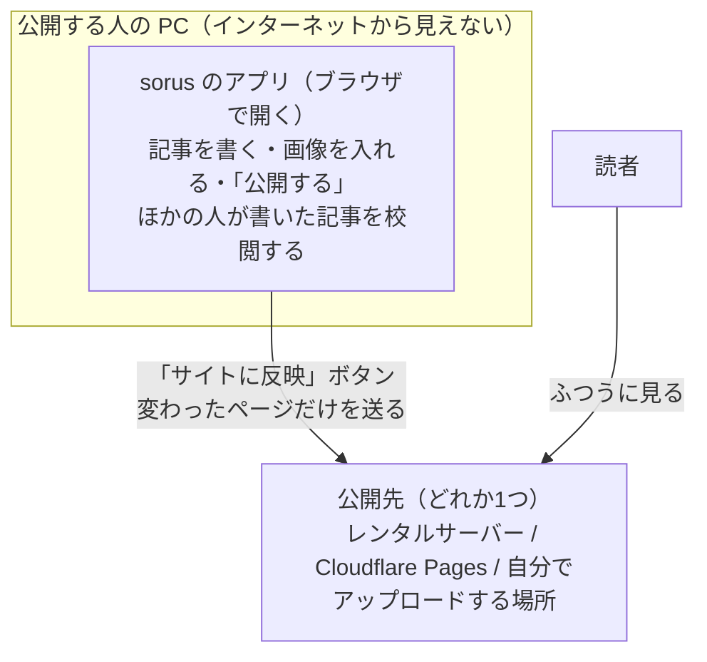
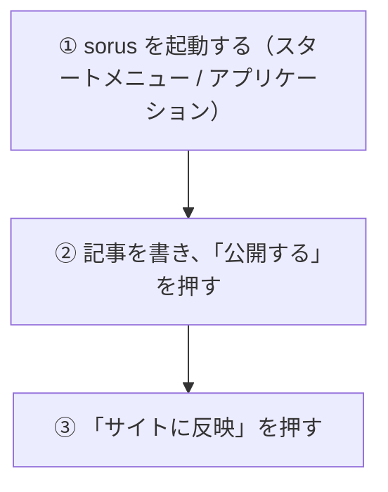

# サーバーを持たずに公開するガイド（静的サイト公開）

このガイドは、sorus を **「自分の PC で書いて、できあがったページだけをインターネットに置く」** 形で使うための手順書です。すべての操作は sorus の画面で行います。上から順に進めれば、公開まで終わります。

* sorus の入れ方は [インストールガイド](install_guide.md)、記事の書き方は [執筆・編集・AI連携ガイド](writing_guide.md)、サイトの設定・管理は [サイト管理者ガイド](site_admin_guide.md) にあります。
* 公開サーバーを用意する形は [公開サーバーを使うガイド（公開サーバー連携）](decoupled_sync_guide.md) にあります。ほとんどの人は、このガイド（静的サイト公開）で足ります。
* ターミナルを使う手順は、最後の [技術者向け付録](#11-技術者向け付録) にまとめています。ふだんは読まなくてかまいません。

---

## 目次

1. [しくみ](#1-しくみ)
2. [用意するもの](#2-用意するもの)
3. [sorus を入れて「はじめに」を済ませる](#3-sorus-を入れてはじめにを済ませる)
4. [記事を書いて公開状態にする](#4-記事を書いて公開状態にする)
5. [公開先を選ぶ（はじめの1回だけ）](#5-公開先を選ぶはじめの1回だけ)
6. [サイトに反映する](#6-サイトに反映する)
7. [日常の運用](#7-日常の運用)
8. [複数人で書く](#8-複数人で書く)
9. [バックアップ](#9-バックアップ)
10. [よくある質問・困ったとき](#10-よくある質問困ったとき)
11. [技術者向け付録](#11-技術者向け付録)

---

## 1. しくみ

sorus は、自分の PC で使うアプリです。サイトの「正本」（公開するデータ）を持つ sorus が1つあり、そこから公開します。複数人で書くときの方法は [8章](#8-複数人で書く) にあります。

静的サイト公開では、**記事を書く画面（管理画面）は自分の PC の中だけで動き、インターネットには完成したページだけを置きます。** インターネット上に管理画面もデータベースも無いので、乗っ取られる心配がありません。



### 静的サイト公開と公開サーバー連携の違い（届け方と公開先の違い）

どちらの利用方法でも、記事を書く画面はインターネットに置きません。違うのは、複数人で書くときの原稿の「届け方」と、サイトの「公開先」です。

| | 静的サイト公開（このガイド） | 公開サーバー連携（[公開サーバーを使うガイド](decoupled_sync_guide.md)） |
| :--- | :--- | :--- |
| 複数人で書くとき | 同じネットワーク（LAN・VPN）のサーバー版に、ブラウザでログインして書く | 各自の PC の sorus から公開サーバーへ提出する |
| 公開先 | レンタルサーバー、Cloudflare Pages、または自分でアップロードする場所 | 自分たちの公開サーバー（VPS） |
| 公開する人 | 正本を持つ1人 | 招待された編集者・サイト管理者 |
| 必要なもの | PC と公開先 | PC と公開先に加えて、VPS とドメイン |

迷ったら静的サイト公開から始めてください。あとから公開サーバー連携に移ることもできます。

### 用語メモ

| 用語 | 意味 |
| :--- | :--- |
| **公開先** | 完成したページを置く場所。読者はここを見ます。 |
| **サイトに反映** | sorus の中で「公開中」の記事を、公開先へ送る操作。 |
| **静的なページ** | 中身が決まっているファイル（HTML・CSS・画像）。置くだけで表示できます。 |

---

## 2. 用意するもの

| 立場 | 用意するもの |
| :--- | :--- |
| ライター（書く人） | PC（Windows または Mac）。同じネットワークのサーバー版を一緒に使うときは、ブラウザだけ |
| 公開する人 | PC ＋ 公開先のどれか1つ（レンタルサーバーの契約、Cloudflare のアカウント、または自分でのアップロード） |
| 公開サーバー連携 を選ぶ場合だけ | 上に加えて VPS とドメイン（[公開サーバーを使うガイド](decoupled_sync_guide.md)） |

* プログラミングの道具やデータベースのサーバーは要りません。
* 公開先は、記事を書き始めた後に決めてもかまいません。

---

## 3. sorus を入れて「はじめに」を済ませる

1. [インストールガイド](install_guide.md) の1行で、sorus を入れます。
2. ブラウザに「はじめに」の画面が出たら、2つのことを決めます。
   * あなたの名前とパスワード
   * サイト名（あとで変えられます）
3. 「はじめる」を押すと、ダッシュボードの画面が開きます。

自分のアカウントで、書く・設定する・公開するのすべてができます。別のアカウントを作り直す必要はありません。

---

## 4. 記事を書いて公開状態にする

1. 「＋ 新しい記事」を押して、記事を書きます。画像の入れ方や AI による推敲は [執筆・編集・AI連携ガイド](writing_guide.md) を見てください。
2. 書き終わったら、**「公開する」** を押します。
   * 公開済みの記事を直したときは「更新して公開」、非公開に戻すときは「下書きに戻す」です。
3. ボタンの役割は2段階です。
   * **「公開する」**: この PC の sorus の中で、記事を「公開中」にします（PC 内での公開。ここではまだ読者に届きません）。
   * **「サイトに反映」**: 「公開中」の記事を公開先へ送り、読者に届けます（[6. サイトに反映する](#6-サイトに反映する)）。

サイトに出るのは、「公開中」で、公開日時が今より前の記事とページだけです。下書き・校閲待ち・予約中のものは出ません。

---

## 5. 公開先を選ぶ（はじめの1回だけ）

1. 「設定」→「公開先」を開きます。
2. 「公開先を選ぶ」で、次のどれか1つを選びます。迷ったら **Cloudflare Pages** がおすすめです（無料で始められます）。

| 公開先 | 費用 | こんな人に |
| :--- | :--- | :--- |
| **A. レンタルサーバー** | 月数百円〜 | すでに契約しているサーバーや独自ドメインを使いたい |
| **B. Cloudflare Pages** | 無料枠あり | これから公開先を用意する |
| **C. S3 互換ストレージ** | サービスによる | Cloudflare R2、AWS S3、MinIO などへ直接公開したい |
| **D. フォルダに書き出すだけ** | 公開先による | ほかのサービスに自分でアップロードしたい |
| **E. GitHub Pages** | 無料（公開リポジトリ） | GitHub のアカウントがあり、リポジトリからサイトを公開したい |

> **大事な注意: サイトは「ドメインの直下」に置いてください。** できたページは、画像やデザインのファイルを `/static/...` や `/uploads/...` のように、アドレスの一番上からの場所で読み込みます。`https://example.com/blog/` のような途中のフォルダに置くと、デザインや画像が出ません。

### A. レンタルサーバー（SFTP・FTP）

サーバー会社から届いた「サーバーの情報」のメールや、会社の案内ページを見ながら入力します。

| 欄 | 入れるもの |
| :--- | :--- |
| 接続のしかた | 案内に「SFTP」「SSH」とあれば「SFTP（おすすめ。通信を暗号化します）」、「FTP」だけなら「FTP（暗号化に対応したサーバーで使えます）」 |
| ホスト名（サーバー名） | 例: `sv1234.example.jp` |
| ポート番号 | ふつうは空欄のまま |
| ユーザー名・パスワード | サーバー会社から届いたもの |
| アップロード先のフォルダ | ホームページを置くフォルダ（例: `/public_html`）。空欄や「/」だけは指定できません |
| 公開サイトのURL | 読者がサイトを開くアドレス（例: `https://media.example.jp`）。入れるまでは「サイトに反映」で送りません |

* SSH の鍵で接続する場合は、「SSH の秘密鍵」の欄に鍵を貼り付けます。
* 「暗号化しないで送る」は、ふつうはチェックしません。パスワードが読み取られるおそれがあります。
* はじめて接続するときに、サーバーの「鍵」を覚えます。あとで「接続先のサーバーの鍵が、前に接続したときと違います」と出たときは、何も送らずに止まります。サーバー会社のお知らせなどで鍵が変わったことを確かめてから、「確かめたので、この接続先を信頼する」を押します。分からないときは、サーバー会社に問い合わせてください。

### B. Cloudflare Pages

1. [Cloudflare](https://dash.cloudflare.com/) に無料で登録し、ログインします。
2. sorus の画面の「はじめに Cloudflare で用意するもの」に沿って、次の2つを用意します。
   * **アカウント ID**: Cloudflare の「アカウントのホーム」を開いたときの、アドレス欄の `dash.cloudflare.com/` のあとに続く32文字の英数字です。
   * **API トークン**: Cloudflare の「プロファイル」→「API トークン」→「トークンを作成する」から「カスタム トークン」を選び、権限に「アカウント」「Cloudflare Pages」「編集」を付けて作ります。トークンはそのとき1回しか表示されないので、すぐにコピーします。
3. sorus の画面に、アカウント ID と API トークンを貼り付けます。
4. 「プロジェクト名」に、半角の英小文字・数字・ハイフンで名前を入れます（例: `my-media`）。公開サイトのアドレスは `https://my-media.pages.dev` になります。

* プロジェクトがまだ無ければ、はじめて「サイトに反映」したときに作ります。
* すでに公開中のサイトがあるプロジェクトを選んだときは、はじめて「サイトに反映」したときに、何も送らずに「sorus のサイトで置き換えますか？」と聞きます。置き換えると、今のサイトのページは見られなくなります。置き換えたくないときは、別のプロジェクト名を入れて保存し直します。
* 公開サイトのURLが未設定なら、`https://（プロジェクト名）.pages.dev` を自動で入れます。
* Cloudflare の画面の文言は変わることがあります。見つからないときは、Cloudflare のヘルプで「API トークン」を探してください。

#### 独自ドメイン（お名前.com 等）を Cloudflare Pages で使う場合

お名前.com などのドメイン登録サービスで取得した独自ドメイン（特に `example.com` のようなルートドメイン）を使う場合の手順です。

> **大事なポイント: IPアドレスやAレコードの手動設定は不要です。**  
> Cloudflare Pages では、固定の IP アドレスを使って接続する仕組みではありません。ドメインのネームサーバーを Cloudflare に向け、Pages の画面でドメインを紐付けるだけで、必要な設定はすべて Cloudflare が自動で行います。

##### 1. Cloudflare にドメインを追加する
1. Cloudflare ダッシュボードにログインし、左メニューの **「ドメイン」**（または「Web サイト」）を開きます。
2. **「ドメインを追加」**（または「ドメインをオンボード」）を押します。
3. お持ちのドメイン名（例: `example.com`）を入力して進みます。
4. プラン選択画面が出たら、一番下の **「Free（無料）」** を選んで「続行」を押します（クレジットカード等は不要です）。
5. **DNS レコードの確認画面が出たら、AレコードやIPアドレスの追加は行わず、そのまま画面下の「続行」を押します。**  
   （※ すでにメールサーバー等をお使いの場合は、メール用の MX レコード等が表示されていることだけ確かめて「続行」を押してください）
6. **Cloudflare から割り当てられた 2 つのネームサーバー（例: `xx.ns.cloudflare.com`）** をメモします。

##### 2. お名前.com でネームサーバーを変更する
1. [お名前.com Navi](https://navi.onamae.com/) にログインします。
2. 上部メニューの **「ドメイン」→「利用ドメイン一覧」** を開きます。
3. 使うドメインの行にある **「ネームサーバー」** の設定ボタン（「変更」や「初期設定」）を押します。
4. ネームサーバー設定画面で **「他のネームサーバーを利用」** タブを選びます。
5. 「ネームサーバー情報を入力」欄の 1 と 2 に、先ほど Cloudflare でメモした 2 つのネームサーバーを入力します（3 以降は空欄のままにします）。
6. **「確認画面へ進む」→「設定する」** を押します。
7. 設定後、全世界に反映されるまで数分〜数時間かかります。Cloudflare ダッシュボードでドメインが「アクティブ」になるのを待ちます。

##### 3. Cloudflare Pages に独自ドメインを紐付ける
1. Cloudflare ダッシュボードの左メニューから **「Workers & Pages」** を開きます。
2. sorus から反映した **プロジェクト名** をクリックします。
3. **「カスタム ドメイン」**（Custom domains）タブを開き、**「カスタム ドメインをセットアップ」** を押します。
4. お持ちのドメイン（例: `example.com`）を入力して「続行」を押します。
5. Cloudflare が同じアカウント内のドメインと自動認識し、専用の DNS レコードを自動で追加してくれます。内容を確認して **「ドメインをアクティブ化」** を押します。

##### 4. sorus 側の公開サイト URL を更新して反映する
1. sorus を開き、**「設定」→「サイト基本設定」** を開きます。
2. **「公開サイトのURL」** を独自ドメイン（例: `https://example.com`）に変更して「保存」を押します。
3. ホーム画面の **「サイトに反映」** をもう一度押します（SNS 共有用の OGP タグやサイトマップ内のアドレスが独自ドメインに差し替わります）。

##### 5. （おすすめ）「www」付きのアドレスからの自動転送
訪問者が `www.example.com` と入力しても `example.com` に届くようにしておくと親切です。
1. Cloudflare ダッシュボードでドメイン（`example.com`）を選びます。
2. 左メニューの **「ルール」→「リダイレクト ルール」** を開きます。
3. 「テンプレート」の中から **「Redirect from WWW to root」**（www からルートへ転送）を選び、「デプロイ」を押します。これだけで自動転送が有効になります。

### C. S3 互換ストレージ（Cloudflare R2・AWS S3・MinIO）

S3 互換ストレージは、ファイルを置く「バケット」と、読み書き用のアクセスキーを発行して使います。バケットを公開サイトとして配信するには、各サービス側で静的ウェブサイト配信または CDN のドメイン設定も必要です。

1. 利用するサービスでバケットを作り、sorus 用の書き込み・一覧・削除権限を持つアクセスキーを発行します。接続テストではバケット内に一時ファイルを書き込み、削除できることも確認します。権限は対象バケットだけに絞ることをおすすめします。
2. 公開先の種類から「S3 互換ストレージ」を選び、次の値を入力します。

| 欄 | 入れるもの |
| :--- | :--- |
| エンドポイント URL | サービスが案内する S3 API の HTTPS URL。R2 はアカウントの R2 エンドポイント、MinIO はサーバーの URL |
| バケット名 | 作成したバケットの名前 |
| リージョン | R2・MinIO は通常 `auto`、AWS S3 はバケットのリージョン（例: `ap-northeast-1`）。半角英小文字・数字・ハイフンで入力します |
| アクセスキー ID / シークレットアクセスキー | サービス側で発行したキー。シークレットは保存後に画面へ表示されません |
| 公開サイトの URL | 読者が見る配信ドメイン（例: `https://media.example.jp`） |

3. 「接続テスト」で一時ファイルの書き込みと削除ができることを確認し、「保存」を押します。確認用ファイルはテスト後に削除されます。
4. R2・S3・MinIO 側でバケットの静的サイト配信や CDN を設定し、公開 URL が HTTPS で表示できることを確かめてから「サイトに反映」を押します。

S3 のオブジェクト URL は、サービスによってはフォルダ形式の URL（例: `/articles/post-1/`）を `index.html` に自動で置き換えません。Cloudflare R2 では Workers または URL Rewrite の Transform Rules で末尾の `/` に `index.html` を補う設定をしてください。AWS では S3 Static Website Hosting のインデックスドキュメントを設定するか、S3 REST API を CloudFront の背後で使う場合は CloudFront Functions などで同じ書き換えを設定してください。

sorus は Go 標準ライブラリで S3 の署名付き API（AWS Signature Version 4）を使い、内容が変わったファイルをアップロードし、前回 sorus が送ったファイルのうち不要になったものだけを削除します。初回はバケットにあるファイルを削除しません。接続テストではバケットに一時ファイルを書き込み、削除できる権限があることを確認します。R2 や S3 のバケットを公開する方法やエンドポイント URL はサービスごとに異なるため、各サービスの最新の案内も確認してください。

### D. フォルダに書き出すだけ

1. 「書き出すフォルダ」に、サイトを作るフォルダの場所を入れます。
2. 「公開サイトのURL」に、読者がサイトを開くときのアドレスを入れます。入れるまでは、「サイトに反映」を押しても書き出しません（SNS で共有したときのリンクなどが正しく作られないため）。
3. 「サイトに反映」を押すと、そのフォルダにサイトのファイル一式ができます。中身をそのまま、使いたいサービスにアップロードします。

* はじめて書き出すフォルダにトップページ（`index.html`）がすでにあるときは、何も書き換えずに「sorus のサイトで置き換えますか？」と聞きます。「置き換える」を押すと、トップページなど同じ名前のファイルを上書きします（ほかのファイルは消しません）。置き換えたくないときは、空のフォルダか新しいフォルダを指定して保存し直します。

フォルダの代わりに1つのファイルで受け取りたいときは、「今のサイトを Zip ファイルでダウンロード」を押します。

### E. GitHub Pages

GitHub のリポジトリに、sorus が直接サイトのファイルを送ります。パソコンに git やほかのコマンドを入れる必要はありません。

**特徴**

* **外部コマンド・Git 操作は不要**: sorus が GitHub の API を直接呼び出します。`git clone` や `git push` は要りません。
* **ワンクリックで原子的に反映**: 「サイトに反映」を押すと、サイト全体の変更を1つのコミットにまとめて、最後に一度だけ公開先ブランチを進めます。送っている途中の、ページが半分だけ新しい状態は公開されません。途中で失敗したときは、ブランチは前の状態のままです。
* **変わったファイルだけを送る**: 2回目からは、前回送ったファイルとの差分だけを送ります。

**必要なもの**

* GitHub のアカウント
* サイトを置くリポジトリ。表示が崩れないよう、`<ユーザー名>.github.io` という名前のリポジトリを使うか、独自ドメインを設定してください（[大事な注意](#5-公開先を選ぶはじめの1回だけ)のとおり、`https://<ユーザー名>.github.io/<リポジトリ名>/` のような途中のフォルダの形では、デザインや画像が出ません）。リポジトリは空のままでもかまいません。
* Personal Access Token（以下トークン）。GitHub の「Settings」→「Developer settings」→「Personal access tokens」→「Fine-grained tokens」で作ります。「Repository access」で対象のリポジトリだけを選び、「Permissions」の「Contents」を「Read and write」（`contents:write`）にします。トークンは作ったときに1回しか表示されないので、すぐにコピーします。

**sorus での設定**

1. 公開先の種類から「GitHub Pages」を選び、次の値を入力します。

| 欄 | 入れるもの |
| :--- | :--- |
| ユーザー名または組織名 | リポジトリの持ち主（`https://github.com/<ここ>/<リポジトリ名>` の部分） |
| リポジトリ名 | サイトを置くリポジトリの名前（例: `<ユーザー名>.github.io`） |
| 公開元ブランチ | サイトを置くブランチ。初めは `main` が入っています。ほかの内容と分けたいときは `gh-pages` などにします。まだ無いブランチなら、初回の反映で sorus が作ります |
| リポジトリ内のフォルダ | リポジトリのルートに置くなら空欄。`docs` フォルダに置くなら `docs`（この2つだけ選べます） |
| Personal Access Token | 上で作ったトークン。保存後は画面に表示されず、欄には「保存済み（変更するときだけ入力）」と出ます |

2. 「接続テスト」を押します。sorus はブランチを読み取れること（まだ無いブランチや空のリポジトリでもかまいません）と、トークンでリポジトリに書き込めることを確かめます。書き込みの確認では、リポジトリに中身の小さなデータ（どのブランチにも入らない Blob）を1つ作ります。サイトのファイルやブランチは変わりません。
3. 「保存」を押します。公開サイトの URL には `https://<ユーザー名>.github.io` が自動で入ります。すでに独自ドメインを入れてある場合は、そのままにします。
4. GitHub のリポジトリの「Settings」→「Pages」で、「Source」を「Deploy from a branch」にし、ブランチとフォルダ（`/ (root)` または `/docs`）を、sorus に入れたものと同じにします。ブランチがまだ無いときは、一度「サイトに反映」を押してブランチができてから設定します。

**差分反映のしくみ**

* sorus は送ったファイルの一覧（マニフェスト）を覚えています。2回目からは、内容が変わったファイルと新しいファイルだけを送ります。
* 記事を下書きやゴミ箱に戻して要らなくなったページは、同じコミットの中で自動で消します。消すのは、前回 sorus が送ったファイルだけです。リポジトリにある `README.md` など、sorus が送っていないファイルは消しません。初回の反映でも、もともとあるファイルは消しません。
* 1つのファイルが100MBを超えると、GitHub の上限のため、何も送らずに止めます。

**GitHub Pages 特有の注意点**

* **Jekyll の自動変換は自動で止めます**: GitHub Pages は通常、サイトを Jekyll で変換し、`_` で始まるファイルやフォルダを公開しません。sorus は公開先のフォルダに空の `.nojekyll` を自動で置くので、変換を待たずに速く反映され、`_` で始まるファイルも消えません。自分で作る必要はありません。
* **ルートと `docs` フォルダの両方に対応**: 「リポジトリ内のフォルダ」を空欄にするとルート、`docs` にすると `docs` フォルダの中にサイトを置きます。GitHub の「Pages」の設定と必ず揃えてください。
* **独自ドメインと一緒に使える**: GitHub の「Pages」→「Custom domain」でドメインを設定すると、GitHub がリポジトリに `CNAME` ファイルを作ります。sorus はこのファイルを消さずに残します。sorus の公開サイトの URL も、独自ドメイン（例: `https://blog.example.jp`）に変えてください。DNS の設定は GitHub の案内に従います。
* 反映してから GitHub Pages のサイトに表示されるまで、GitHub 側の処理で数十秒から数分かかることがあります。

### 保存する

1. 「接続テスト」を押して、つながることを確かめます。
2. 「保存」を押します。

パスワードと API トークンは、この PC の sorus に保存し、画面には表示しません。

---

## 6. サイトに反映する

1. ホームの「サイトに反映」、または「設定」→「公開先」の「サイトに反映」を押します。
2. 終わると結果が出ます。うまくいったときは「公開サイトを開く」で確かめます。

* 送るのは、前の反映から変わったファイルだけです。
* 記事を下書きに戻したときは、そのページを公開先から消します。消すのは sorus が前に送ったファイルだけです。はじめて反映するとき、公開先にもともとあるファイルは消しません。
* アップロード先のフォルダの外には、書き込んだり消したりしません。
* 「公開サイトのURLが入っていないため、サイトに反映していません。」と出たときは、画面に出る「『公開サイトのURL』を入力する」を押し、読者がサイトを開くときのアドレス（例: `https://media.example.jp`）を入れて保存してから、もう一度反映します。`http://127.0.0.1` などのこの PC の中だけのアドレスのままでも、同じように止まります。
* そのほかの「お知らせ」が出たときも、内容を読んで直します。

### 記事を下書き・ゴミ箱に戻したとき

静的サイトは sorus の画面とは別に公開されているため、記事を下書きに戻したりゴミ箱へ移したりしただけでは、公開先は変わりません。変更後に「サイトに反映」を実行すると、sorus が前回までに送った記事ページや一覧などの不要なファイルを公開先から削除します。反映が完了したことを確認してください。

Cloudflare Pages は反映ごとに新しいデプロイへ切り替わります。通常は新しい内容に切り替わりますが、ブラウザのキャッシュや CDN の反映タイミングにより、古いページが一時的に表示される場合があります。数分待って再読み込みし、まだ古い場合は強制再読み込み（Windows は `Ctrl + Shift + R`、Mac は `Cmd + Shift + R`）で確認してください。記事や画像を頻繁に更新するサイトでは、長い `Cache-Control: max-age` を設定しないでください。ハッシュ付きファイル名など変更されない資産だけを長期間キャッシュする設定にします。

#### Cloudflare CDN キャッシュを自動で消す

Cloudflare 経由で配信している場合は、サイト反映後に CDN のキャッシュを自動で消せます。設定に必要な Zone ID と API Token は、次の手順で用意します。

1. [Cloudflare ダッシュボード](https://dash.cloudflare.com/)にログインし、対象のドメイン（Zone）を選びます。
2. ドメインの **Overview（概要）** を開きます。画面右側の **API** 欄にある **Zone ID** の **Click to copy** を押し、値を控えます。Cloudflare の画面配置が変わった場合は、対象ドメインの Overview で「Zone ID」を探してください。
3. ダッシュボード右上のプロフィールアイコンから **My Profile（マイプロフィール）** → **API Tokens** を開き、**Create Token** → **Create Custom Token** を選びます。
4. トークン名を入力し、**Permissions** に次の権限を1つだけ追加します。対象は **Zone**、権限は **Cache Purge**、操作は **Purge** です。
5. **Zone Resources** で **Include** → **Specific zone** を選び、対象ドメインを指定します。別のゾーンのキャッシュを消す必要がなければ、ほかのゾーンは選びません。
6. 内容を確認して **Continue to summary** → **Create Token** を押します。表示された API Token はこのときだけ確認できるため、すぐコピーします。
7. sorus の「設定」→「公開先」で「CDNキャッシュ自動クリア（Cloudflare）」を有効にし、控えた **Zone ID** と **API Token** を入力して保存します。
8. 「接続テスト」を押して確認します。テストは対象 Zone 全体のキャッシュをすぐにパージします。以後はサイト反映でファイルのアップロードまたは削除が行われた後に自動でパージされ、結果が反映状況に表示されます。

Zone ID は対象ドメインのものを使ってください。API Token は **Zone / Cache Purge / Purge** の権限に絞り、ほかの権限を付けないでください。トークンを紛失した場合は、Cloudflare で新しいトークンを作成して sorus に登録し直します。

### 公開サイトの状態を確認する

公開先が設定済みで「公開サイトのURL」が入力されている場合、「設定」→「公開先」に「公開サイトの状態」パネルが表示され、診断結果と確認時刻を確認できます。サイトへの反映が成功すると、バックグラウンドで公開 URL を検査します。手動で確認するには「公開状態を確認」を押します。

診断ではトップページが正常な応答（HTTP 200 番台）と HTML を返すこと、https の場合は SSL 証明書の有効期限が30日より長いこと、`sitemap.xml` が取得できることを確認します。HTTP エラー、DNS・接続失敗、タイムアウト、証明書の期限が近い状態、サイトマップの欠落は、画面に理由と確認箇所を表示します。検査は最大10秒で終了します。

この確認は、sorus から公開 URL に GET リクエストを送る簡易チェックです。公開 URL はインターネットから到達できる必要があり、ローカルアドレスやプライベート IP への接続は安全のため拒否します。ログインや Cloudflare Access が必要なサイトでは認証できないため、正常なサイトでもエラーになることがあります。読者と同じネットワークやブラウザからも確認してください。

### 公開サイトに閲覧制限を付ける（Cloudflare Pages）

静的サイト公開の静的サイトは、URLを知っている人なら誰でも読める状態が基本です。関係者だけに公開したい場合は、Cloudflare Zero Trust の [Cloudflare Access](https://developers.cloudflare.com/cloudflare-one/access-controls/policies/) で Pages のホスト名を保護します。

1. Cloudflare ダッシュボードで **Zero Trust** を開き、**Access** → **Applications** → **Add an application** → **Self-hosted** を選びます。
2. アプリ名を付け、公開サイトのホスト名（例: `media.example.jp`）を指定します。パスも指定する画面では `/*` としてサイト全体を対象にします。
3. Access ポリシーを追加して **Allow** を選び、対象者をメールアドレス、メールドメイン、または許可するグループで絞ります。
4. 認証方法に **One-time PIN**（メールに届く確認コード）を有効にします。招待した人が初回アクセス時にメールアドレスと PIN で認証できることを確認します。
5. 設定を保存し、ログアウト状態のブラウザで公開 URL を開いて、許可した人だけがサイトを閲覧できることを確かめます。

Cloudflare は [Zero Trust の無料枠](https://developers.cloudflare.com/reference-architecture/architectures/sase/)で最大50ユーザーまで利用できると案内しています（条件が変わる場合があるため、現在のプラン条件を Cloudflare の画面で確認してください）。Access はサイトの入口で認証を行います。`*.pages.dev` の URL やプレビュー用ホスト名も使える状態なら、それらも別途保護するか、利用者へ共有しないようにしてください。

sorus の Basic 認証は、公開サイトを sorus の Go サーバーが直接配信している場合だけ機能します（管理画面のあるサーバー版の「サイト設定」、または公開サーバー連携の公開サーバー。PC に入れたアプリ（デスクトップ版）の「サイト設定」には閲覧制限はありません）。「サイトに反映」で出力した静的サイトでは、sorus の Go サーバーを通らないため機能しません。Cloudflare Pages などの静的サイトに閲覧制限を付ける場合は、Cloudflare Zero Trust の Cloudflare Access で設定してください。公開サーバー連携の公開サーバー（sorus の Go サーバーが配信する公開サイト）の閲覧制限は、「設定」→「公開サーバー」で設定します（[公開サーバーを使うガイド](decoupled_sync_guide.md#公開サイトをパスワードで保護する)）。CDN の前に置いた公開サーバーでは、以前のキャッシュが残ることがあるため、有効にしたあと CDN のキャッシュを削除してください。Cloudflare Pages の [`_headers` ファイル](https://developers.cloudflare.com/pages/configuration/headers/)は応答ヘッダーを設定する仕組みで、Basic 認証のログイン画面やパスワード検証は行いません。

### アクセス解析を設定する

静的サイトのアクセス数は、Cloudflare Web Analytics または Google Analytics 4（GA4）で計測できます。どちらのサービスでも、計測タグを sorus に登録すると、以後「サイトに反映」したページにタグが入ります。

#### Cloudflare Web Analytics

1. Cloudflare ダッシュボードにログインし、[Web Analytics](https://developers.cloudflare.com/web-analytics/get-started/) を開いて **Add a site** を選びます。
2. 公開サイトのドメインを入力して登録します。
3. 登録したサイトの **Manage site** を開き、JavaScript の計測スニペットをコピーします。Cloudflare Pages のプロジェクトでは、**Workers & Pages** → 対象プロジェクト → **Metrics** → **Web Analytics** の **Enable** でも設定できます。sorus の「アクセス解析タグ」に自分でスニペットを登録する場合、Cloudflare 側の自動挿入と二重にならないよう、Manage site で手動設定を選んでください。

#### Google Analytics 4（GA4）

1. [Google Analytics](https://analytics.google.com/) にログインします。初めて使う場合はアカウントを作成し、管理画面で **作成** → **プロパティ** を選んで GA4 プロパティを作成します。
2. 作成したプロパティの **管理** → **データ ストリーム** → **ストリームを追加** → **ウェブ** を選び、公開サイトの URL とストリーム名を入力して作成します。
3. 作成したウェブストリームを開き、**Google タグ** → **タグの手順を表示** → **手動でインストール** を選びます。表示された `<script>` を含む Google タグ全体をコピーします。`G-` で始まる測定 ID だけでは計測タグとして使えません。

#### sorus に計測タグと解析画面の URL を登録する

1. sorus で「設定」→「サイト設定」を開きます。
2. コピーしたタグ全体を **アクセス解析タグ** に貼り付け、「設定を保存する」を押します。Cloudflare Web Analytics のスニペットまたは GA4 の Google タグを貼り付けます。
3. 同じ画面の **詳細なアクセス解析の URL** にはタグではなく解析サービスの画面 URL を貼り付けて保存します。Cloudflare は Web Analytics で対象サイトを開いたときの URL、GA4 は対象プロパティのレポート画面（例: レポートのリアルタイム画面）の URL を使います。`https://` から始まる URL を入力してください。
4. sorus のホームを開き、「詳細なアクセス解析を開く」を押して目的の解析画面が開くことを確かめます。静的サイトの閲覧数は sorus 内蔵の集計には含まれず、ここから外部サービスで確認します。

Cloudflare と Google の画面名や配置は変更されることがあります。詳しくは [Cloudflare Web Analytics の設定](https://developers.cloudflare.com/web-analytics/get-started/) と [Google Analytics のウェブサイト設定](https://support.google.com/analytics/answer/14183469?hl=ja) を参照してください。

書き出したサイトでは、次のものも使えます。

* **サイト内検索**: 読者のブラウザの中で検索します。本文は、先頭の約2000文字までが検索の対象です。
* **記事一覧の2ページ目以降**: すべてのページを書き出します。
* **RSS・サイトマップ**: 自動で作ります。

---

## 7. 日常の運用

一度設定が終われば、記事を増やすたびに次を繰り返すだけです。



* 記事を直したとき（「更新して公開」）、非公開に戻したとき（「下書きに戻す」）も、③でサイトに出ます。
* テーマやメニューを変えたとき（「設定」→「外観」）も、③でサイトに出ます（標準の5つのテーマのほか、GitHub のリポジトリ URL などから独自テーマを取り込んで見た目を変えることもできます。くわしくは [サイト管理者ガイドの外観](site_admin_guide.md#3-外観テーマサイト構成urlと予約スラッグ) を参照してください）。
* **予約投稿**: 公開日時に未来の日時を入れて公開すると、予約になります。sorus を起動している間に予約の時刻になると、自動で公開してサイトに反映します。sorus を終了していた場合は、次に起動したときにホームに「予約時刻を過ぎた記事が N 件あります。サイトに反映しますか？」と出るので、「サイトに反映する」を押します。この確認は1回だけ出ます。「あとで」を押した場合も、手動で「サイトに反映」が成功するまでは、予約の時刻による自動の反映はしません。

---

## 8. 複数人で書く

複数人でサイトを作る方法は、次の3つです。

| 方法 | 向いているとき | 使い方 |
| :--- | :--- | :--- |
| 同じネットワークのサーバー版を一緒に使う | 同じ事務所・学校など、同じ LAN・VPN にいる | 1台で管理画面のあるサーバー版（`sorus --server`）を動かし、メンバーはブラウザでその sorus にログインして書きます。ライターの記事は編集者か管理者が承認して公開し、管理者が「サイトに反映」します。 |
| 公開サーバーとつなぐ（招待コード） | 離れた場所の人が、それぞれの PC の sorus で書く | 公開サーバー（VPS）を用意し、招待コードで参加します。書く人は「公開サーバーへ提出」を押し、編集者は「届いた原稿」で受け取って校閲・公開します（[公開サーバーを使うガイド](decoupled_sync_guide.md)）。 |
| AI アプリ（MCP） | AI アプリから記事を探したり、下書きを保存したりしたい | 一人ひとりが自分の API トークンを発行して、AI アプリをつなぎます（[執筆・編集・AI連携ガイドの「AI のアプリとつなぐ」](writing_guide.md#10-ai-のアプリとつなぐmcp-連携)）。 |

### 同じネットワークのサーバー版を一緒に使う

1. 正本にする1台で、sorus をサーバー版として動かします（`sorus --server`。動かし方は [運用保守ガイド](operations_guide.md#デスクトップ版とサーバー版の切り替え)）。
2. 管理者が「設定」→「ユーザー管理」で、メンバーのアカウント（ライター・編集者）を作ります（[サイト管理者ガイドの「ユーザー管理」](site_admin_guide.md#ユーザー管理)）。
3. メンバーは、同じネットワークの PC のブラウザでその sorus を開き、ログインして書きます。ライターは「校閲を申請」を押します。
4. 編集者か管理者が内容を確かめて「承認して公開」を押し、管理者が「サイトに反映」を押します。

* ライターは、公開先を設定する必要はありません。
* くわしくは [サイト管理者ガイドの「複数人で書く」](site_admin_guide.md#複数人で書く) を見てください。

---

## 9. バックアップ

静的サイト公開では、**公開する人の PC の中のデータがすべての原本**です。PC が壊れても困らないよう、自動バックアップを設定してください。

1. 「設定」→「バックアップ」を開きます。
2. 「自動バックアップ」で、OneDrive・Google ドライブ・Dropbox のフォルダ（または好きなフォルダ）を選びます。
3. sorus は、起動したときと、動いている間は1日1回、そのフォルダにバックアップを置きます。新しいものから14個を残します。

* ホームの「自動バックアップ」に、最後のバックアップの結果が出ます。
* 別の PC に引っ越すときは、新しい PC に sorus を入れ、「はじめに」の画面の「バックアップから始める」でバックアップを読み込みます。
* 公開先のファイルは、データからいつでも作り直せるので、バックアップは要りません。

くわしくは [サイト管理者ガイドの「バックアップと復元」](site_admin_guide.md#7-バックアップと復元) を見てください。

---

## 10. よくある質問・困ったとき

**Q. 「サイトに反映」が見当たりません。**
A. まだ公開先が決まっていません（公開先を決めるまで、ダッシュボードには「サイトに反映」が出ません）。「設定」→「公開先」で公開先を選んで保存してください。

**Q. 反映したのに、記事がサイトに出ません。**
A. 記事が「公開中」になっているか、公開日時が今より前になっているかを確かめてください。下書き・校閲待ち・予約中の記事は出ません。

**Q. 公開したサイトでデザインが崩れる・画像が出ません。**
A. サイトがドメインの直下ではなく、途中のフォルダ（例: `https://example.com/blog/`）に置かれていないか確かめてください。レンタルサーバーなら、「アップロード先のフォルダ」がホームページを置くフォルダ（`/public_html` など）になっているかも確かめてください。

**Q. SNS で共有したときのリンクや RSS のアドレスがおかしいです。**
A. 「設定」→「サイト設定」の「公開サイトURL」が、読者が開くアドレスと違っています（独自ドメインに変えたときなど）。公開サイトのアドレスを入れて保存し、サイトに反映し直してください。

**Q. 接続テストが失敗します。**
A. 画面に出た説明を読んで、ホスト名・ユーザー名・パスワード・アップロード先のフォルダを確かめてください。Cloudflare Pages では、API トークンの権限に「Cloudflare Pages」の「編集」が付いているかを確かめてください。

**Q. Cloudflare にドメインを追加するとき、IP アドレスや A レコードの指定を求められました。**
A. A レコードの追加や IP アドレスの指定は不要です。Cloudflare Pages では固定 IP アドレスを使わないため、DNS レコード確認画面では何も追加せず、画面下の「続行」を押してスキップしてください。お名前.com 等でネームサーバーを変更した後、Pages プロジェクトの「カスタム ドメイン」にドメインを登録すれば、Cloudflare が必要なレコードを全自動で設定します。

**Q. 更新したのに古い内容が表示されます。**
A. ブラウザや配信サービスが古い内容を一時保存している可能性があります。ブラウザで再読み込み（`Ctrl + Shift + R`、Mac は `Cmd + Shift + R`）し、数分待ってから確かめてください。

**Q. 予約した記事が、時刻になってもサイトに出ません。**
A. sorus を終了していると、予約の時刻になってもサイトには出ません。sorus を起動すると、ホームに「予約時刻を過ぎた記事が N 件あります。サイトに反映しますか？」と出るので、「サイトに反映する」を押してください。

**Q. ホームの閲覧数が増えません。**
A. 公開先のページは sorus を通らずに読者へ届くため、ホームの閲覧数には数えられません。読者の数を知りたいときは、「設定」→「サイト設定」の「アクセス解析タグ」に、Cloudflare Web Analytics などのタグを貼ってください。

**Q. PC を再起動したら画面が開けません。**
A. sorus が止まっています。スタートメニュー（Windows）か「アプリケーション」フォルダ（Mac）の sorus から起動してください。データはそのまま残っています。

**Q. あとから公開サーバーを使いたくなりました。**
A. [公開サーバーを使うガイド（公開サーバー連携）](decoupled_sync_guide.md) に進んでください。今の PC の sorus は、そのまま使えます。公開サーバーは空の状態から始まるため、今ある記事は公開サーバーへ提出し直します。

---

## 11. 技術者向け付録

ここから先は、ターミナルやコマンドを使う技術者向けの補足です。sorus のアプリ（デスクトップ版）を使う人には必要ありません。

### ソースから開発用サーバーで動かす

ソースコードは公開リポジトリ `ryuzi/sorus` から取得します。ふつうは [インストールガイド](install_guide.md) の1行や [リリースのページ](https://github.com/ryuzi/sorus/releases/latest) から配布版のアプリを入れてください。

```bash
git clone https://github.com/ryuzi/sorus.git sorus
cd sorus
go mod download
make dev
```

* Go 1.25 以降と make が必要です（Windows では WSL2 の中で実行します）。
* `make dev` は `scripts/dev.sh` を実行し、`deploy/environments/dev.env` を読み込んで `http://localhost:8080` で起動します（`dev.env` が無ければ `dev.env.example` から自動で作ります）。データはリポジトリ直下の `local_dev.db` です。
* ログインは `admin` / `dev-admin-pass` です。開発用サーバーは従来のサーバー版として動くため、`admin` では記事を書けません。「設定」→「ユーザー管理」で編集者のアカウントを作り、ログインし直してください。
* 配布版と同じデスクトップモードで動かすときは、`make dev` の代わりに `go run . --desktop` を使います。

### コマンドで書き出す

`make dev` で書いた記事を書き出すときは、同じデータベースを読むよう `ENV_FILE` を指定します。`--clean` を付けると、前回の書き出しの残り（下書きに戻した記事など）を消して入れ替えます。

```bash
ENV_FILE=deploy/environments/dev.env go run . export --clean dist
```

* `ENV_FILE` を付けないと、`.env` または既定の `database.db` から書き出します。
* テーマを一時的に変えるときは `--theme modern` のように指定します（`modern`、`tech`、`news`、`portal`）。
* コマンドの `sorus export` は、公開サイトのURLが未設定でも警告を出して書き出します（画面の「サイトに反映」は止まります）。
* デスクトップ版の実行ファイルでは、`sorus export --clean <フォルダ>` がデスクトップ版のデータ（[データの置き場所](install_guide.md#8-データの置き場所)）から書き出します。`ENV_FILE` は要りません。

### GitHub Pages に置く

画面からそのまま送るときは、「[E. GitHub Pages](#e-github-pages)」を使ってください。ここでは、書き出したファイルを自分で git で送る方法を説明します。

GitHub Pages では、`<ユーザー名>.github.io` という名前のリポジトリを使うか、独自ドメインを設定します。`https://<ユーザー名>.github.io/<リポジトリ名>/` のような途中のフォルダの形では表示が崩れます。

```bash
git clone https://github.com/<ユーザー名>/<ユーザー名>.github.io.git ~/site-public
cd ~/site-public
find . -mindepth 1 -maxdepth 1 ! -name .git -exec rm -rf {} +
cp -r ~/sorus/dist/. ~/site-public/
touch .nojekyll
git add -A
git commit -m "Update site"
git push
```

* `.nojekyll` は、GitHub Pages の自動変換（Jekyll）を止めるための空のファイルです。
* リポジトリの「Settings」→「Pages」で、Source を「Deploy from a branch」、ブランチを `main`、フォルダを `/ (root)` にします。
* sorus の「公開先」の「フォルダに書き出すだけ」で書き出したフォルダを使ってもかまいません。

### Cloudflare Pages にコマンドで送る

Cloudflare 公式の Wrangler（Node.js が必要。sorus 自体には不要）を使う方法です。

```bash
npx wrangler login
npx wrangler pages deploy dist --project-name my-media
```

### rsync で送る

```bash
rsync -avz --delete ./dist/ user@example.com:/var/www/html/
```

* `--delete` は、サーバーにだけ残っている古いファイルを消します。公開フォルダの指定を間違えると別のファイルを消すため、最初は `--dry-run` を付けて確かめてください。
* `dist/` の末尾の `/` は「フォルダの中身を送る」という意味です。省略しないでください。

### コマンドでバックアップする

```bash
ENV_FILE=deploy/environments/dev.env make backup
```

`backups/sorus_backup_YYYYMMDD_HHMMSS.zip` に、データベース・画像・添付資料をまとめた Zip ができます。復元などの詳細は [運用保守ガイド](operations_guide.md#4-技術者向け付録-バックアップとリストア) を見てください。
