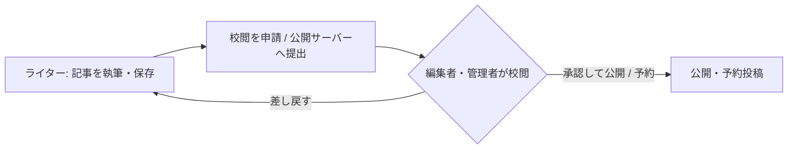
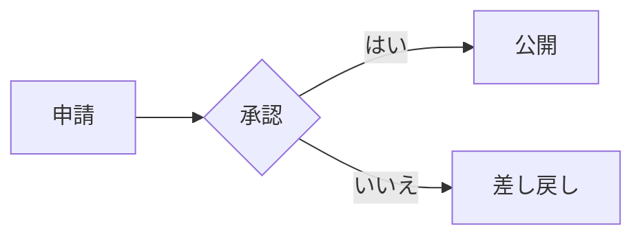

# 執筆・編集・AI連携ガイド

このガイドは、sorus を使って記事や固定ページを書き、校閲し、公開するまでの操作説明です。プログラミングやサーバーの知識は要りません。

* sorus をまだ入れていないときは、先に [インストールガイド](install_guide.md) を読んでください。
* サイト全体の初期設定、外観（テーマ）、公開先の設定、ユーザー管理、バックアップなどの管理操作は [サイト管理者ガイド](site_admin_guide.md) を見てください。
* 公開までの流れを通して知りたいときは、次のどちらかを読んでください。
  * [サーバーを持たずに公開するガイド（静的サイト公開）](static_site_guide.md)
  * [公開サーバーを使うガイド（公開サーバー連携）](decoupled_sync_guide.md)

---

## 目次

1. [画面の見方](#1-画面の見方)
2. [ログインとパスワード](#2-ログインとパスワード)
3. [役割と執筆フロー](#3-役割と執筆フロー)
4. [記事とページの執筆・編集・翻訳](#4-記事とページの執筆編集翻訳)
5. [Markdown 記法クイックリファレンス](#5-markdown-記法クイックリファレンス)
6. [画像の貼り付けと自動セキュリティ処理](#6-画像の貼り付けと自動セキュリティ処理)
7. [メディアライブラリ](#7-メディアライブラリ)
8. [フォトギャラリー](#8-フォトギャラリー)
9. [AI 執筆アシスタント](#9-ai-執筆アシスタント)
10. [AI のアプリとつなぐ（MCP 連携）](#10-ai-のアプリとつなぐmcp-連携)
11. [同時編集ロック](#11-同時編集ロック)
12. [記事の保存・予約・公開サーバーへの提出](#12-記事の保存予約公開サーバーへの提出)

---

## 1. 画面の見方

### 上部のメニュー

| 項目 | 内容 |
| :--- | :--- |
| サイト名 | いま開いているサイトの名前です。サイトが2つ以上あるときはメニュー（サイト名 ▼）になり、サイトを切り替えられます。切り替えたサイトも、同じ sorus のウィンドウの中で開きます。 |
| ダッシュボード | 記事の状況、閲覧数、週間の人気記事などをまとめた画面です。 |
| 記事 | 書いた記事とページの一覧です。 |
| 届いた原稿 | 公開サーバーに届いた原稿を受け取り、校閲します（[12章](#届いた原稿を校閲して公開する編集者サイト管理者)）。公開サーバーに参加していないときは、参加の案内が出ます。 |
| メディア | アップロードした画像の一覧です（[7章](#7-メディアライブラリ)）。 |
| 設定 | 設定画面の入口です。 |
| ＋ 新しい記事 | 新しい記事を書き始めます。 |
| 名前 ▼ | 自分の名前のメニューです。「表示言語」（JA / EN）、「ログアウト」、「sorus を終了」があります。 |

* 「sorus を終了」は、PC に入れた sorus（アプリ版）だけに出ます。押すと sorus そのものが止まります（予約投稿が残っているときの終了確認など、詳しくは [サイト管理者ガイド](site_admin_guide.md#起動と終了) を見てください）。
* 役割によって出る項目が変わります（[3章](#3-役割と執筆フロー)）。
* 「設定」の画面では、「MCP連携」と「AI設定」（ライターは文章スタイルなどの「AI執筆支援設定」）が全員に出ます。「カテゴリ」は編集者と管理者に出ます。各画面の項目の横にある **「?」** を押すと、その項目の説明が吹き出しで出ます。もう一度押すか、`Esc` キーか吹き出しの外を押すと閉じます。

### ダッシュボードの画面

ダッシュボードには、記事の状況と閲覧数が並び、確かめてほしいことがあるときだけ、いちばん上に案内が出ます。

* **記事の状況**: 下書き・校閲待ち・予約投稿などの件数です。押すと、その記事の一覧が開きます。
* **「届いた原稿」**: 公開サーバーに届いた原稿を受け取る入口です。公開サーバーに参加しているとき、編集者と管理者に出ます（[12章](#届いた原稿を校閲して公開する編集者サイト管理者)）。
* **閲覧数の概要とグラフ、週間の人気記事（上位5件）**: 人気記事のタイトルを押すと、公開サイトのアドレス（基本設定の「公開サイトURL」か、つないでいる公開サーバー）があれば、読者が見ている本番のページを新しいタブで開きます。まだ公開サイトのアドレスが無いときは、この PC の中のページを開きます。
* 公開サーバーにまだ反映していないサイト設定があるときは、どの画面でも上に「公開サーバーにまだ反映していない設定があります」と出ます（管理者が「公開サーバーへ反映する」を押すと送ります）。

### 表示言語

右上の名前 ▼ の「表示言語」で、管理画面の言語を JA（日本語）と EN（英語）で切り替えられます。選んだ言語は次からも使われます。

---

## 2. ログインとパスワード

### ログイン

* PC に入れた sorus（アプリ版）では、はじめての起動で「はじめに」の画面で決めたユーザー名とパスワードでログインします。
* サーバー版では、サイトの管理者から伝えられたユーザー名とパスワードを入力して「ログイン」を押します。

### パスワードを忘れたとき

PC に入れた sorus では、自分で新しいパスワードを決められます。PC の中にファイルを作り、そのファイルを読めることで本人だと確かめます。

1. ログインの画面で「パスワードを忘れたとき」を押します。
2. 「再設定コードを作る」を押します。
3. データの置き場所のフォルダが開き、「パスワード再設定コード.txt」というファイルができています。ファイルを開いて、中の8桁の数字を確かめます。
   * フォルダが開かないときは、画面に表示された場所を開きます。
4. 画面に戻り、「再設定コード（8桁の数字）」に数字を入力します。
   * アカウントが1つだけのときは、「対象のユーザー名」が表示されます。ログインに使うのはこのユーザー名です。忘れていたときは、ここで確かめてください。
   * アカウントが2つ以上あるときは、パスワードを変えたい人のユーザー名も入力します。
5. 「新しいパスワード」（8文字以上）を2回入力し、「パスワードを変える」を押します。
6. ログインの画面に戻ると、ユーザー名が入った状態になっています。新しいパスワードを入力してログインします。

* パスワードを変えるとログアウトされ、AI アプリの接続（連携中のアプリと API トークン）も解除されます。AI アプリを使うときは、もう一度つなぎ直すか、トークンを発行し直してください（[10章](#10-ai-のアプリとつなぐmcp-連携)）。
* コードは15分間、1回だけ使えます。分からなくなったときは「コードを作り直す」を押します。
* 5回続けて間違えると、そのコードは使えなくなり、15分間は新しいコードも作れません。15分たってから「コードを作り直す」を押します。
* サーバー版には「パスワードを忘れたとき」はありません。サイトの管理者に、パスワードの再設定を頼んでください。

---

## 3. 役割と執筆フロー

sorus は、4つの役割で権限を分けます。PC に入れた sorus（アプリ版）でも、サーバー版でも同じです。

| 役割 | どんな人か | できること | できないこと |
| :--- | :--- | :--- | :--- |
| **読者** | サイトを見に来る一般の人 | 公開サイトの閲覧、検索、RSS 購読。アカウントは要りません。 | 管理画面の利用 |
| **ライター** | 記事を書く人 | 記事の新規作成、下書き・校閲待ちの記事の編集、画像・添付資料の追加、AI 執筆支援、校閲申請、自分の MCP トークンの管理 | 公開承認・差し戻し、カテゴリ管理、サイト設定、外観、公開先、ユーザー管理 |
| **編集者** | 記事の公開を決める人（デスク・編集長） | 記事の作成・編集・削除・版の復元、公開承認・差し戻し、予約投稿、カテゴリ管理、画像・添付資料の追加、編集ロックの強制解除、自分の MCP トークンの管理 | サイト設定、外観、公開先、ユーザー管理 |
| **管理者** | サイトを運用する人 | 編集者・ライターのすべての操作に加えて、ユーザー管理、サイト設定、外観、公開先とサイトへの反映、バックアップ、メディア削除、AI 接続設定、全員の MCP トークン管理 | — |

* 公開サーバーに対して何ができるかは、受け取った招待コードの立場（ライター・編集者・サイト管理者）で決まります（[公開サーバーを使うガイド](decoupled_sync_guide.md)）。

### 執筆と校閲の基本フロー

ライターは記事を直接公開できないため、編集者か管理者が確かめてから公開されます。



1. ライターが記事を書き、「校閲を申請」（または公開サーバーへ「公開サーバーへ提出」）します。
2. 編集者（または管理者）が内容を確かめ、「承認して公開」（または予約）するか、「差し戻す」を行います。
3. 管理者は、記事に加えて、ユーザーの追加やサイト設定などの運用も担当します。

---

## 4. 記事とページの執筆・編集・翻訳

「＋ 新しい記事」を押すと、執筆画面が開きます。左に本文の欄、右に「内容のプレビュー（簡易表示）」が並びます。

### 基本項目

* **タイトル**: 記事の見出し（必須）。
* **スラッグ**: 記事の URL になる英数字。空欄ならタイトルから作ります。
* **カテゴリ**: 記事が属するカテゴリを選びます。
* **抜粋**: 記事一覧や SNS で共有したときに出る短い説明（任意）。
* **本文**: 下の装飾ツールバーを使えば、記法を覚えなくても書けます。

### 本文を書く（装飾ツールバーと書き方ガイド）

本文の欄の上に、文字を飾るボタンが並びます。文字を選んでから押すとその文字に、何も選ばずに押すとカーソルの位置に、飾りの記号が入ります。

| ボタン | どうなるか |
| :--- | :--- |
| 見出し | 行を見出しにします（行の先頭に `## ` が入ります）。 |
| 太字 | 選んだ文字を太字にします（`**` で挟みます）。 |
| リンク | 選んだ文字をリンクにします。入った `(https://...)` の部分を、開きたいページのアドレスに書き換えます。 |
| 箇条書き | 行を箇条書きにします（行の先頭に `- ` が入ります）。 |
| 引用 | 行を引用にします（行の先頭に `> ` が入ります）。 |
| コード | プログラムなどを、そのままの形で見せます。複数の行を選ぶと、枠で囲みます。 |
| 数式 | 数式を入れます（例: `$E=mc^2$`）。複数の行を選ぶと、独立した行の数式にします。 |

* いちばん右の **「? 書き方ガイド」** を押すと、見出し・太字・箇条書き・リンク・画像・数式の書き方の早見表が出ます。sorus の本文は Markdown（マークダウン）記法と数式に対応しています。記法の一覧は [5章](#5-markdown-記法クイックリファレンス) にあります。
* 本文の欄では、見出し・太字・リンク・引用・箇条書き・コード・数式などの記号に色が付きます（シンタックスハイライト）。どこが飾りの記号か、ひと目で分かります。色が付くのは画面の中だけで、本文の文字は変わりません。

### 仕上がりを確かめる（プレビュー）

* 右の **「内容のプレビュー（簡易表示）」** には、入力した本文が、その場で読みやすい形で出ます。本文だけを手早く確かめるための表示で、サイトのデザイン（テーマ）は当てていません。
* 公開サイトと同じデザインで見るときは、プレビューの上の **「公開デザインで確認 ↗」** を押します。いま使っているテーマを当てた見た目が、別の画面で開きます。
  * 一度保存した記事なら、下書き・校閲待ち・予約中でも確かめられます。開くのは保存した内容なので、直したあとは先に「下書き保存」を押してください。確かめても、記事が公開されることはありません。
  * 公開中の記事では、公開ページそのものを開きます。
  * まだ一度も保存していない新しい記事では、「下書き保存すると公開デザインで確認できます」と出ます。
* ウィンドウの幅が狭いときは、「編集」と「プレビュー」のタブで切り替えます。

### ブラウザに残った下書きを戻す（差分を確認）

書いている途中の内容は、保存ボタンを押す前でも、そのつどブラウザに控えておきます。保存する前に画面を閉じたり、通信が切れたりしても、書いた文章を失いません。

次にその記事を開いたとき、保存した内容とブラウザの控えが違えば、上に **「ブラウザに保存された未保存の下書きがあります」** と出ます。

1. **「差分を確認」** を押すと、保存した記事（「現在（サーバー）」）とブラウザの控え（「未保存の下書き」）の違いが、タイトル・スラッグ・抜粋・本文など変わった項目ごとに出ます。本文は、消える行に「−」、加わる行に「＋」が付き、文字数の増減も出ます。
2. 違いを見て、控えの内容に戻すときは **「下書きを復元」**、要らないときは **「破棄」** を押します。
3. 復元した内容は、まだ保存されていません。確かめてから「下書き保存」などで保存してください。

* 控えを取ったあとに、ほかの人（または別の画面）が記事を保存していたときは、「サーバー上の記事が更新されています。端末の下書きで復元しますか？」と出ます。復元すると新しい内容を控えで上書きするため、差分を確かめてから選んでください。
* 保存した内容と控えが同じときは、何も出ません。

### 記事とページの使い分け

sorus には「記事」と「ページ」の2つの種類があります。執筆画面の「種類」で選びます。

| 項目 | 記事 | ページ |
| :--- | :--- | :--- |
| 向いている内容 | お知らせ、活動の報告、イベントの記録など、日付順に並ぶもの | サイト案内、プロフィール、アクセスなど、いつ読まれても古くならないもの |
| 公開される場所 | `/articles/スラッグ` | `/スラッグ` |
| 日付・カテゴリ・著者 | 表示する | 表示しない |
| トップの新着・記事一覧・カテゴリ・RSS | 出る | 出ない |
| 検索・サイトマップ | 出る | 出る |

迷ったら、「後から読まれても古くならない内容か」で判断してください。古くならないなら、ページです。

### ページを書く

1. 「記事」の一覧で「＋ 新しいページ」を押します。
2. 「種類」が「ページ」になっていることを確かめます。ページには「カテゴリ」の欄はありません。
3. タイトルと本文を入力します。スラッグはページの URL（`/about` など）になるため、英数字で短くすると覚えやすくなります。使えない言葉（予約スラッグ）は [サイト管理者ガイドの「URL と転送」](site_admin_guide.md#url-と転送) を見てください。
4. 保存や公開は、記事と同じ手順です。

### 記事の一覧とゴミ箱

上部のメニューの「記事」で、書いた記事とページの一覧を開きます。上のタブで、下書き・校閲待ち・予約投稿・公開中・ゴミ箱などを切り替えます。

* 要らなくなった記事は、一覧の **「ゴミ箱へ」** を押します。確認が出たら「OK」を押すと、記事がゴミ箱に移ります。
* 移したあとも、それまで見ていた一覧（タブ・言語・検索語）のままです。上に「「（記事のタイトル）」をゴミ箱に移動しました。」と出るので、ゴミ箱の中を確かめたいときは、横の **「ゴミ箱を見る」** を押します。
* ゴミ箱に移した記事は、サイトに出なくなります。静的サイト公開では、次に「サイトに反映」したときに公開先から消えます。
* まだ記事が1つも無いときは、「まだ記事がありません。」の案内と、管理者には **「他のサービスから取り込む」** のリンクが出ます。

### 英語版を書く（翻訳）

管理者が「設定」→「基本設定」で **「公開サイトの多言語対応（英語ページ /en/ を使う）」** を ON にすると、記事ごとに英語版を作れます。

1. 「記事」の一覧で、英語版を作りたい記事の **「+ EN」** を押します。英語版がもうある記事には「EN」が出て、押すとその英語版を開きます。
2. 翻訳の編集画面が開きます。上の帯に、原文（JA）のタイトルと、次のボタンが並びます。
   * **「全文をAI翻訳」**: 原文のタイトル・抜粋・本文を、まとめて英語に翻訳します。入っている内容を置き換える前に、差分を確かめられます。
   * **「原文と比較｜仕上がりプレビュー」**: 画面の並びを切り替えます。
     * 「原文と比較」: 左に原文、右に翻訳の編集欄が並びます。原文で文を選んで **「選択文を翻訳して挿入 →」** を押すと、その文の翻訳が右の編集欄のカーソルの位置に入ります。「スクロールを合わせる」で、左右のスクロールがそろいます。
     * 「仕上がりプレビュー」: 編集欄の横に、英語版の簡易プレビューが並びます。
   * **「公開デザインで確認 ↗」**: 保存した英語版を、公開サイトのデザインで確かめます。
3. 一部だけ直すときは、編集欄で文を選び、AI のボタンの先頭にある **「選択範囲を英語に翻訳・推敲」** を使います。
4. 保存や公開は、記事と同じ手順です。英語版は `/en/` から始まるアドレスで公開されます。

* 翻訳の画面には、ゼロから書くための「AI で下書き」は出ません。
* 多言語対応を OFF にすると、「+ EN」や翻訳のボタンは出なくなります。作った英語版の記事は消えません。

---

## 5. Markdown 記法クイックリファレンス

| やりたいこと | 書き方 | 表示結果 |
| :--- | :--- | :--- |
| **大見出し** | `## 見出しのテキスト` | 大きな見出し |
| **中見出し** | `### 中見出しのテキスト` | 中くらいの見出し |
| **太字** | `**強調したい文字**` | **強調したい文字** |
| **箇条書き** | `- 項目1`<br>`- 項目2` | ・項目1<br>・項目2 |
| **番号付きリスト** | `1. 最初の手順`<br>`2. 次の手順` | 1. 最初の手順<br>2. 次の手順 |
| **リンク** | `[リンクの文字](https://example.com)` | [リンクの文字](https://example.com) |
| **引用** | `> 引用文` | 枠線付きの引用 |
| **図（Mermaid）** | `` ```mermaid `` で始め `` ``` `` で閉じたコードブロック | フローチャートなどの図 |

### 図を入れる（Mermaid）

フローチャート・シーケンス図・円グラフなどは、コードブロックの言語に `mermaid` を書くと図として表示します（[Mermaid](https://mermaid.js.org/) の記法）。

````markdown

````

* 執筆画面のプレビューでも、公開ページと同じ図になります。公開ページでは、閲覧者の画面が暗い配色（ダークモード）のとき、図も暗い配色で描きます。
* 図を描く仕組みは sorus に入っているため、インターネットにつながらない環境や静的サイトとして公開した場合も表示されます。外部のサービスには何も送りません。
* 記法に誤りがあるときは、図の代わりに書いた記述がそのまま表示されます。プレビューで図になることを確かめてから保存してください。

---

## 6. 画像の貼り付けと自動セキュリティ処理

1. **ドラッグ＆ドロップ**: PC の画像ファイルを、本文の下の「画像をここにドラッグ＆ドロップ」に入れます。
2. **貼り付け**: 画像をコピーした状態で、本文の中で `Ctrl + V`（Mac は `Cmd + V`）を押します。
3. **メディアライブラリから選ぶ**: 「メディアライブラリから選択」を押すと、前にアップロードした画像の一覧が開きます。画像を押すと、カーソルの位置に挿入されます。

* スマートフォンで撮った写真に含まれる **位置情報や撮影日時（EXIF 情報）は自動で消します**。自宅の場所などが公開されてしまう心配はありません。
* 画像は軽くて画質のよい **WebP 形式** に自動で変換します。

---

## 7. メディアライブラリ

上部のメニューの「メディア」で、アップロードした画像をまとめて管理できます。

* **グリッド表示とリスト表示**: 写真の見た目で一覧するか、ファイルの大きさ・更新日時・使っている記事で一覧するかを切り替えます。
* **AI による説明文の自動作成**: AI の連携を設定している場合、画像の代わりに読み上げる「Alt テキスト」、キャプション、検索用のタグを AI が作ります。
* **言葉で探す**: 「青空」「パソコン」などの言葉で、タグやキャプションから写真を探せます。
* **詳細と編集**: 画像を押すと、拡大表示、各サイズの URL、Alt テキストやキャプションの修正、記事に貼るためのコードのコピーができます。

複数の画像に同じタグを付けたり、不要になったタグをまとめて外したりするには、一覧の画像にあるチェックボックスで対象を選びます。画面下に出る「タグを追加」または「タグを削除」を押し、タグを入力します。複数のタグはカンマで区切って入力できます。処理後は選択中の画像のタグ表示が更新されます。「選択解除」で選択をすべて外せます。

---

## 8. フォトギャラリー

複数の写真をきれいに並べたいときは、本文にフォトギャラリーを入れます。

* 写真の縦横の比率に合わせて、すき間なく並びます。執筆画面のプレビューでも、公開ページと同じように2列か3列で並びます。
* 読者が写真を押すと、画面いっぱいに拡大します。左右の矢印キーで前後の写真へ、`Esc` キーか余白を押すと閉じます。

### 執筆画面からギャラリーを作る

本文の欄の下にある「フォトギャラリーを挿入」を押すと、「フォトギャラリーの作成・挿入」の画面が開きます。記事を表示したまま作れるので、先に下書きを保存したり、メディアライブラリの画面へ移ったりする必要はありません。作り方は2通りあり、画面の上のタブで切り替えます。

#### 写真を選んで作成（個別指定）

1. 写真の一覧から、ギャラリーに入れる写真を押します。押した順に番号が付き、「選択した写真」に並びます。もう一度押すと外れます。検索欄で、ファイル名・代替テキスト・キャプション・タグから写真を探せます。
2. まだアップロードしていない写真は、この画面にドラッグ＆ドロップします（枠を押してファイルを選んでも構いません）。アップロードが終わると、自動で「選択した写真」に加わります。
3. 「選択した写真」では、「前へ」「次へ」で並び順を変え、「外す」で写真を外します。代替テキストとキャプションもここで直せます。ここで直した内容は、この記事に挿入する記述にだけ使い、メディアライブラリの写真の情報は変わりません。
4. 「ギャラリーを本文に挿入（N枚）」を押すと、本文のカーソルの位置に次のような記述が入り、プレビューにすぐ表示されます。

```markdown
:::gallery


:::
```

画面を閉じても、選んだ写真は挿入するまで残ります（sorus の画面を読み込み直すと消えます）。

#### タグで指定（動的自動更新）

写真には、メディアライブラリで「タグ（カンマ区切り）」を付けられます（AI による自動作成も使えます）。同じタグの写真をまとめてギャラリーにできます。

1. 「使われているタグ」から選ぶか、「タグを入力」の欄にタグを入れて「このタグを使う」を押します。
2. そのタグの付いた写真が、新しい順にその場で表示されます。いま何枚あるかも表示されます。
3. 挿入のしかたを選びます。
   * **動的ギャラリーとして挿入（将来の写真も自動反映）**: 本文に次の2行が入ります。公開ページを表示するときに、そのタグの写真が新しい順にギャラリーとして並びます。あとでそのタグを付けた写真を追加すると、記事を編集し直さなくても新しい写真が加わります。静的サイトとして公開している場合は、次に「サイトに反映」したときに加わります。
     ```markdown
     :::gallery tag="イベント"
     :::
     ```
   * **現在のN枚を固定ギャラリーとして挿入**: いまそのタグが付いている写真を、「写真を選んで作成」と同じ形（写真を1枚ずつ書いた記述）で入れます。あとでそのタグの写真が増えても、この記事のギャラリーは変わりません。

* まだ写真の無いタグでも、動的ギャラリーとして入れておけます。そのタグの写真が1枚も無い間、ギャラリーは表示されません。
* タグは文字がすべて同じときだけ一致します（「イベント」と「イベント2026」は別のタグです）。

動的ギャラリーでは、挿入前に「表示件数（上限）」と「並び順」を選べます。表示件数は「すべて」または「指定」（1〜100枚）です。並び順は「新しい順」「古い順」「ランダム」です。選択内容は本文に `limit` と `sort` の指定として保存され、例として `:::gallery tag="イベント" limit="12" sort="oldest"` のようになります。件数の指定を省略した場合は、新しい順に最初の24枚を表示し、写真がそれより多ければギャラリーの下に総枚数と「もっと見る（残り N 件）」ボタンを出します（押すたびに24枚ずつ追加。拡大表示で最後の写真から「次へ」を押しても続きを読み込みます）。タグを付けるだけで写真が増え続けるページ（アルバムなど）でも重くなりません。一度に全件を並べたいときは `limit="all"` と書きます。また `min_width="600"` のように書くと、元の幅が 600px 以上の写真だけを表示します（WordPress から取り込んだ縮小サムネイルなどの小さな画像を除けます）。

#### どちらを使うか

| こんなとき | 向いている作り方 |
| :--- | :--- |
| 載せる写真と並び順を、記事の内容に合わせて決めたい（イベントの報告など） | 写真を選んで作成（個別指定） |
| 写真ごとのキャプションを、記事に合わせて書き分けたい | 写真を選んで作成（個別指定） |
| 同じテーマの写真がこれからも増えていく（季節の写真集、活動の記録など） | タグで指定 → 動的ギャラリーとして挿入 |
| いまタグの付いている写真をそのまま載せ、あとから変わらないようにしたい | タグで指定 → 固定ギャラリーとして挿入 |

### 記述を直接書くとき

本文の欄に直接書いても作れます。`:::gallery` と `:::` の間に画像を1行ずつ並べます（`"..."` はキャプションで、省略できます）。タグで指定するときは、`:::gallery tag="タグ"` の次の行に `:::` だけを書きます。

---

## 9. AI 執筆アシスタント

執筆画面の本文の上にある AI のボタンから、AI による文章の支援を使えます（管理者が「設定」→「AI設定」で AI の連携を設定している場合）。

### AI のボタン（3つのまとまり）

AI のボタンは、使う場面ごとに3つにまとまっています。「▾」の付いたボタンは、押すとメニューが開きます。

| ボタン | メニューの項目 | 内容 |
| :--- | :--- | :--- |
| **AI で下書き** | — | 対話のメモやテーマから、下書き記事をまとめて作ります（下の「対話のメモから下書きを作る」）。 |
| **文章を整える ▾** | 選択範囲をAI推敲… | 本文で選んだ部分だけを、目的を選んで直します。公開サイトの多言語対応が ON のときは「選択範囲をAI翻訳・推敲…」になり、翻訳もできます。 |
| | 文章を推敲する | 誤字脱字を直し、読みやすい文章に整えます。段落を選んでいればその段落を、選んでいなければ本文全体を直します。 |
| | わかりやすく書き直す | 難しい言葉を、やさしい言い方に書き直します。 |
| | 事実関係・裏取りを確認 | 本文の中の事実や数字について、確かめたほうがよいところを挙げます。 |
| | 翻訳する | 本文を別の言葉に翻訳します。 |
| **仕上げ・告知 ▾** | タイトルを提案 | 本文から、タイトルの案をいくつか出します。 |
| | リード文（抜粋）を作成 | 記事の要点をまとめた導入文を作ります。抜粋の欄や本文の冒頭に入れられます。 |
| | SNS 告知文を作成 | X・Instagram・LINE などで告知する短い文を作ります。 |

* AI が作った文章は、そのままでは本文に入りません。内容を確かめて「エディタに反映する」などを押したときに入ります。
* 英語版を翻訳している画面（[4章の「英語版を書く」](#英語版を書く翻訳)）では、「AI で下書き」と「翻訳する」は出ず、先頭に「選択範囲を英語に翻訳・推敲」が出ます。全文の翻訳は、上の帯の「全文をAI翻訳」で行います。

### 対話のメモから下書きを作る

1. ChatGPT・Claude・Gemini などで、伝えたいことや取材の要点を話し合い、メモにまとめます。
2. 執筆画面の「AI で下書き」を押します。
3. 記事のテーマと、対話のメモや箇条書きを貼り付けます。必要なら「はじめて読む人向けに、親しみやすい語り口で」のような希望も書きます。
4. 「下書きを生成する」を押すと、タイトル・スラッグ・抜粋・本文がまとめて作られます。
5. 内容を確かめて「エディタに反映する」を押します。
6. 事実関係や表現を人が確かめてから、保存・公開します。

---

## 10. AI のアプリとつなぐ（MCP 連携）

Web・スマートフォンの AI アプリ（ChatGPT・Claude・Gemini・Perplexity など）や、PC で動く AI ツール（Claude Desktop・Claude Code・VS Code・Cursor・GitHub Copilot CLI など）と sorus をつなぎ、AI との会話から記事を探す・読む・下書きを保存する・推敲する・校閲に回すことができます。

AI がこのサイトでできることは、連携を許可した（または API トークンを発行した）あなたの役割（ライター・編集者・管理者）の範囲に限られます。

### 1. 2つの接続URL（「設定」→「MCP連携」）

「設定」→「MCP連携」を開くと、つなぎ方に合わせた接続URLが表示されます。

| 表示される URL | 使う場面 | 特徴 |
| :--- | :--- | :--- |
| **この PC 専用の接続URL（ローカル）**<br>（例: `http://127.0.0.1:8780/api/mcp`） | 同じ PC で動く AI ツール（Claude Desktop・Claude Code・VS Code・Cursor など）からつなぐとき | この PC の中だけで使えるアドレス（`127.0.0.1`）です。ほかの PC・スマートフォンや、Web 版の AI アプリ（ChatGPT・Claude など）からは届きません。**AI ツールを使う間は、この PC の sorus を起動したままにしてください**（ウィンドウをすべて閉じると sorus は終了します）。 |
| **どこからでも使える接続URL（公開サーバー）**<br>（例: `https://example.com/api/mcp-...`） | 外出先の PC・スマートフォン・Web 版の AI アプリ（ChatGPT・Claude・Gemini・Perplexity など）からつなぐとき | 公開サーバーに参加しているときだけ表示されます（静的サイト公開など公開サーバーが無いときは出ません）。第三者に推測されない秘匿パス（`/api/mcp-<ランダムな英数字>`）を含んでおり、この PC の sorus を閉じていても、インターネット経由でいつでも使えます。 |

* 管理画面のあるサーバー版（`--server`）を独自ドメイン（`https://...`）で動かしているときは、「接続URL」（例: `https://あなたのドメイン/api/mcp`）が1つ表示され、Web・スマホの AI アプリからも PC の AI ツールからも使えます。

### 2. Web・スマホの AI アプリでつなぐ（OAuth 2.1 連携・おすすめ）

**ChatGPT / Claude / Gemini / Perplexity など**から、API トークンをコピーすることなく、同意画面で「許可する」を押すだけでつなげます（OAuth 2.1 連携）。インターネットから `https://` で届く公開サーバー、または独自ドメインのサーバー版で使えます。

**公開サーバーに参加しているとき**

1. AI アプリの設定で「コネクタを追加」（アプリによって「コネクタ」「カスタムコネクタ」「MCP」など）を開き、「設定」→「MCP連携」の **「どこからでも使える接続URL（公開サーバー）」** をコピーして貼り付けます。
2. AI アプリが公開サーバーの同意画面（「（アプリ名）との連携を始めます」）を開いたら、PC の sorus の「設定」→「MCP連携」の下にある **「公開サーバーの MCP 連携」** で **「確認コードを表示」** を押します。
3. 表示された8文字の確認コード（例: `ABCD-EFGH`。10分間・1回だけ有効）を同意画面に入力して「次へ」を押し、内容を確認して **「許可する」** を押します（公開サーバーには管理画面のログインが無いため、この確認コードで本人だと確かめます）。
4. つないだアプリは「公開サーバーの連携中のアプリ」に並びます。使わなくなったアプリや心当たりのないアプリは、**「取り消す」** を押すとすぐに接続できなくなります。

**管理画面のあるサーバー版（独自ドメインの `https://`）のとき**

1. AI アプリの設定で「コネクタを追加」を開き、「接続URL」を貼り付けます。
2. sorus のログイン画面が開いたらログインし、同意画面で **「許可する」** を押します。
3. つないだアプリは「連携中のアプリ」に並び、いつでも **「取り消す」** で接続を止められます。

* 画面の「ChatGPT を開く」「Claude を開く」から、各サービスの画面を新しいタブで開けます。メニューの名前や使えるプランはアプリごとに違うため、各アプリの案内も確認してください。

### 3. PC の AI ツールでつなぐ（APIトークン）

**Claude Desktop / Claude Code / VS Code / Cursor / GitHub Copilot CLI など**、同じ PC で動く AI ツール（またはカスタムヘッダー `Authorization: Bearer ...` を設定できるツール）からつなぐときは、API トークンを発行します。

1. 「設定」→「MCP連携」を開きます。
   * **この PC の sorus につなぐとき**: **「新しいAPIトークンを発行」** で「名前（使うツールや端末）」と「有効期限」を選び、**「発行する」** を押します。
   * **公開サーバーにつなぐとき**: 下の「公開サーバーの MCP 連携」にある **「公開サーバーのAPIトークンを発行」** で名前と有効期限を選び、**「公開サーバーで発行する」** を押します（この PC の API トークンは公開サーバーでは使えません）。
2. 表示された **API トークン（`cmsmcp_` で始まる文字列）** を「コピー」で控えます（安全のため、この画面を閉じると二度と再表示されません）。
3. 画面の一番下にある **「高度な設定（接続URL・クライアント設定例）」** を開きます（トークンを発行した直後は自動で開き、設定例の中に発行したトークンが入ります）。
   * 公開サーバーに参加しているときは、**「設定例の接続先」** で **「この PC（ローカル）」** と **「どこからでも（公開サーバー）」** を切り替えられます。切り替えると、各ツールの設定例の URL とトークンが自動でその接続先のものに入れ替わります。
4. お使いの AI ツールの設定例を「コピー」して設定します。

* **Claude Code**（ターミナルで実行）
  ```bash
  claude mcp add --transport http sorus http://127.0.0.1:8780/api/mcp --header "Authorization: Bearer <APIトークン>"
  ```

* **GitHub Copilot CLI**（`~/.copilot/mcp-config.json`）
  ```json
  {
    "mcpServers": {
      "sorus": {
        "type": "http",
        "url": "http://127.0.0.1:8780/api/mcp",
        "headers": { "Authorization": "Bearer <APIトークン>" },
        "tools": ["*"]
      }
    }
  }
  ```

* **VS Code**（`.vscode/mcp.json`）
  ```json
  {
    "servers": {
      "sorus": {
        "type": "http",
        "url": "http://127.0.0.1:8780/api/mcp",
        "headers": { "Authorization": "Bearer <APIトークン>" }
      }
    }
  }
  ```

* **Cursor**（`~/.cursor/mcp.json`）
  ```json
  {
    "mcpServers": {
      "sorus": {
        "url": "http://127.0.0.1:8780/api/mcp",
        "headers": { "Authorization": "Bearer <APIトークン>" }
      }
    }
  }
  ```

* 接続URLは Streamable HTTP 方式です。旧仕様の SSE にしか対応しないツールでは、末尾に `/sse` を付けた URL（例: `http://127.0.0.1:8780/api/mcp/sse`）を使えます。
* 使わなくなったトークンは、一覧の **「失効」** を押すとすぐに使えなくなります。

### 4. AI に指示を出してみる（プロンプト例）

設定が完了したら、AI アプリのチャット欄で以下のように自然な日本語で話しかけるだけで、AI が自動でツールを呼び出して処理します。

* **過去記事の検索・参照**:
  * 「sorus の過去記事から『Cloudflare』に関するものを探して、要点を教えて」
  * 「カテゴリー『技術』の記事一覧を見せて」
* **対話メモから下書きを作成**:
  * 「今の対話内容を整理して、sorus に新しい下書き記事として保存して」
* **記事の推敲・誤字チェック**:
  * 「記事 ID 5 の内容を読み込んで、誤字脱字や読みにくい表現を指摘して」
* **校閲（レビュー）申請**:
  * 「下書き記事『〇〇』を校閲待ち（レビュー申請）に変更して」
* **テーマの取り込みと切り替え**（取り込み・切り替え・削除はサイト管理者の権限のみ）:
  * 「https://github.com/owner/theme-name のテーマを sorus に取り込んで」
  * 「sorus で使えるテーマの一覧を見せて、テック に切り替えて」

### 5. AI のアプリが既存の記事を書き換えるとき（変更案の確認）

* 執筆チームの人（ライター・デスク・編集長）は、管理画面と同じく、AI のアプリからも他の人の非公開の記事を読み、下書きを直せます。公開サイトの読者には、公開中の記事しか見えません。
* AI のアプリが、すでにある記事のタイトル・本文・抜粋を書き換えようとしたとき（既存の翻訳を AI の翻訳で置き換えるときも）、sorus は記事を変えずに **「変更案」** として預かります。新しい下書きを作るときや、スラッグなどの設定だけを変えるときは、そのまま保存されます。
* AI のアプリが知らせる確認用の URL か、その記事の編集画面を開くと、「AIアプリからの変更案が届いています」と表示されます。「差分を確かめる」を押すと、今の内容を誰が保存したか、だれの案でどう変わるかが差分で出ます。
* よければ「編集欄に反映」を押してから、いつもの保存ボタンで保存します。保存したときに初めて記事が変わります。要らなければ「案を破棄」を押します（記事は変わりません）。
* AI のアプリの側で「承認」しても、記事には反映されません。必ず sorus の画面で確かめてください。
* 差分を確かめた後に、ほかの人が記事を保存したり、新しい案が届いたりしたときは、保存せずに知らせます。もう一度差分を確かめてください。
* 公開中の記事への案は、公開できる人（デスク・編集長）だけが確かめて反映できます。
* 翻訳の案では、どの原文から作られたかも表示します。案を作った後に原文が変わったとき（または確かめられないとき）は「注意: 原文が変わっています」と出ます。反映するかは原文を確かめて判断してください。反映して保存しても、その翻訳は「要更新」のままになります。
* 差分は、消える部分を赤の取り消し線、入る部分を緑の下線で示します。

### 6. Web の対話型 AI にサイトを読ませる（`llms.txt`）

ChatGPT などのチャット欄に `https://あなたのサイトのアドレス/llms.txt` を貼り、「このサイトの過去記事を踏まえて企画案を出して」のように頼むと、AI がサイトの構成と記事の要約を読んで提案します。

### 7. 困ったとき（トラブルシューティング）

* **「接続できない」「エラーになる」**:
  * 「この PC 専用の接続URL（`127.0.0.1`）」を使っているときは、PC 上で sorus が起動しているか確かめてください。sorus のウィンドウをすべて閉じると sorus は終了します。また、ブラウザのアドレス欄のポート番号（例: `http://127.0.0.1:8780`）と AI ツールの設定のポート番号が一致しているかも確かめてください。
  * Web 版の AI アプリ（ChatGPT・Claude など）からは、この PC の中だけのアドレス（`127.0.0.1`）にはつながりません。「どこからでも使える接続URL（公開サーバー）」または独自ドメイン（`https://`）のサーバー版の接続URLを使ってください。
  * 公開サーバーの接続URLに API トークンでつなぐときは、この PC の API トークンではなく、「公開サーバーの MCP 連携」で発行した公開サーバーの API トークンを使ってください。
* **「公開サーバーの同意画面で確認コードが通らない」**:
  * 確認コードは発行してから10分間・1回だけ有効です。期限が切れたり打ち間違えたりしたときは、「設定」→「MCP連携」の「公開サーバーの MCP 連携」でもう一度「確認コードを表示」を押して新しいコードを入力してください。続けて何度も間違えると一時的に入力を受け付けなくなるため、10分ほど待ってからやり直してください。
* **「API トークンをなくした・忘れた」「連携したアプリを外したい」**:
  * 安全のため、一度発行した API トークンを画面で再表示することはできません。「設定」→「MCP連携」の一覧で古いトークンを「失効」させ、新しく発行し直してください。Web・スマホの AI アプリ（OAuth 連携）は、「連携中のアプリ」の「取り消す」でいつでも接続を止められます。
* **「パスワードを変えたら、つながらなくなった」「招待を取り消したら、公開サーバーにつながらなくなった」**:
  * パスワードを変えると、安全のため連携中のアプリ（OAuth）と API トークンもすべて解除されます。もう一度つなぎ直すか、新しくトークンを発行して AI ツールの設定を書き換えてください。
  * 公開サーバーの招待（招待コード）が取り消されたり有効期限が切れたりしたときも、その招待でつないだ公開サーバーの連携アプリと API トークンはすべて使えなくなります。

---

## 11. 同時編集ロック

* 同じ記事を2人が同時に直して上書きしてしまわないよう、編集中の記事には自動で「ロック」がかかります。
* ほかの人が編集中の記事を開くと、「〇〇さんが編集中です（閲覧専用モード）」と出ます。
* 編集中の人が画面を閉じると、2分ほどでロックは自動で外れます。
* 急ぐときは、編集者または管理者が「強制解除して編集する」でロックを解除できます。保存されていない変更は失われることがあります。

---

## 12. 記事の保存・予約・公開サーバーへの提出

### 保存と公開のボタン

| ボタン | 内容 |
| :--- | :--- |
| 下書き保存 | 途中の状態を保存します。サイトには出ません。 |
| 公開する | 記事を「公開中」にします。公開済みの記事を直したときは「更新して公開」です。 |
| 下書きに戻す | 公開中の記事を非公開に戻します。 |
| 校閲を申請 | 公開できない人（サーバー版のライター）が、編集者に確認を頼みます。 |

* 「公開する」は、この PC の sorus の中で記事を「公開中」にする操作です（PC 内での公開）。読者に届けるのは、次の操作です。
  * **静的サイト公開**: 「サイトに反映」で公開先へ送ったとき（[サイト管理者ガイド](site_admin_guide.md#サイトに反映する)）。
  * **公開サーバー連携**: 「公開サーバーへ提出」し、編集者が「公開サーバーで公開する」を押したとき（下の手順）。
* 校閲を待っている記事を開くと、上に「この記事は校閲待ちです」と出ます。内容を確かめて「承認して公開」するか、理由を書いて「差し戻す」を押します。

### 予約投稿

予約投稿は、「公開する」と決めた記事に、読者に見せ始める日時（公開日時）を未来の日時で付けたものです。公開日時になるまで、読者には見えません。公開日時になると、記事に手を加えなくても読者に見え始めます。

* **予約のしかた**: 予約のしかたは2つあります。
  1. **記事を書いたその場で予約する**: 新しい記事か、まだ一度も公開していない下書きを開き、「公開する」の横の「日時を決めて予約」を押します。「公開する日時（日本時間）」に日時を入れて、「この日時に予約する」を押します。書きかけの内容も保存してから予約します。すぐに公開するときは、これまでどおり「公開する」を押します。
  2. **校閲待ちの記事を承認して予約する**: 校閲待ちの記事（届いた原稿など）を開き、「承認して公開」の欄の「公開日時（空欄なら今すぐ公開・日本時間）」に日時を入れて、「承認して公開」を押します。
* 予約の日時には、今から1分以上先の日時を選びます。過ぎた日時や形式の正しくない日時を入れると、理由が出て、記事は保存も公開もされません。日時を直して、もう一度押してください。
* 「日時を決めて予約」は、記事を公開できる人（編集者・管理者）にだけ出ます。ライターは「校閲を申請」して、編集者に予約してもらいます。
* 予約した記事は、記事の一覧で「予約投稿」と公開予定の日時が出ます。記事を開くと、上に「（日時）に自動で公開されます」と出ます。
* **予約を取り消すとき**は、記事を開いて「下書きに戻す」を押します。予約の日時を変えるときは、取り消してから予約し直します。
* 予約をやめてすぐに公開するときは、記事を開いて「今すぐ公開」を押します。
* **一度公開した記事は、予約にできません。** 読者に一度見えた記事が、見えなくなってしまうのを防ぐためです。直した記事を承認し直すと、最初の公開日時のまま公開します。

予約の時刻を守るのは、読者に記事を届けている場所です。公開のしかたによって、次のように違います。

#### 公開先に反映する場合（静的サイト公開）

公開先に置いたファイルは、誰でも見られます。そのため、予約の時刻になったら、この PC の sorus がサイトに反映します。**予約の時刻に、この PC の sorus が動いている必要があります。**

* sorus が動いている間に予約の時刻になると、公開先が設定してあれば、自動で「サイトに反映」します。
* まだ反映していない予約があるときにウィンドウを閉じると、確認が出ます。「予約をすべて反映してから終了する」を選ぶと、sorus は画面を出さずに動き続け、最後の予約を反映してから終了します（PC の電源は切らないでください）。
* sorus を終了している間に予約の時刻を過ぎた場合は、次に起動したときにダッシュボードに「予約時刻を過ぎた記事が N 件あります。サイトに反映しますか？」と出ます。「サイトに反映する」を押すと反映します。「あとで」を押すと、そのときは反映しません。
* この確認は1回だけ出ます。「あとで」を押した場合も、手動で「サイトに反映」が成功するまでは、予約の時刻による自動の反映はしません。

#### 公開サーバーで予約する場合（公開サーバー連携）

公開サーバーは、いつも動いています。公開サーバーで予約した記事は、予約の時刻に公開サーバーが読者に見せ始めます。**この PC の sorus を閉じていても、PC の電源を切っていてもかまいません。** 予約のしかたは次の「届いた原稿を校閲して公開する」を見てください。

### 公開サーバーへ提出する（ライター）

公開サーバーに招待コードで参加している場合（参加手順は [サイト管理者ガイド](site_admin_guide.md#公開サーバーに参加する招待コード)）、ボタン1つで原稿を公開サーバーへ提出できます。準備と全体の流れは [公開サーバーを使うガイド](decoupled_sync_guide.md) にあります。

1. 記事を書いて保存します。
2. 執筆画面の「公開サーバーへ提出」を押し、確認で提出します。保存済みの本文と画像が送られます。
3. 公開サーバーでは「校閲待ち」になります。この時点では読者には見えません。

### 届いた原稿を校閲して公開する（編集者・サイト管理者）

1. 上部のメニューの「届いた原稿」を開きます。公開サーバーに届いた原稿が、ここに並びます。
2. 次のどれかを押します。
   * **「公開サーバーで公開する」**: そのまま公開サーバーで公開します。
   * **「日時を決めて予約」**: 「公開する日時（日本時間）」を選んで「この日時に予約する」を押すと、その時刻に公開サーバーで公開するよう予約します。この PC の sorus を閉じていても、その時刻に公開されます。
   * **「この PC に受け取る」**: 中身を確かめてから、自分の PC に取り込みます。この PC に同じ記事があれば、違うところを確かめてから「この内容で上書きする」を押します。直してから「公開サーバーへ提出」し直し、公開します。

ホームや「設定」→「公開先」の画面の「公開サーバーの校閲待ち記事」からも、プレビューを見て「承認して本番公開」「日時を決めて予約」または「ローカルに取り込む」を選べます。

* 予約した記事は「公開サーバーで予約中の記事」に、「予約: 11月3日 9:00」のように日時つきで並びます。「予約を取り消す」を押すと、校閲待ちに戻ります。
* くわしくは [公開サーバーを使うガイド](decoupled_sync_guide.md#公開サーバーで予約して公開する) にあります。
